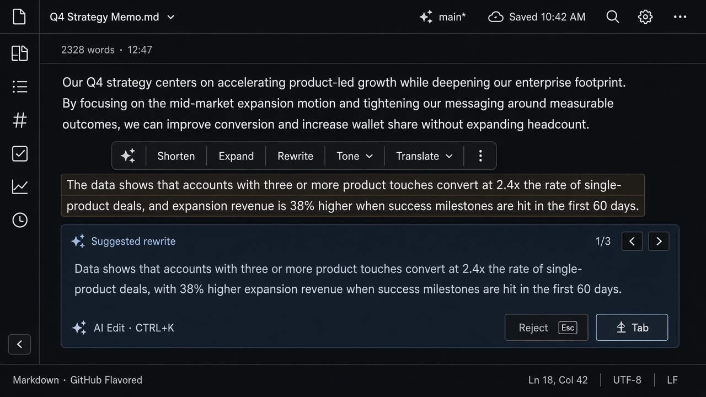
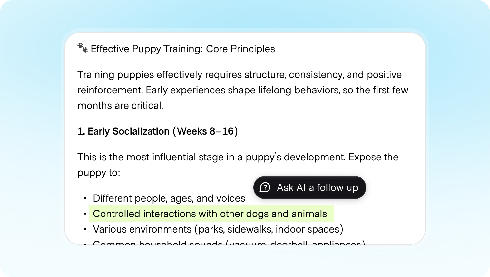

# Inline Action

**ID:** `inline-action` · **Shape of AI:** Prompt actions · [source](https://www.shapeof.ai/patterns/inline-action)  
**Related:** `mandate-approval-card` (high-stakes edits), `disclosure`





---

## Purpose

Target a selection (text, block, canvas node) with preset actions — shorten, expand, rewrite, tone, transform — without regenerating the whole document. Preview as a suggestion layer; commit only on Accept.

## Do / Don't

**Do:** scope word→block; contextual action ranking; preview before overwrite.  
**Don't:** dump 20 generic actions; silent replace of factual claims.

## Snippet

```tsx
const DEFAULTS = ["Shorten", "Expand", "Rewrite", "Tone", "Translate"] as const;

export function InlineActionBar({
  onAction,
  onAccept,
  onReject,
  preview,
}: {
  onAction: (a: (typeof DEFAULTS)[number]) => void;
  onAccept?: () => void;
  onReject?: () => void;
  preview?: string;
}) {
  return (
    <div className="inline-flex flex-col gap-dense">
      <div className="flex gap-dense rounded-control border border-hairline bg-surface-overlay p-dense shadow-bar">
        {DEFAULTS.map((a) => (
          <button
            key={a}
            type="button"
            onClick={() => onAction(a)}
            className="rounded-control px-control py-dense text-2xs text-ink-muted hover:bg-accent-muted hover:text-accent-ink"
          >
            {a}
          </button>
        ))}
      </div>
      {preview != null && (
        <div className="max-w-md rounded-control border border-hairline bg-accent-muted/40 px-panel py-control text-xs text-ink">
          {preview}
          <div className="mt-control flex gap-dense">
            <button type="button" onClick={onAccept} className="text-2xs text-ok">Accept ↵</button>
            <button type="button" onClick={onReject} className="text-2xs text-ink-faint">Reject</button>
          </div>
        </div>
      )}
    </div>
  );
}
```
