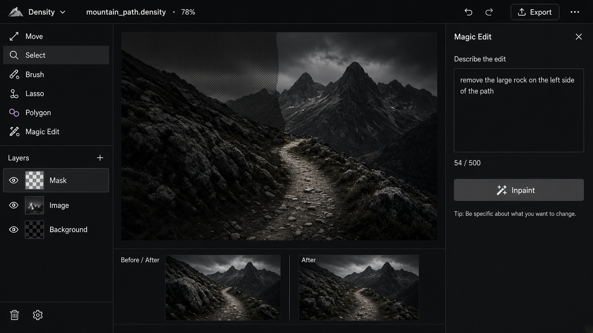

# Inpainting

**ID:** `inpainting`  
**Playground:** [inpainting](https://aiuxplayground.com/pattern/inpainting)  **Shape of AI:** https://www.shapeof.ai/  **Related:** inline-action, smart-diff

---



## Purpose

Mask a region and regenerate only that area; preview before apply (Shape of AI + Playground).

## When to use

Regional image regenerate without full redo.

## When not to use

Global restyle (use style-transfer).

## Anatomy

Mask · prompt · preview · Apply

## Do / Don't

**Do:** Before/after; undo; mask visible.  
**Don't:** Invisible mask edits.

## Snippet

```tsx
export function InpaintBar({ onGenerate }: { onGenerate: () => void }) {
  return (
    <div className="flex gap-control rounded-control border border-hairline bg-surface-overlay p-dense">
      <span className="text-2xs text-ink-muted">Mask selected</span>
      <button type="button" onClick={onGenerate} className="rounded-control bg-accent px-control py-dense text-2xs text-accent-ink">Inpaint</button>
    </div>
  );
}
```
