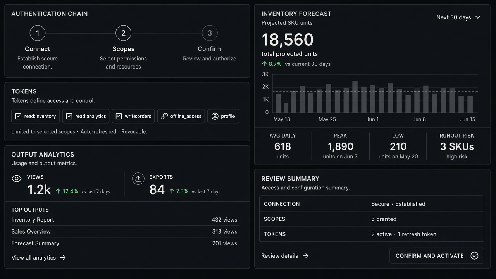

# Inventory Prediction

**ID:** `inventory-prediction`  
**Playground:** [inventory-prediction](https://aiuxplayground.com/pattern/inventory-prediction)  **Related:** generative-ui, confidence

---



## Purpose

Forecast stock/demand with confidence range and recommended actions.

## Snippet

```tsx
export function InventoryForecast({ sku, low, high }: { sku: string; low: number; high: number }) {
  return <p className="font-mono text-xs text-ink">{sku}: {low}–{high} units</p>;
}
```
