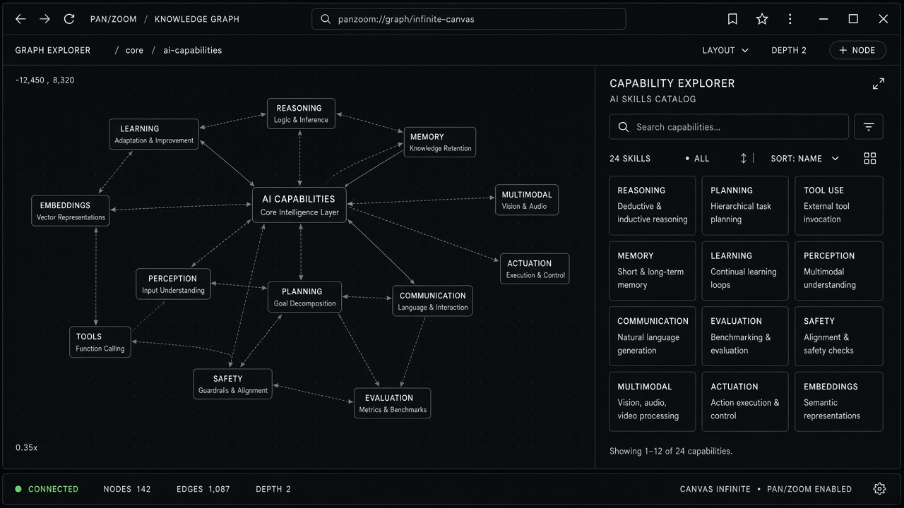

# Knowledge Graph

**ID:** `knowledge-graph`  
**Playground:** [knowledge-graph](https://aiuxplayground.com/pattern/knowledge-graph)  **Related:** citations, footprints

---



## Purpose

Visual/list graph of entities and relations grounding an AI answer for exploration.

## Snippet

```tsx
export function KnowledgeEdge({ from, rel, to }: { from: string; rel: string; to: string }) {
  return <p className="font-mono text-2xs text-ink-muted">{from} —{rel}→ {to}</p>;
}
```
