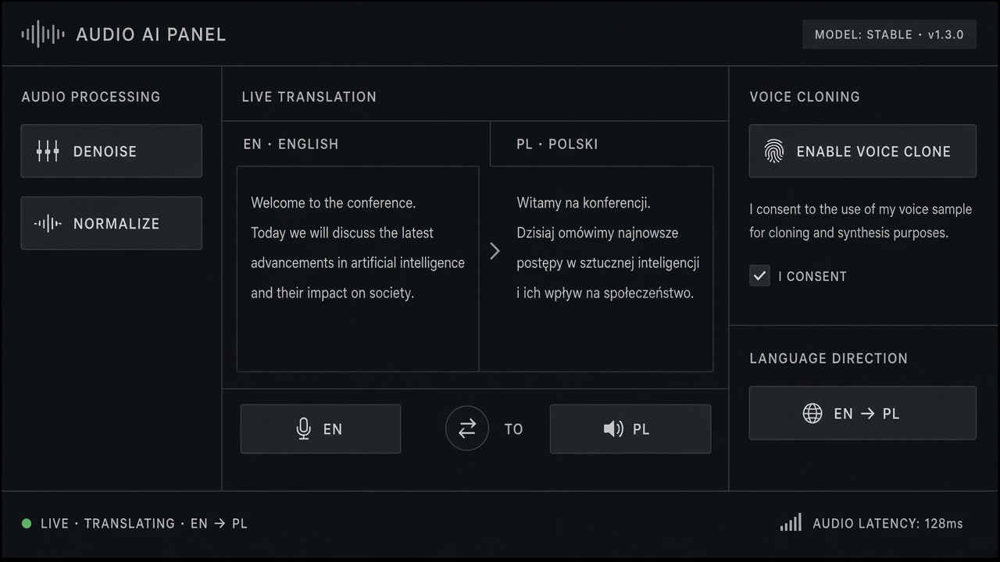

# Language Toggle

**ID:** `lang-toggle`  
**Playground:** [lang-toggle](https://aiuxplayground.com/pattern/lang-toggle)  **Related:** voice-transcript, real-time-translation

---



## Purpose

Switch input/output language for AI with clear source/target labels.

## Snippet

```tsx
export function LangToggle({ from, to, onSwap }: { from: string; to: string; onSwap: () => void }) {
  return (
    <button type="button" onClick={onSwap} className="rounded-control border border-hairline px-control py-dense font-mono text-2xs text-ink-muted">{from} ↔ {to}</button>
  );
}
```
