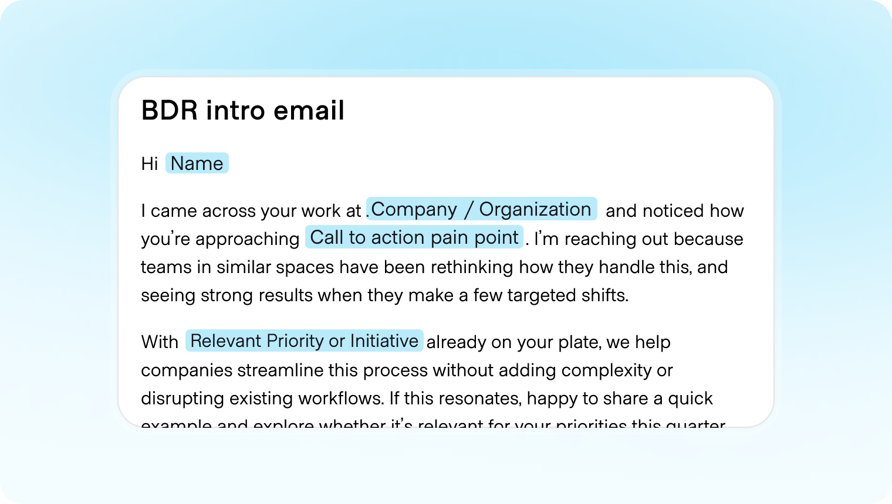
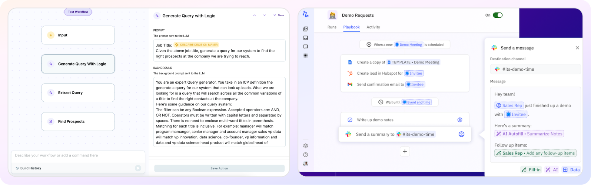
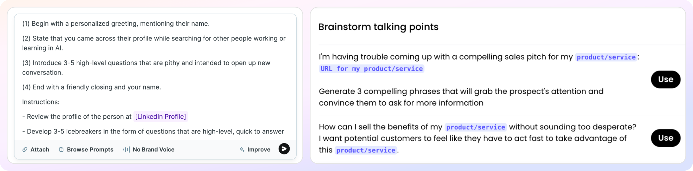
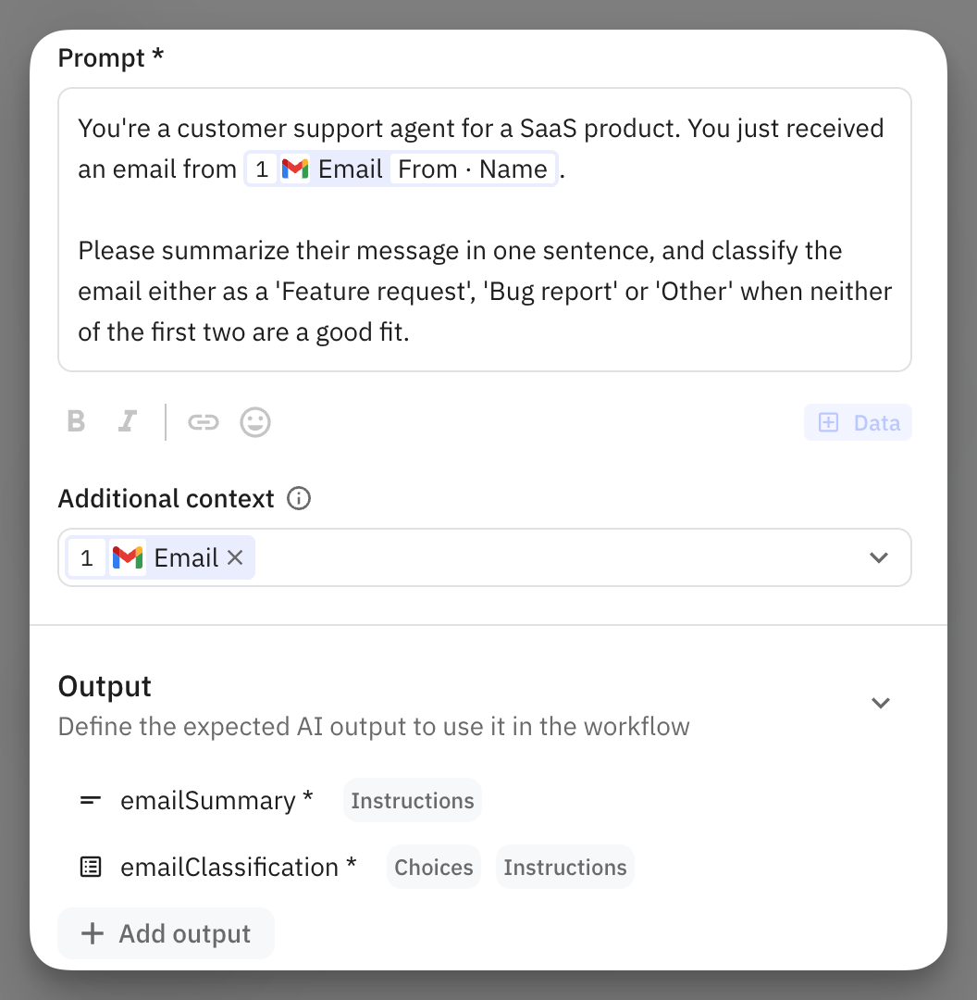
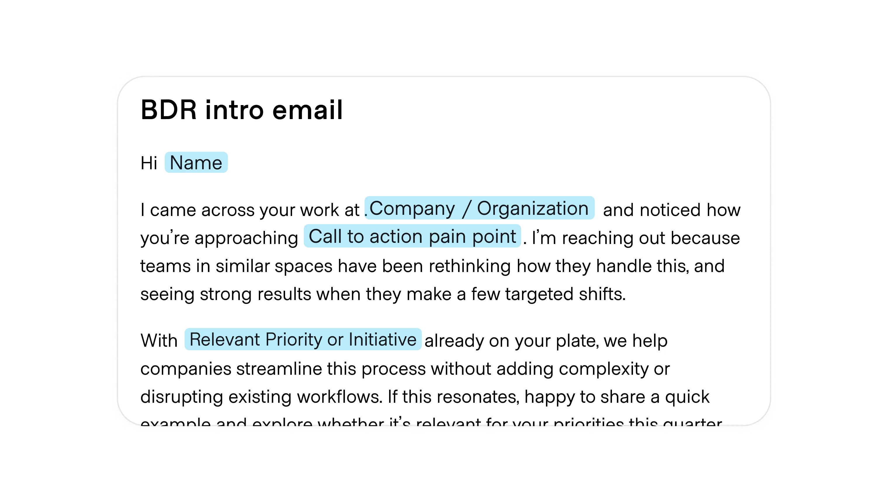
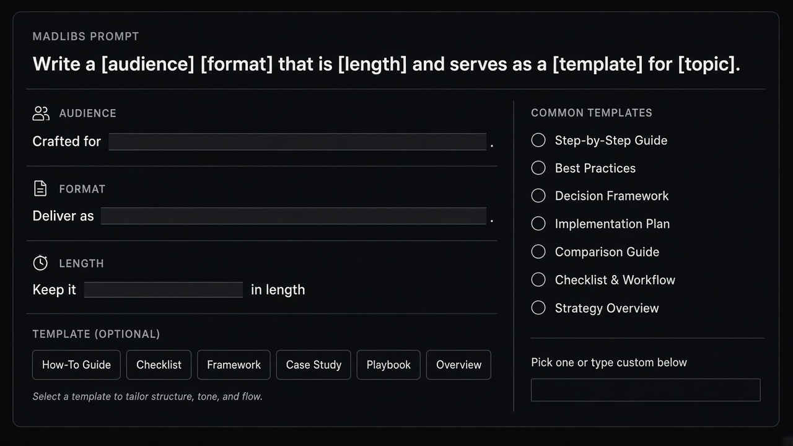

# Madlibs

**ID:** `madlibs`  
**Shape of AI:** https://www.shapeof.ai/  **Related:** templates, copilot-input

---

<!-- shapeof-captures:start -->
**Shape of AI captures** · [source](https://www.shapeof.ai/patterns/madlibs)













<!-- shapeof-captures:end -->



## Purpose

Slot-based generative forms that preserve format/accuracy across runs.

## When to use

Format must stay fixed across runs.

## When not to use

Freeform creative chat.

## Anatomy

Sentence with slots · validate · Generate

## Do / Don't

**Do:** Inline slots; preserve skeleton.  
**Don't:** Break format silently on regenerate.

## Snippet

```tsx
export function MadlibSlot({ label, value, onChange }: { label: string; value: string; onChange: (v: string) => void }) {
  return <label className="inline-flex items-center gap-dense text-xs text-ink">{label}<input value={value} onChange={(e) => onChange(e.target.value)} className="h-7 w-28 border-b border-hairline bg-transparent px-dense outline-none" /></label>;
}
```
