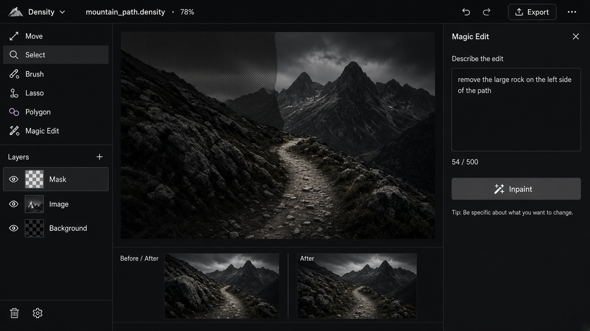

# Magic Edit

**ID:** `magic-edit`  
**Playground:** [magic-edit](https://aiuxplayground.com/pattern/magic-edit)  **Related:** inline-action, inpainting

---



## Purpose

Natural-language edit of an image/region (“make the sky dusk”) with preview.

## Snippet

```tsx
export function MagicEditInput({ value, onChange, onRun }: { value: string; onChange: (v: string) => void; onRun: () => void }) {
  return (
    <div className="flex gap-dense">
      <input value={value} onChange={(e) => onChange(e.target.value)} placeholder="Describe the edit…" className="h-8 flex-1 rounded-control border border-hairline bg-canvas px-control text-xs text-ink" />
      <button type="button" onClick={onRun} className="rounded-control bg-accent px-control text-2xs text-accent-ink">Edit</button>
    </div>
  );
}
```
