# Mandate Approval Card — Human-in-the-Loop

**ID:** `mandate-approval-card`  
**Family:** Governors ([shapeof.ai](https://www.shapeof.ai/))  
**Maps to:** Verification · Sample response · Cost estimates (budget) · Action plan (contractual gate)  
**Source:** [Verification](https://www.shapeof.ai/patterns/verification) · [Action plan](https://www.shapeof.ai/patterns/action-plan)  
**Inspired by:** LangGraph HITL, Cursor permission cards, Cofounder “Always Ask”  
**Teardowns:** [HITL](https://aiuxplayground.com/teardowns/compare/human-in-the-loop) — Gemini Send gate · ChatGPT draft card · Perplexity per-tool Allow  
**Precede with:** `clarify-before-act` when intent is incomplete; pair with `connectors` for standing permissions

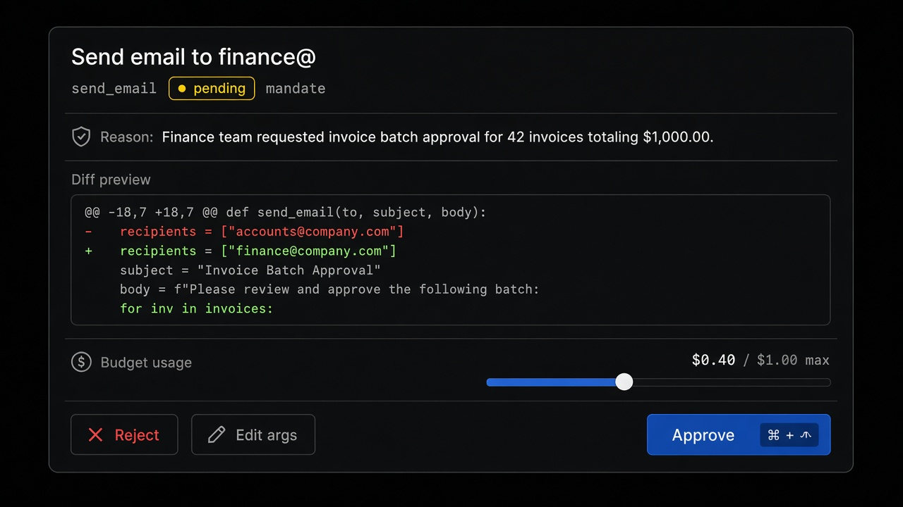

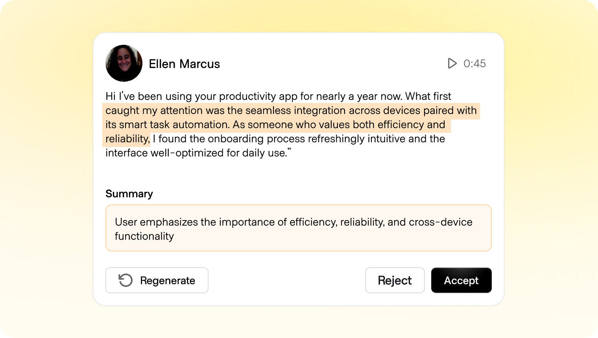

---

<!-- shapeof-captures:start -->
**Shape of AI captures** · [source](https://www.shapeof.ai/patterns/verification)


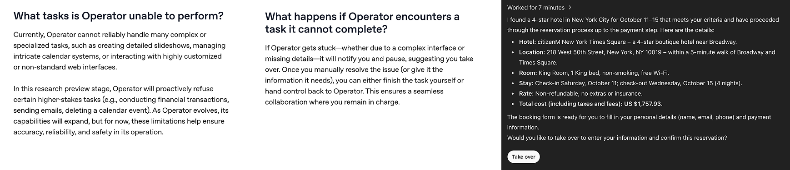

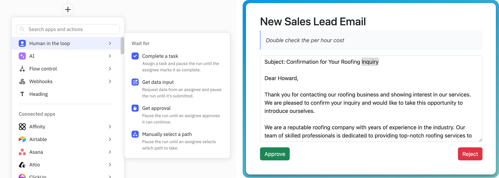

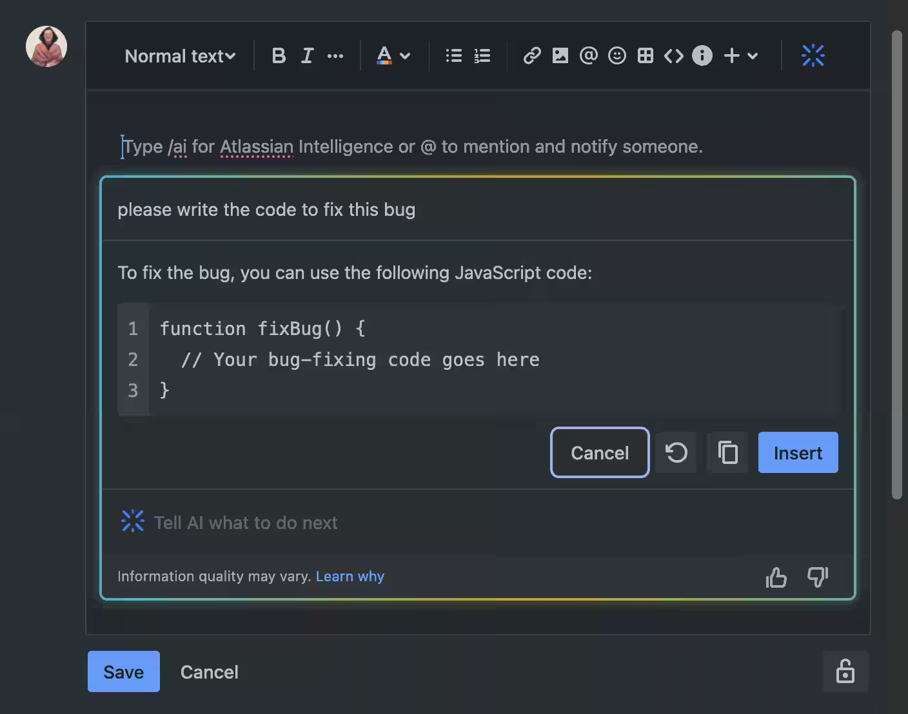

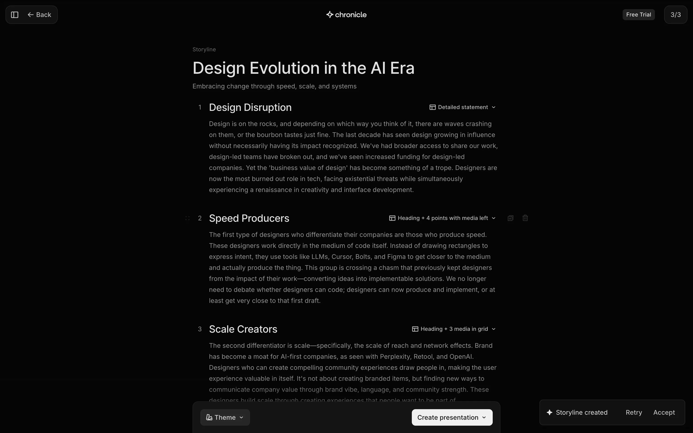

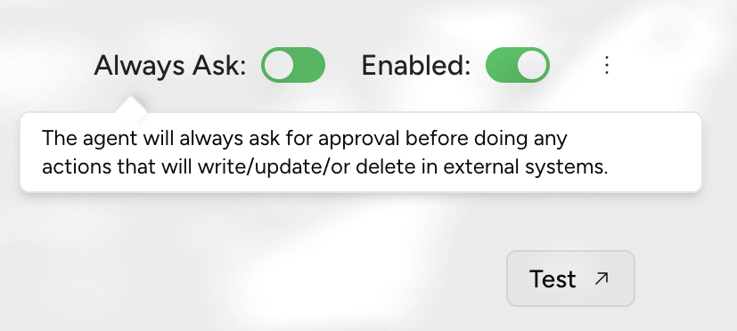

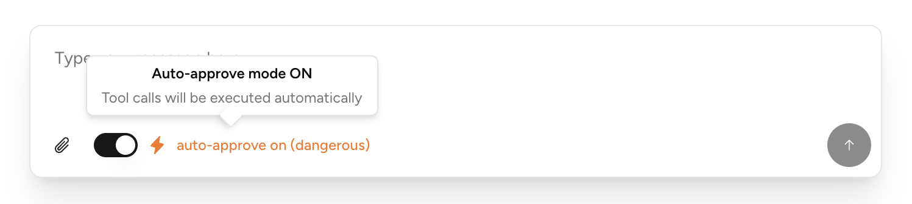

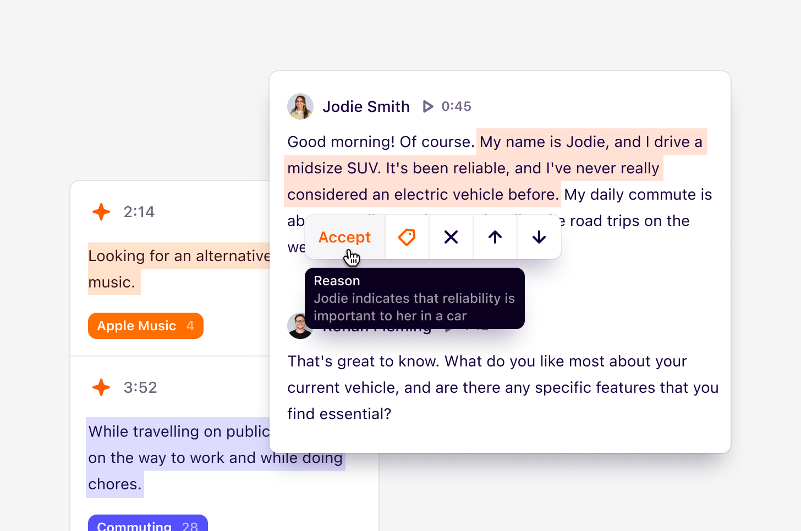

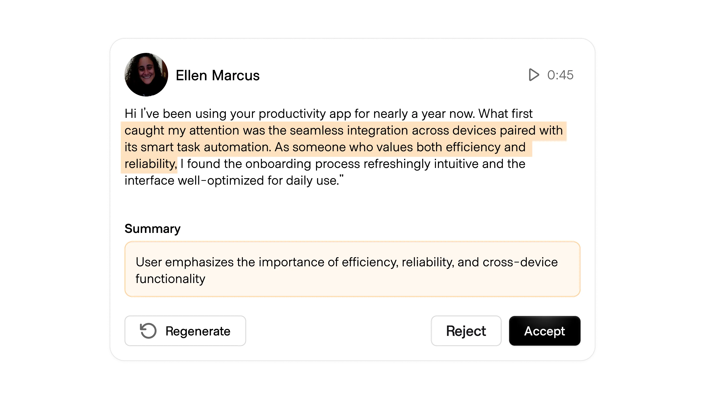

<!-- shapeof-captures:end -->

<!-- playground-captures:start -->
**AI UX Playground teardowns** · [hub](https://aiuxplayground.com/teardowns)


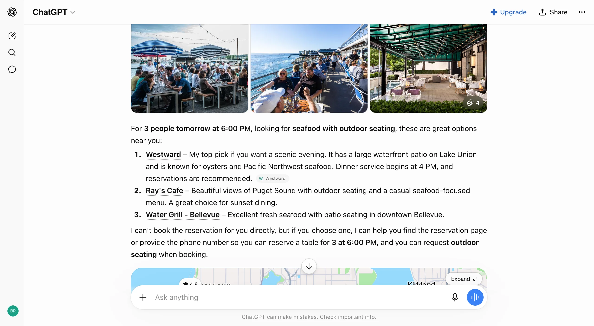

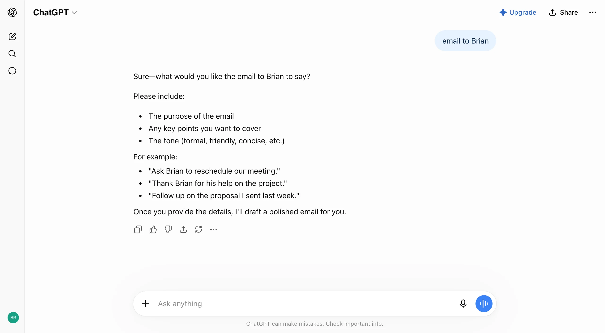

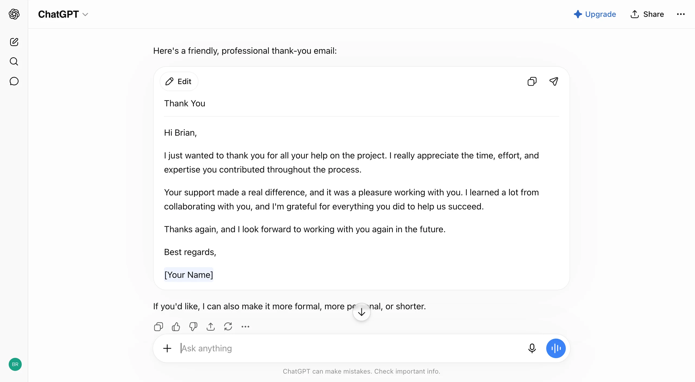

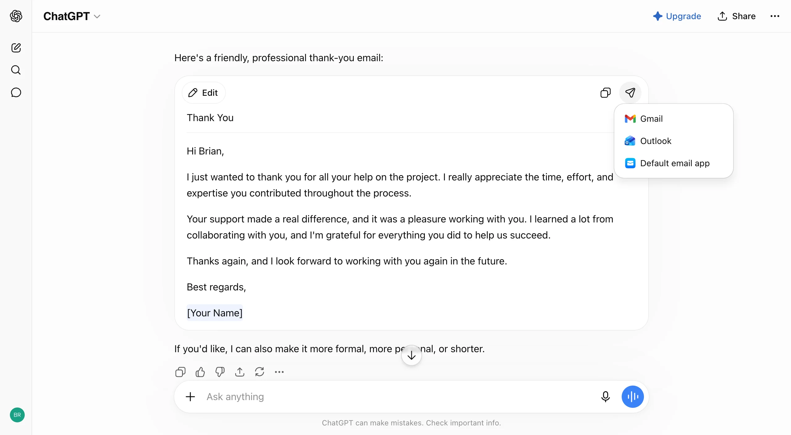

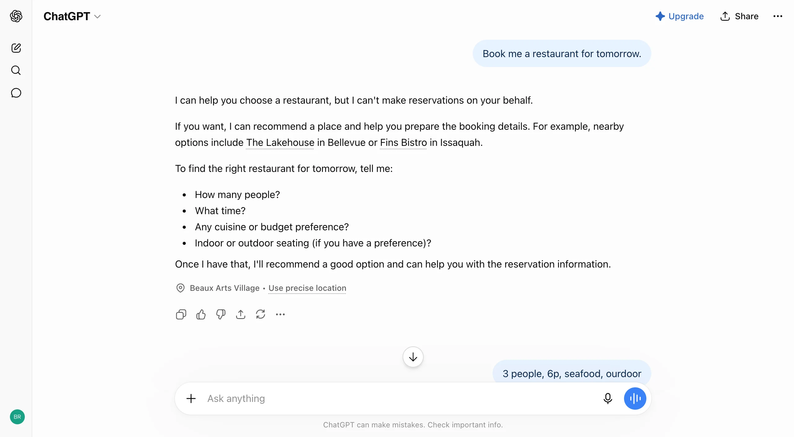

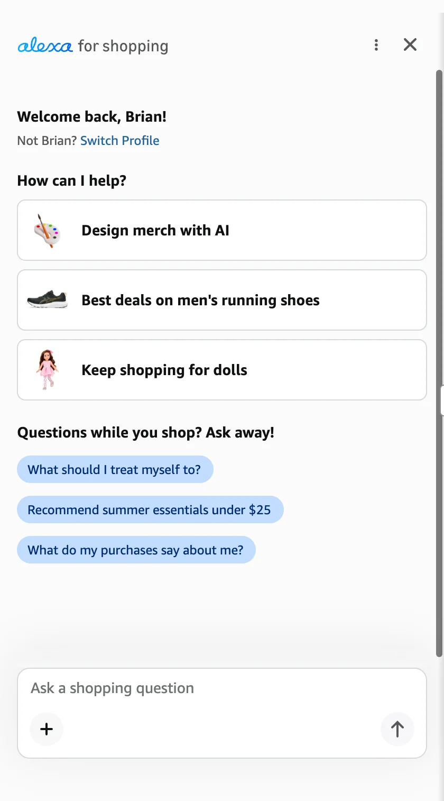


<!-- playground-captures:end -->


## Source references (external)

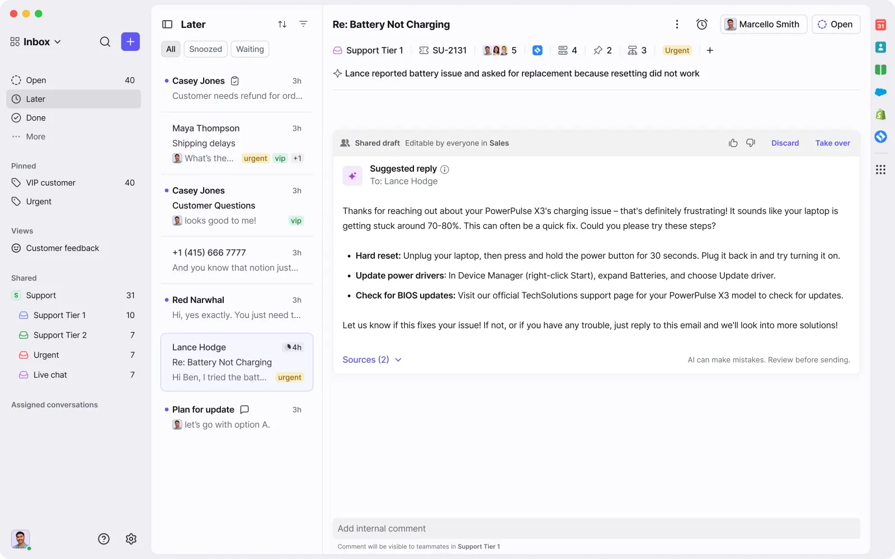
## Purpose

Gate **irreversible, costly, or externally visible** agent actions. The card shows what will change (diff / args), why, and a **budget slider** for spend / blast-radius before the human issues a mandate: approve, edit, or reject.

## When to use

- Tool calls with side effects (email, deploy, delete, pay, write files outside sandbox)
- Multi-step plans that need a single mandate before execution
- Any action with a non-zero cost or compliance boundary

## When not to use

- Read-only tools (search, list) — show in Streaming Thought State instead  
- Already-approved session mandates (respect “allow for session” silently)

---

## Anatomy

```
┌─ Mandate ────────────────────────────────────── pending ─┐
│  Send email to finance@… · tool: send_email              │
│  Why: User asked to notify finance of the Q3 summary     │
├──────────────────────────────────────────────────────────┤
│  Diff / preview                                          │
│  − to: team@…                                            │
│  + to: finance@…                                         │
│  + body: “Q3 summary attached…”                          │
├──────────────────────────────────────────────────────────┤
│  Budget   ▓▓▓▓▓░░░░░  $0.40 / $1.00 max                  │
├──────────────────────────────────────────────────────────┤
│  [ Reject ]   [ Edit args ]        [ Approve  ⌘↵ ]       │
└──────────────────────────────────────────────────────────┘
```

1. **Header** — action title, tool name, urgency/status  
2. **Rationale** — one dense line from the agent (“why”)  
3. **Preview** — diff, structured args, or plan steps — not raw JSON walls  
4. **Budget** — slider + hard max; disable Approve if over cap  
5. **Decisions** — Reject / Edit / Approve (`⌘↵`); Approve is the easiest path  

---

## States

| State | UI |
|-------|----|
| `pending` | Accent border; Approve enabled if budget OK |
| `over-budget` | Warn styling; Approve disabled |
| `editing` | Inline arg editor (validated) |
| `submitting` | Buttons locked; snappy progress on Approve |
| `resolved` | Compact receipt row in transcript (approved/rejected) |

### Decision payload (host contract)

```ts
type MandateDecision =
  | { type: "approve"; budget: number }
  | { type: "reject"; message?: string }
  | { type: "edit"; args: Record<string, unknown>; budget: number };
```

Aligns with LangGraph-style resume: approve / reject / edit.

---

## Do / Don't

**Do**
- Show exact blast radius (files, recipients, $)
- Make Approve one shortcut; keep Reject/Edit available
- Persist interrupt across refresh (host/checkpoint)

**Don't**
- Auto-dismiss on outside click while pending
- Hide arguments behind “advanced”
- Use a soft marketing modal — keep operator density

---

## React + Tailwind snippet

```tsx
import { useState } from "react";

type DiffLine = { op: "add" | "del" | "ctx"; text: string };

export function MandateApprovalCard({
  title,
  tool,
  reason,
  diff,
  budgetMax = 1,
  defaultBudget = 0.4,
  onDecide,
}: {
  title: string;
  tool: string;
  reason: string;
  diff: DiffLine[];
  budgetMax?: number;
  defaultBudget?: number;
  onDecide: (
    d:
      | { type: "approve"; budget: number }
      | { type: "reject"; message?: string }
      | { type: "edit" }
  ) => void;
}) {
  const [budget, setBudget] = useState(defaultBudget);
  const over = budget > budgetMax;

  return (
    <section className="w-full max-w-mandate overflow-hidden rounded-panel border border-hairline-strong bg-surface-raised shadow-bar">
      <header className="flex items-start justify-between gap-control border-b border-hairline px-panel py-control-2">
        <div className="min-w-0">
          <h2 className="truncate text-sm font-medium text-ink">{title}</h2>
          <p className="mt-dense font-mono text-2xs text-ink-faint">{tool}</p>
        </div>
        <span className="shrink-0 rounded-control bg-warn-muted px-dense-2 py-px text-2xs text-warn">
          pending mandate
        </span>
      </header>

      <p className="border-b border-hairline px-panel py-control text-xs text-ink-muted">
        {reason}
      </p>

      <div className="max-h-40 overflow-auto bg-canvas px-panel py-control font-mono text-2xs leading-[16px]">
        {diff.map((l, i) => (
          <div
            key={i}
            className={
              l.op === "add"
                ? "bg-diff-add text-ok"
                : l.op === "del"
                  ? "bg-diff-del text-danger"
                  : "text-ink-muted"
            }
          >
            <span className="inline-block w-3 select-none opacity-70">
              {l.op === "add" ? "+" : l.op === "del" ? "−" : " "}
            </span>
            {l.text}
          </div>
        ))}
      </div>

      <div className="border-t border-hairline px-panel py-control">
        <div className="mb-dense-2 flex items-center justify-between text-2xs text-ink-muted">
          <span>Budget</span>
          <span className={over ? "text-warn" : "text-ink"}>
            ${budget.toFixed(2)} / ${budgetMax.toFixed(2)} max
          </span>
        </div>
        <input
          type="range"
          min={0}
          max={budgetMax * 1.5}
          step={0.05}
          value={budget}
          onChange={(e) => setBudget(Number(e.target.value))}
          className="w-full accent-accent"
        />
      </div>

      <footer className="flex items-center justify-between gap-control border-t border-hairline px-panel py-control">
        <div className="flex gap-dense-2">
          <button
            type="button"
            onClick={() => onDecide({ type: "reject" })}
            className="rounded-control px-control py-dense-2 text-xs text-ink-muted hover:bg-danger-muted hover:text-danger"
          >
            Reject
          </button>
          <button
            type="button"
            onClick={() => onDecide({ type: "edit" })}
            className="rounded-control px-control py-dense-2 text-xs text-ink-muted hover:bg-surface-overlay"
          >
            Edit args
          </button>
        </div>
        <button
          type="button"
          disabled={over}
          onClick={() => onDecide({ type: "approve", budget })}
          className="rounded-control bg-accent px-panel py-control-2 text-xs font-medium text-accent-ink disabled:opacity-40"
        >
          Approve <kbd className="ml-dense opacity-70">⌘↵</kbd>
        </button>
      </footer>
    </section>
  );
}
```

---

## References

- LangGraph / LangChain HITL: interrupt → review card → resume (`approve` | `reject` | `edit`)  
- shapeof.ai Governors: Action plan before execution  
- Beamline / Beautiful UI: Approval card as first-class agent moment  
- Operator consoles (Supabase-like): confirm high-impact mutations with preview  
