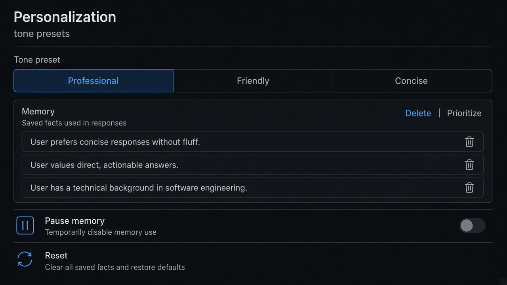
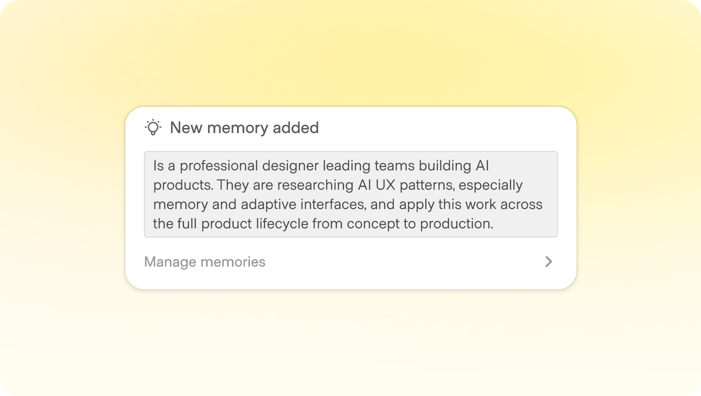
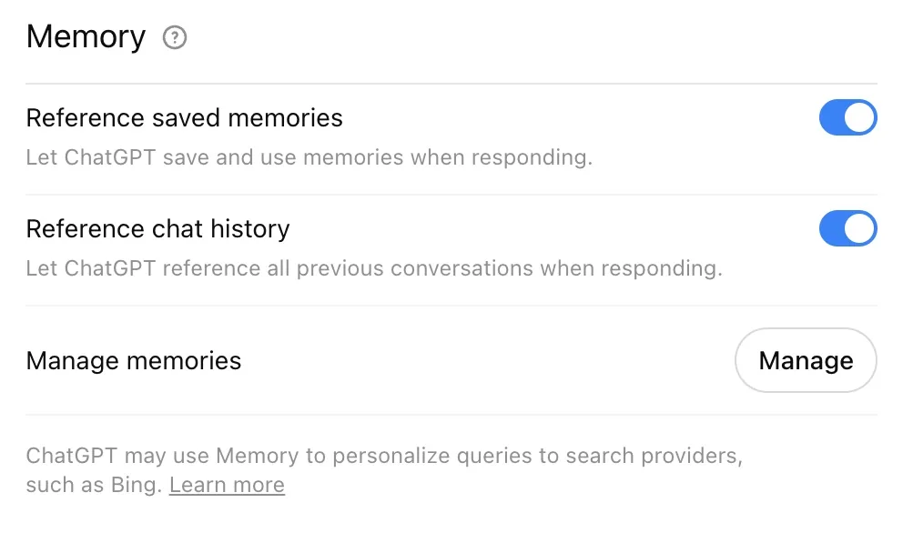
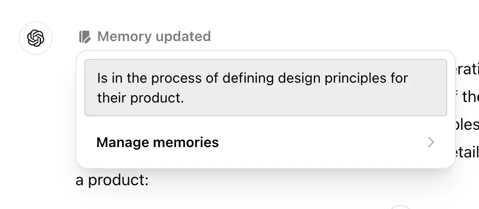
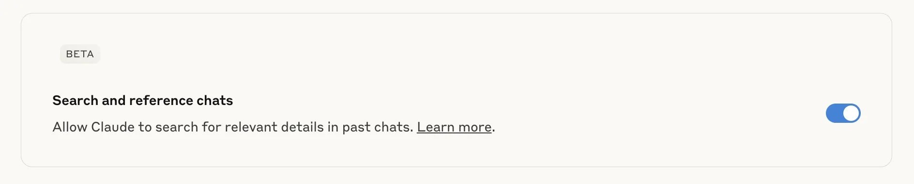
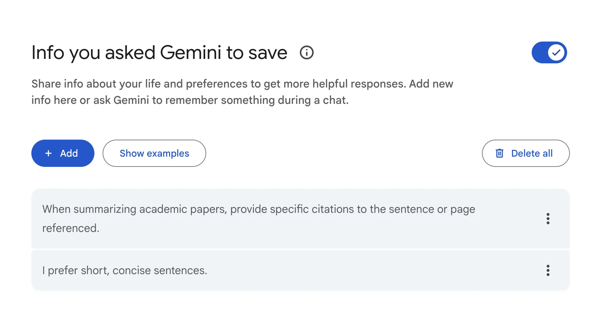
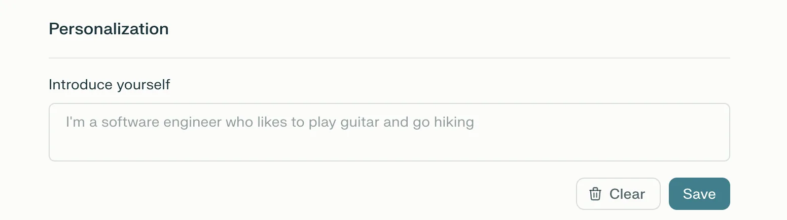
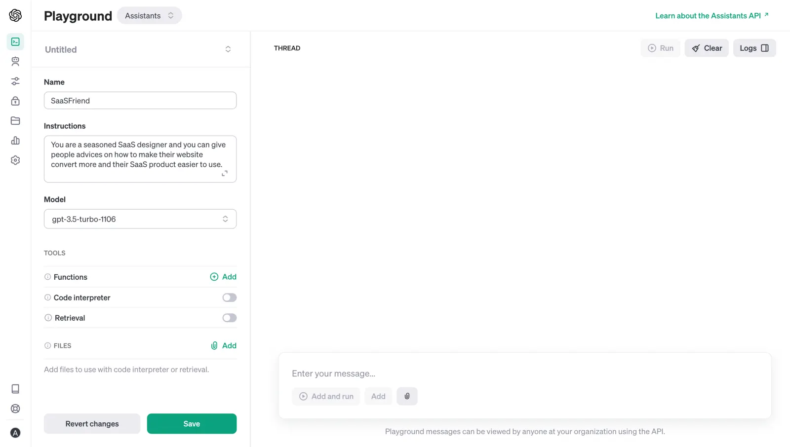

# Memory & Personalization

**ID:** `memory-personalization`  
**Teardowns:** [Personalization & memory](https://aiuxplayground.com/teardowns/compare/personalization-memory)  
**Related:** `disclosure`, `footprints`, `suggestions`



---

<!-- shapeof-captures:start -->
**Shape of AI captures** · [source](https://www.shapeof.ai/patterns/memory)















<!-- shapeof-captures:end -->


## Source references (external)


## Purpose

Let users shape **tone / instructions / profile** and control **inferred memory** without feeling surveilled. Separate declared prefs from learned facts; make off-ramps honest (pause vs reset).

## Product bets (copy)

| Product | Copy |
|---------|------|
| ChatGPT | Named tone presets + versioned memory list |
| Claude | Natural-language Instructions + opt-in memory + pause/reset |
| Perplexity | Response length + vertical profiles; history ≠ per-fact list |

## Do / Don't

**Do:** inspect / delete / prioritize memories; clear consequence copy on off.  
**Don't:** bury memory with no off-ramp; mix surveillance-feeling fields into first-run without consent.

## When to use

Let users shape **tone / instructions / profile** and control **inferred memory** without feeling surveilled.

## When not to use

Skip when a denser core kit pattern already covers the job (see Related).

## Anatomy

1) Trigger 2) Dense primary surface 3) Confirm / dismiss

## Do / Don't

**Do:** Keep Linear/Raycast density; keyboard where actions exist; reuse kit tokens.  
**Don't:** Don't invent parallel chrome; don't hide irreversible effects.

## Snippet

```tsx
type Memory = { id: string; text: string };

export function MemoryPersonalization({
  tone,
  tones,
  memories,
  onTone,
  onDelete,
  onPause,
}: {
  tone: string;
  tones: string[];
  memories: Memory[];
  onTone: (t: string) => void;
  onDelete: (id: string) => void;
  onPause: () => void;
}) {
  return (
    <section className="max-w-mandate space-y-section rounded-panel border border-hairline bg-surface p-panel">
      <div>
        <h2 className="mb-control text-xs font-medium text-ink-muted">Tone</h2>
        <div className="flex gap-dense">
          {tones.map((t) => (
            <button
              key={t}
              type="button"
              onClick={() => onTone(t)}
              className={`rounded-control px-control py-dense text-2xs ${
                tone === t ? "bg-accent-muted text-accent-ink" : "text-ink-muted"
              }`}
            >
              {t}
            </button>
          ))}
        </div>
      </div>
      <div>
        <div className="mb-control flex items-center justify-between">
          <h2 className="text-xs font-medium text-ink-muted">Memory</h2>
          <button type="button" onClick={onPause} className="text-2xs text-warn">
            Pause
          </button>
        </div>
        <ul className="divide-y divide-hairline">
          {memories.map((m) => (
            <li key={m.id} className="flex items-center gap-control py-control text-xs text-ink">
              <span className="min-w-0 flex-1 truncate">{m.text}</span>
              <button type="button" onClick={() => onDelete(m.id)} className="text-2xs text-ink-faint hover:text-danger">
                Delete
              </button>
            </li>
          ))}
        </ul>
      </div>
    </section>
  );
}
```
