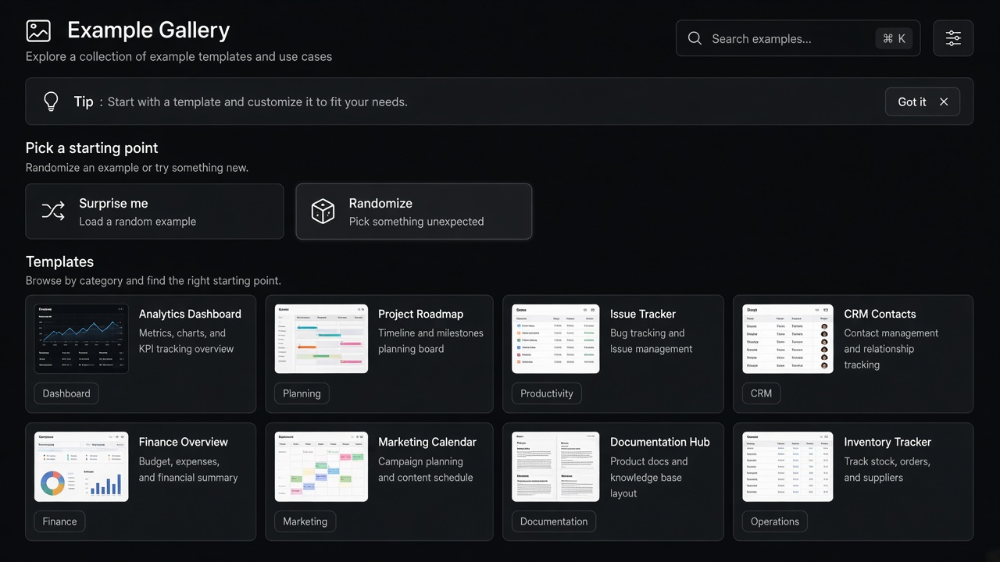

# Nudges

**ID:** `nudges`  
**Shape of AI:** https://www.shapeof.ai/pattern-types/wayfinders  **Related:** suggestions, onboarding-first-value

---



## Purpose

Lightweight alerts pointing users to AI actions they can take, especially when new.

## Snippet

```tsx
export function AiNudge({ text, onAct, onDismiss }: { text: string; onAct: () => void; onDismiss: () => void }) {
  return <div className="flex items-center gap-control rounded-control bg-accent-muted px-control py-dense text-2xs text-accent-ink"><span className="flex-1">{text}</span><button type="button" onClick={onAct}>Try</button><button type="button" onClick={onDismiss} className="opacity-60">×</button></div>;
}
```
