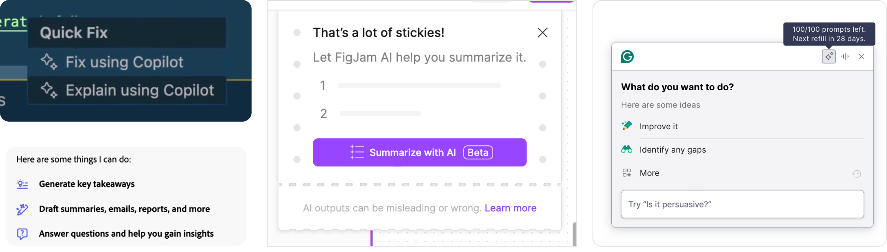
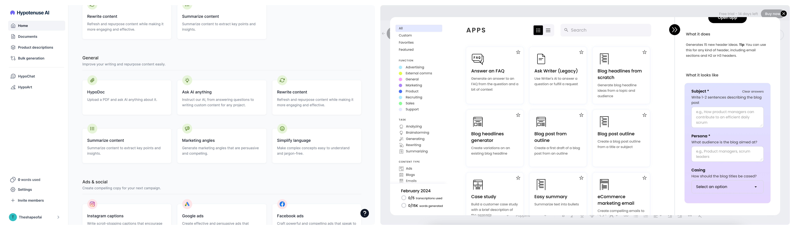
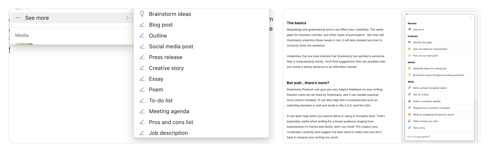
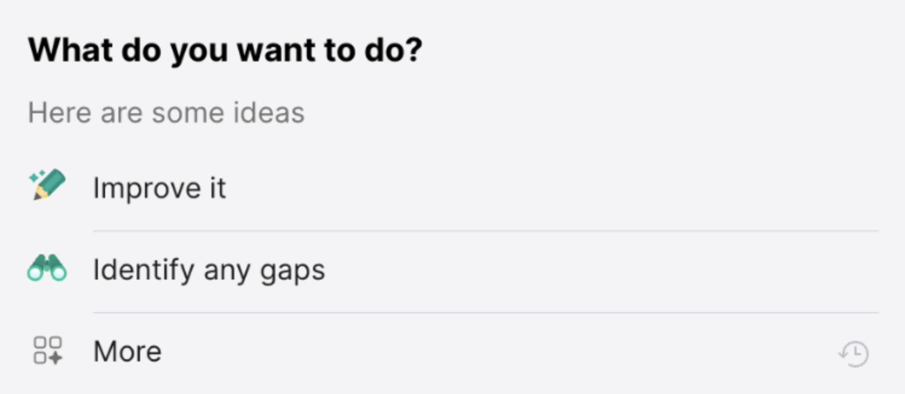
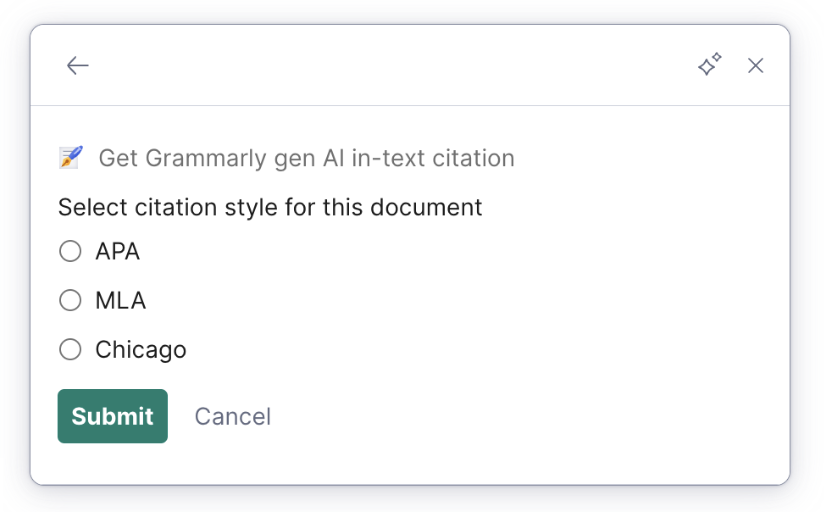
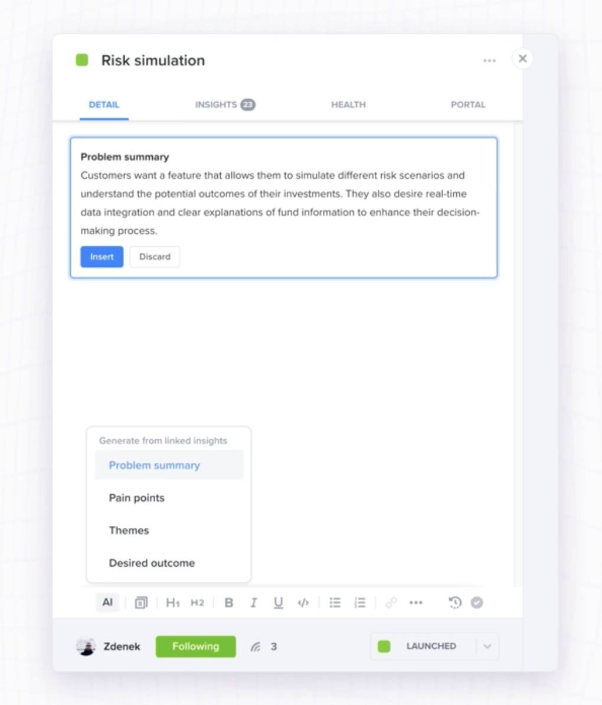
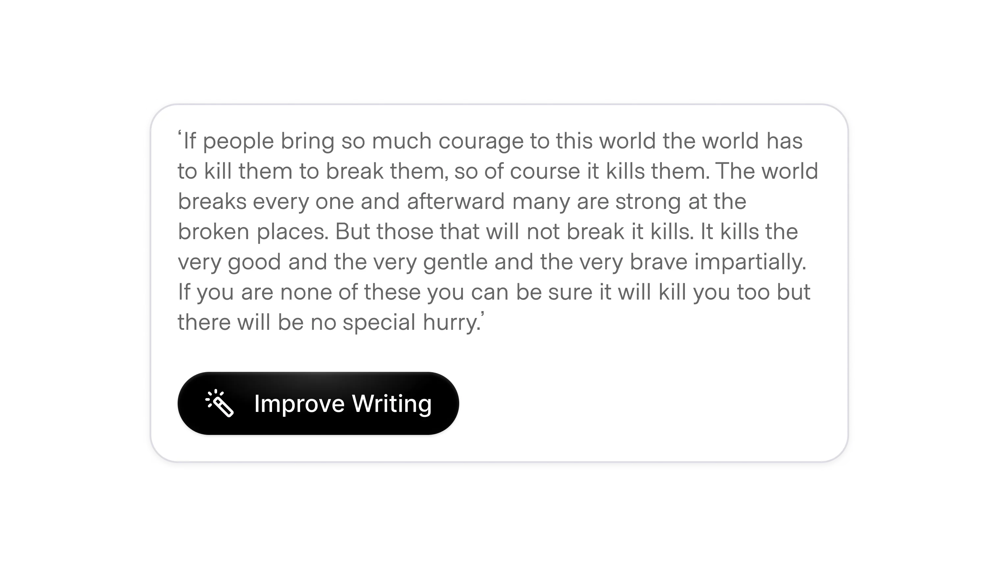

# Nudges

**ID:** `nudges`  
**Shape of AI:** [Nudges](https://www.shapeof.ai/patterns/nudges) · Wayfinders  
**Related:** `suggestions`, `onboarding-first-value`, `copilot-input`, `inline-action`, `rate-limit-meter`

---

<!-- shapeof-captures:start -->
**Shape of AI captures** · [source](https://www.shapeof.ai/patterns/nudges)
















<!-- shapeof-captures:end -->

---

## Purpose

Progressive disclosure of AI capabilities with **actionable triggers** — especially when the product can do far more than users discover on their own.

## When to use

- Idle / empty surfaces where AI is under-discovered  
- Content-rich states (“lots of stickies”, long doc) where a single next action unlocks value  
- First-value / feature onboarding without a blocking coach-mark tour  

## When not to use

Power-user dense mid-flow; blanket menus of every capability; growth-theater upsells disguised as help.

## Anatomy

Contextual tip or menu · capability affordance (icon + label) · optional rate/budget chip · primary act · dismiss / More

## States

| State | Notes |
|-------|--------|
| Idle tip | One dismissible nudge tied to current content |
| Capability list | Short “things I can do” / “What do you want to do?” |
| Contextual menu | Selection-scoped (Fix / Explain / Summarize) |
| Pre-gen config | Params before run (e.g. citation style) → Submit |
| Propose + gate | Generated block with Insert / Discard (HITL) |

## Do / Don't

**Do:** Tie nudge to intent + content state; one tip at a time or a short ranked list; make premium gates explicit.  
**Don't:** Show “Summarize” on an empty page; overwhelm with blanket lists; lock advanced value behind endless hand-holding.

## Snippet

```tsx
export function AiNudge({
  text,
  onAct,
  onDismiss,
}: {
  text: string;
  onAct: () => void;
  onDismiss: () => void;
}) {
  return (
    <div className="flex items-center gap-control rounded-control bg-accent-muted px-control py-dense text-2xs text-accent-ink">
      <span className="flex-1">{text}</span>
      <button type="button" onClick={onAct}>
        Try
      </button>
      <button type="button" onClick={onDismiss} className="opacity-60">
        ×
      </button>
    </div>
  );
}
```

## Source references

- [Shape of AI — Nudges](https://www.shapeof.ai/patterns/nudges)  
- Screenshots: `assets/screenshots/shapeof/nudges-*.{png,jpeg,webp}` (CDN originals from shapeof.ai)
