# Onboarding & First Value

**ID:** `onboarding-first-value`  
**Teardowns:** [Onboarding](https://aiuxplayground.com/teardowns/compare/ai-onboarding-first-value)  
**Related:** `suggestions`, `copilot-input`, `connectors`, `cost-estimates`

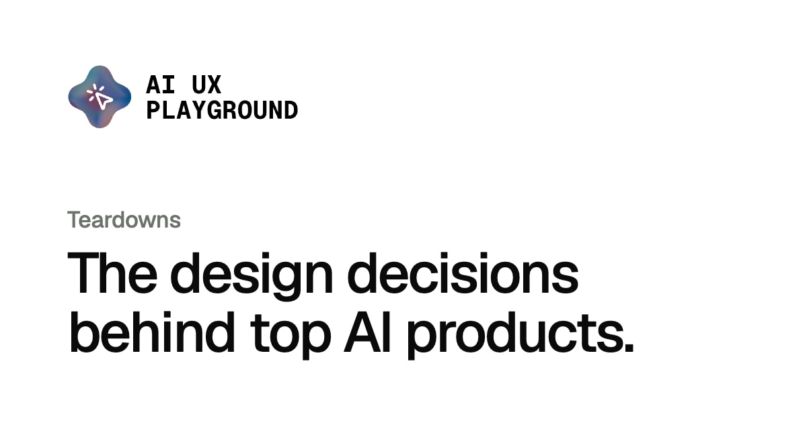

---

<!-- playground-captures:start -->
**AI UX Playground teardowns** · [hub](https://aiuxplayground.com/teardowns)

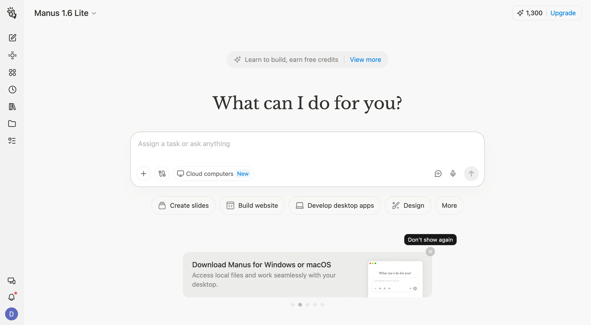

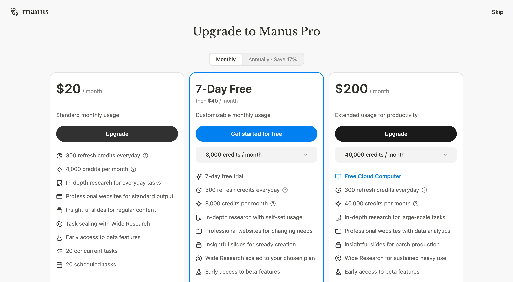

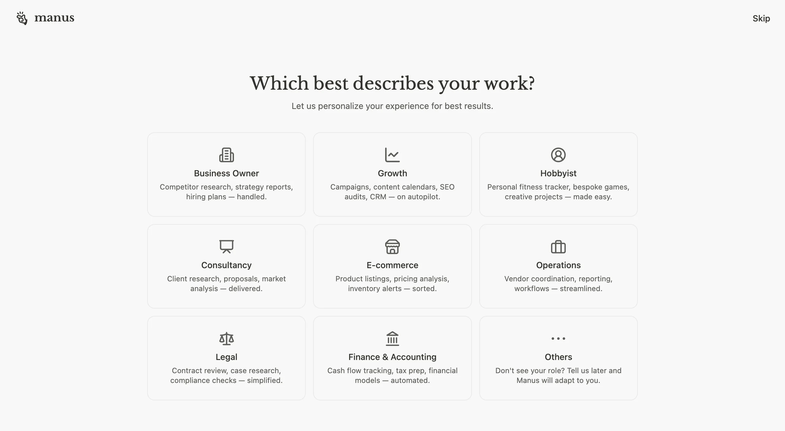

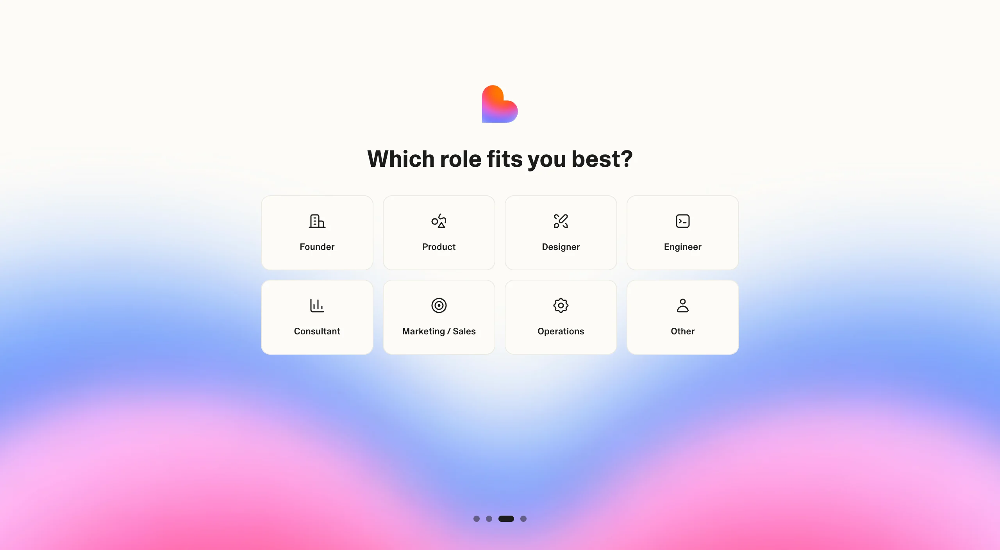


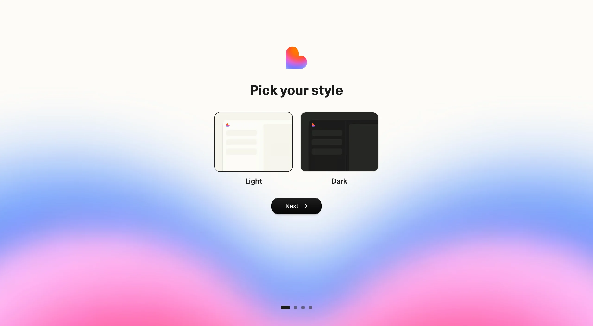


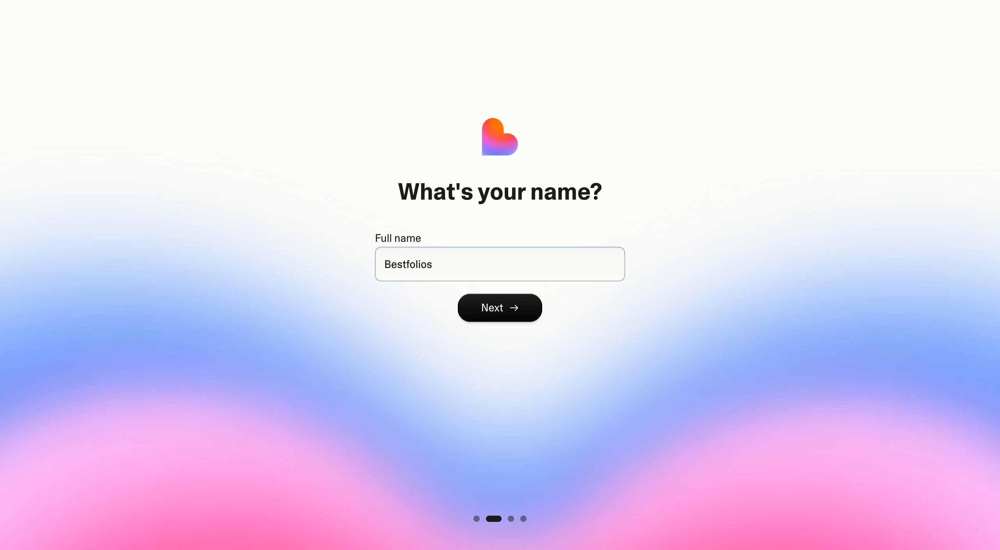

<!-- playground-captures:end -->

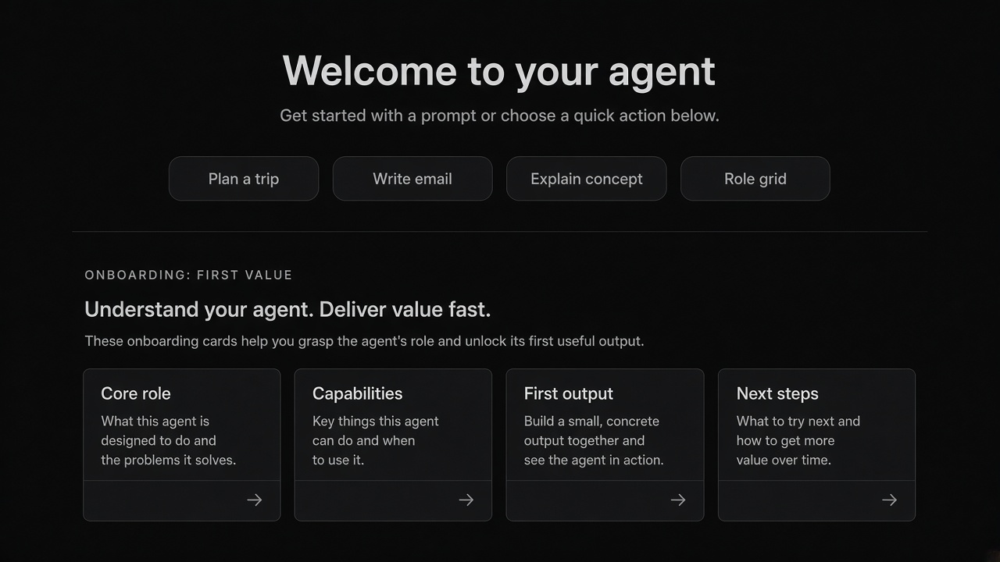


## Source references (external)

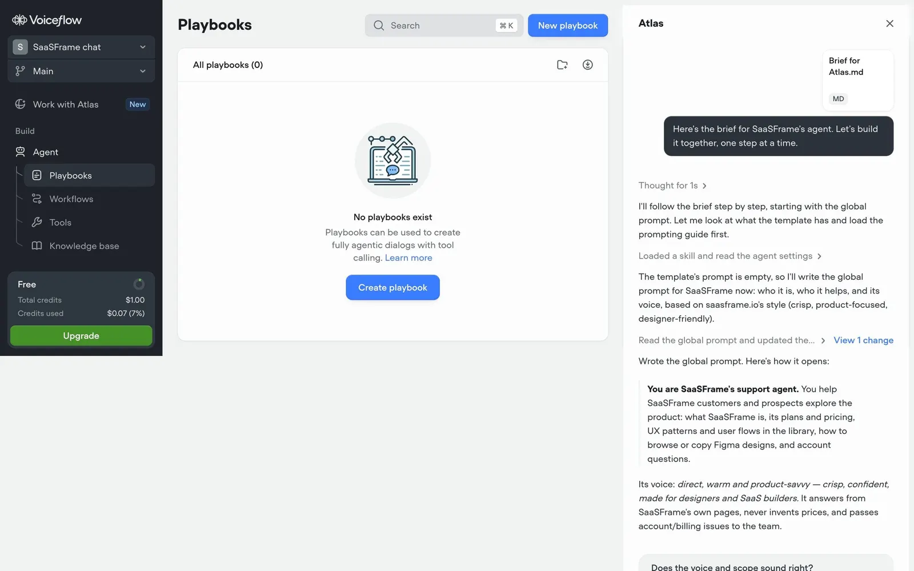
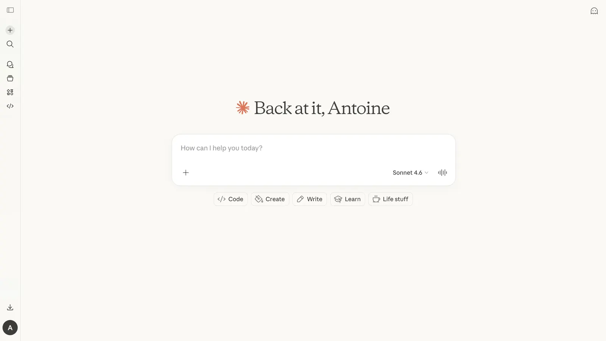
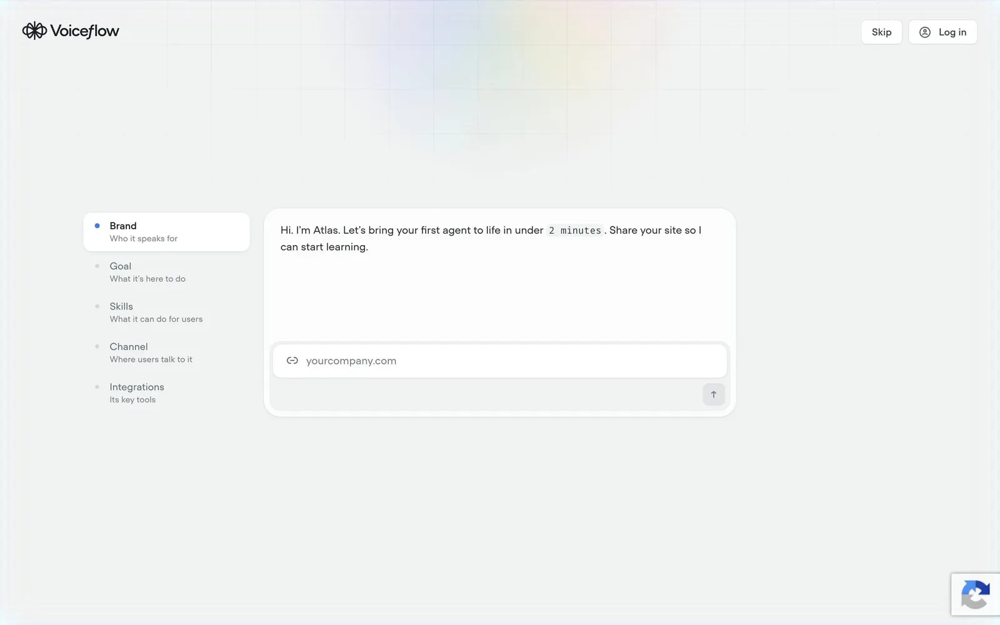
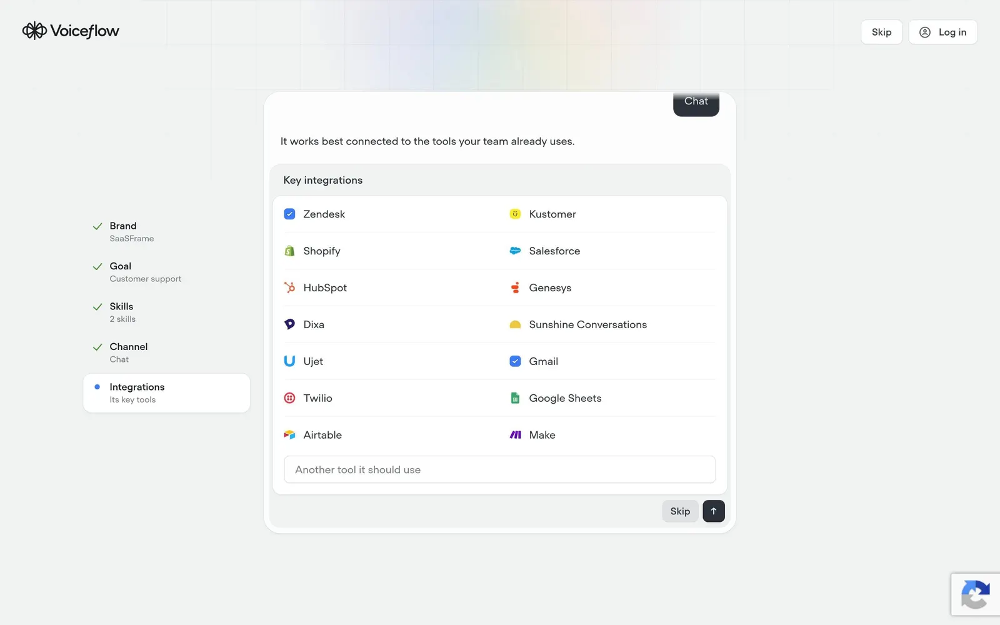
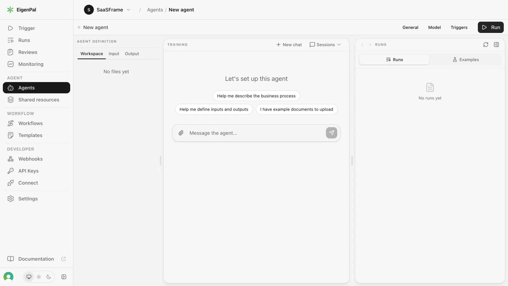
## Purpose

Get a new user from entry → **first successful AI outcome** without a blank canvas or a blocking wizard that hides capability.

## Three shapes (copy)

| Shape | When | Pattern |
|-------|------|---------|
| Point-of-work (Notion AI) | AI inside existing tool | Categorized starters at cursor; no wizard |
| Short wizard (Lovable) | Need segmentation before build | One question / screen + progress; then connectors |
| Role → metered composer (Manus) | Delegated agent tasks | Outcome role cards + Skip; teach credits mid-funnel |

## Do / Don't

**Do:** show real capability fast; keep Skip on role/pricing; land on composer-as-home for agents.  
**Don't:** empty dashboard; upsell-only first screen; wizard with no escape.

## When to use

Get a new user from entry → **first successful AI outcome** without a blank canvas or a blocking wizard that hides capability.

## When not to use

Skip when a denser core kit pattern already covers the job (see Related).

## Anatomy

1) Trigger 2) Dense primary surface 3) Confirm / dismiss

## Do / Don't

**Do:** Keep Linear/Raycast density; keyboard where actions exist; reuse kit tokens.  
**Don't:** Don't invent parallel chrome; don't hide irreversible effects.

## Snippet

```tsx
export function RoleFirstValue({
  roles,
  onPick,
  onSkip,
}: {
  roles: { id: string; label: string; outcome: string }[];
  onPick: (id: string) => void;
  onSkip: () => void;
}) {
  return (
    <section className="mx-auto max-w-lg px-panel py-section-2">
      <header className="mb-section flex items-end justify-between">
        <h1 className="text-sm font-medium text-ink">What should the agent do for you?</h1>
        <button type="button" onClick={onSkip} className="text-2xs text-ink-faint">
          Skip
        </button>
      </header>
      <ul className="grid grid-cols-3 gap-control">
        {roles.map((r) => (
          <li key={r.id}>
            <button
              type="button"
              onClick={() => onPick(r.id)}
              className="h-full w-full rounded-panel border border-hairline bg-surface px-control py-panel text-left hover:border-hairline-strong"
            >
              <span className="block text-xs text-ink">{r.label}</span>
              <span className="mt-dense block text-2xs text-ink-faint">{r.outcome}</span>
            </button>
          </li>
        ))}
      </ul>
    </section>
  );
}
```
