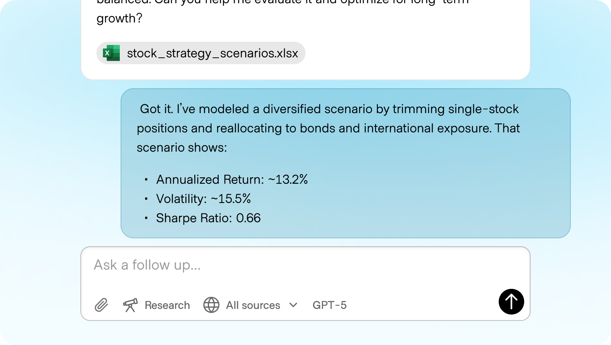
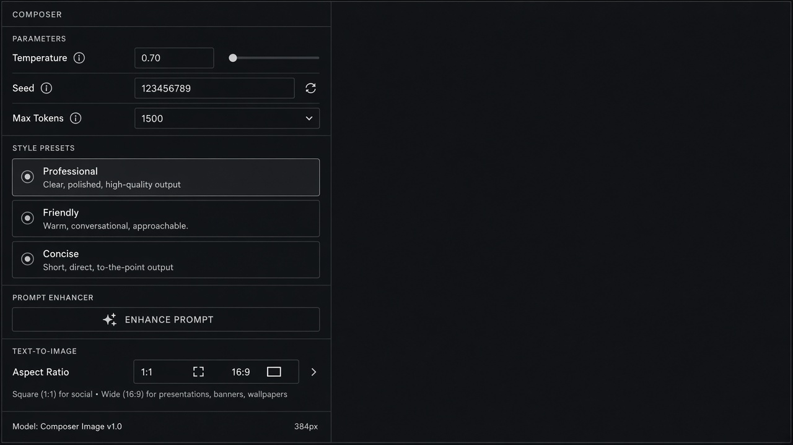

# Parameters

**ID:** `parameters`  
**Shape of AI:** https://www.shapeof.ai/pattern-types/tuners  **Related:** model-mode-picker, cost-estimates

---

<!-- shapeof-captures:start -->
**Shape of AI captures** · [source](https://www.shapeof.ai/patterns/token-layering)




<!-- shapeof-captures:end -->




## Purpose

Expose generation constraints (temperature, length, seed) next to the prompt.

## When to use

Power users need temperature/length/seed control.

## When not to use

Consumer chat where model/effort picker is enough.

## Anatomy

Dense param rows · live cost hint · Reset

## Do / Don't

**Do:** Group advanced behind disclosure; sync with cost-estimates.  
**Don't:** Expose raw JSON walls as the only UI.

## Snippet

```tsx
export function ParamRow({ name, value, onChange }: { name: string; value: number; onChange: (n: number) => void }) {
  return <label className="flex items-center justify-between gap-control text-2xs text-ink-muted"><span>{name}</span><input type="number" value={value} onChange={(e) => onChange(Number(e.target.value))} className="h-7 w-16 rounded-control border border-hairline bg-canvas px-dense font-mono text-ink" /></label>;
}
```
