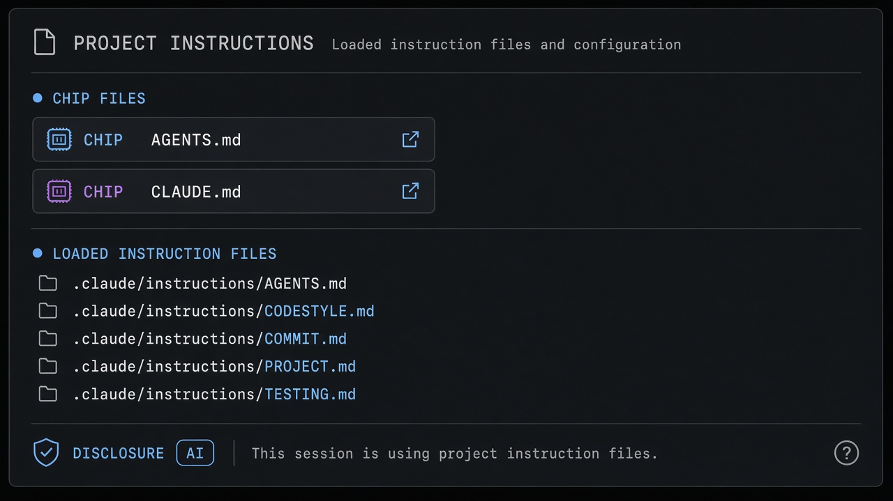
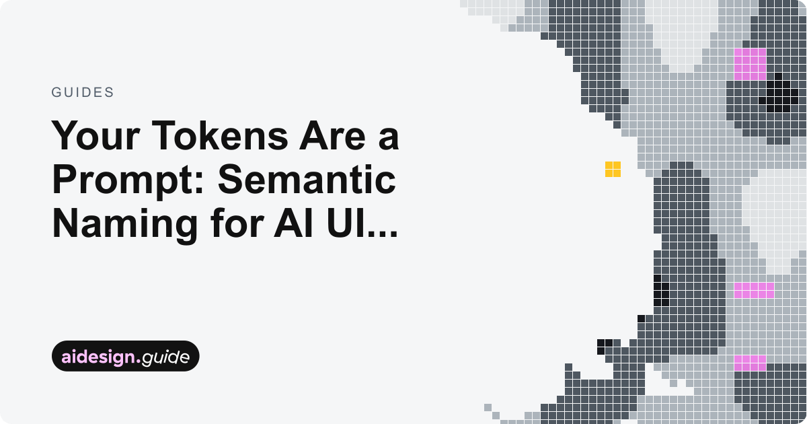
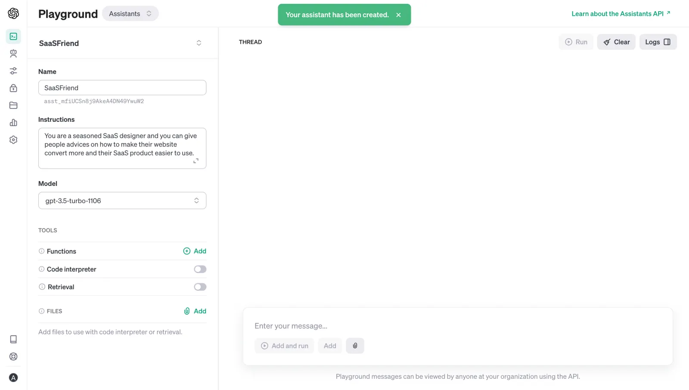

# Project Instructions

**ID:** `project-instructions`  
**Sources:** AI Design Guide · AGENTS.md / CLAUDE.md / GEMINI.md  
**Related:** `memory-personalization`, `connectors`, `disclosure`



---

<!-- aidesign-p1:start -->
**AI Design Guide · P1 resources** · [resources](https://www.aidesign.guide/resources) · anti-patterns gallery is login-gated



<!-- aidesign-p1:end -->


## Source references (external)


## Purpose

Show which **repo instruction files** the agent loaded (`Using: 2 AGENTS.md`) so hosts and humans know the brief in force.

## Snippet

```tsx
export function ProjectInstructionsBadge({
  files,
  onOpen,
}: {
  files: { id: string; name: string }[];
  onOpen?: (id: string) => void;
}) {
  return (
    <div className="inline-flex flex-wrap items-center gap-dense rounded-control border border-hairline bg-surface px-control py-dense text-2xs text-ink-muted">
      <span className="text-ink-faint">Using:</span>
      {files.map((f) => (
        <button
          key={f.id}
          type="button"
          onClick={() => onOpen?.(f.id)}
          className="font-mono text-ink hover:text-accent-ink"
        >
          {f.name}
        </button>
      ))}
    </div>
  );
}
```
