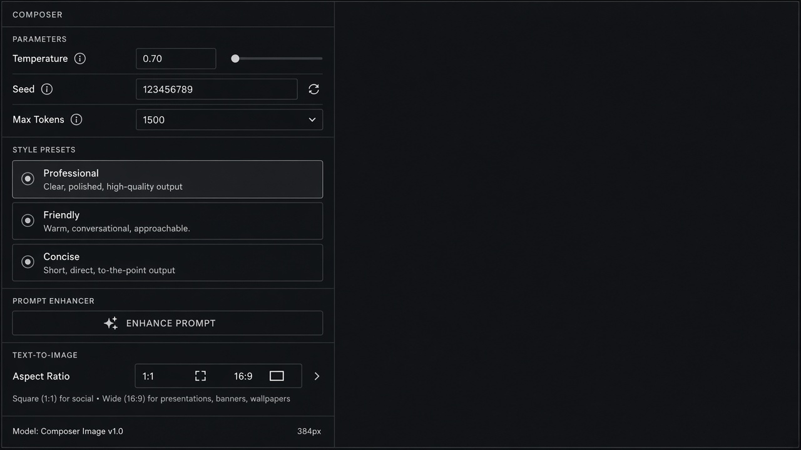

# Prompt Enhancer

**ID:** `prompt-enhancer`  
**Shape of AI:** https://www.shapeof.ai/pattern-types/tuners  **Related:** copilot-input, response-versions

---



## Purpose

One-click expand/improve the user prompt before send, with editable preview.

## When to use

Short prompts that need specificity before spend.

## When not to use

Already long system+user stacks.

## Anatomy

Enhance · diff preview · Replace / Insert

## Do / Don't

**Do:** Show before/after; keep original recoverable.  
**Don't:** Auto-send enhanced prompt.

## Snippet

```tsx
export function PromptEnhancer({ onEnhance }: { onEnhance: () => void }) {
  return <button type="button" onClick={onEnhance} className="rounded-control border border-hairline px-control py-dense text-2xs text-ink-muted">Enhance prompt</button>;
}
```
