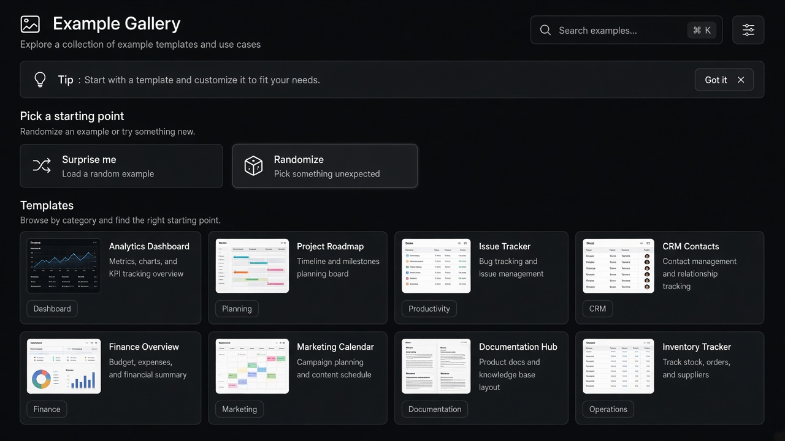

# Randomize

**ID:** `randomize`  
**Shape of AI:** https://www.shapeof.ai/pattern-types/wayfinders  **Related:** suggestions, copilot-input

---



## Purpose

Low-friction kickstart with randomized prompt/params for playful exploration.

## When to use

Playful exploration; blank-canvas anxiety.

## When not to use

High-stakes / compliance flows.

## Anatomy

Surprise control · fills composer · optional seed

## Do / Don't

**Do:** Keep undo; show what changed.  
**Don't:** Overwrite a long user draft without confirm.

## Snippet

```tsx
export function RandomizeButton({ onClick }: { onClick: () => void }) {
  return <button type="button" onClick={onClick} className="rounded-control border border-hairline px-control py-dense text-2xs text-ink-muted">Surprise me</button>;
}
```
