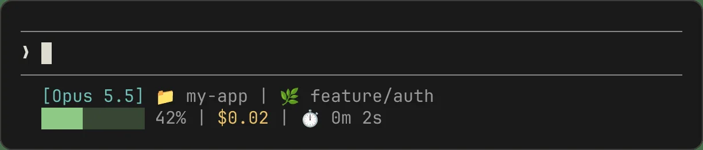
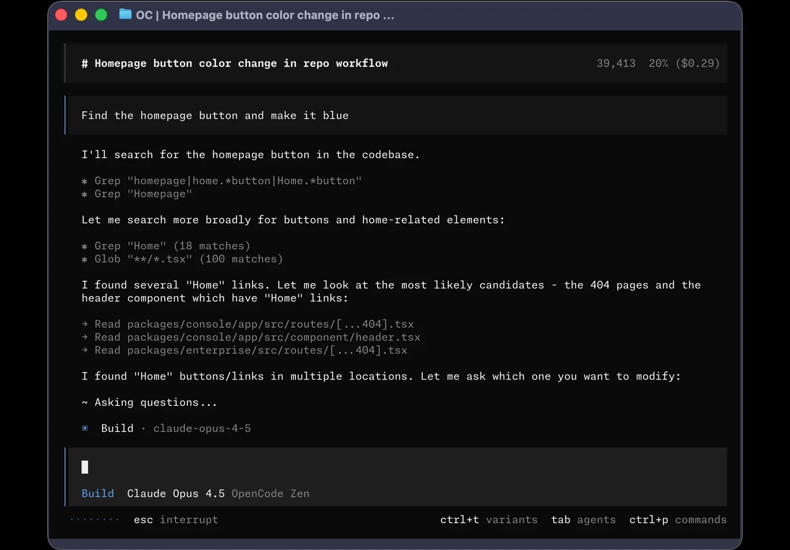
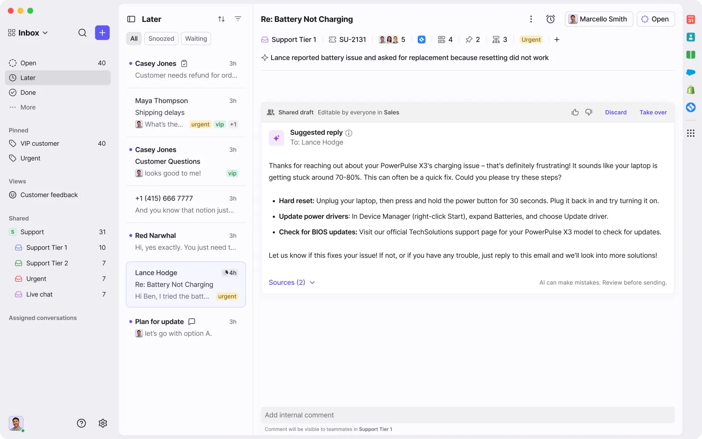
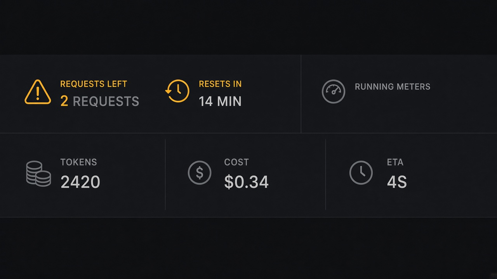

# Rate Limit & Running Meters

**ID:** `rate-limit-meter`  
**Playground:** [rate-limit-warnings](https://aiuxplayground.com/pattern/rate-limit-warnings) · [running-meters](https://aiuxplayground.com/pattern/running-meters)  
**Related:** `cost-estimates`, `autonomy-budget`, `controls`

---

<!-- aidesign-captures:start -->
**AI Design Guide** · [Agentic UX Patterns](https://www.aidesign.guide/agentic-ux-patterns)





<!-- aidesign-captures:end -->

<!-- saasframe-expand:start -->
**SaaSFrame AI captures** (expanded) · [saasframe.io](https://www.saasframe.io/patterns)





<!-- saasframe-expand:end -->





## Source references (external)


## Purpose

Warn **before** the wall: remaining requests, reset time, live token/cost/ETA meters during a run. Soft warning + upgrade/queue path beats a post-hoc hard error after lost work.

## When to use

Warn **before** the wall: remaining requests, reset time, live token/cost/ETA meters during a run.

## When not to use

Skip when a denser core kit pattern already covers the job (see Related).

## Anatomy

1) Trigger 2) Dense primary surface 3) Confirm / dismiss

## Do / Don't

**Do:** Keep Linear/Raycast density; keyboard where actions exist; reuse kit tokens.  
**Don't:** Don't invent parallel chrome; don't hide irreversible effects.

## Snippet

```tsx
export function RateLimitMeter({
  remaining,
  resetIn,
  tokens,
  cost,
  eta,
}: {
  remaining?: number;
  resetIn?: string;
  tokens?: number;
  cost?: string;
  eta?: string;
}) {
  const low = remaining != null && remaining <= 2;
  return (
    <div
      className={`flex flex-wrap items-center gap-control rounded-control border px-control py-dense font-mono text-2xs ${
        low ? "border-warn/50 bg-warn-muted text-warn" : "border-hairline text-ink-muted"
      }`}
    >
      {remaining != null && <span>{remaining} left</span>}
      {resetIn && <span>reset {resetIn}</span>}
      {tokens != null && <span>{tokens.toLocaleString()} tok</span>}
      {cost && <span>{cost}</span>}
      {eta && <span>ETA {eta}</span>}
    </div>
  );
}
```
