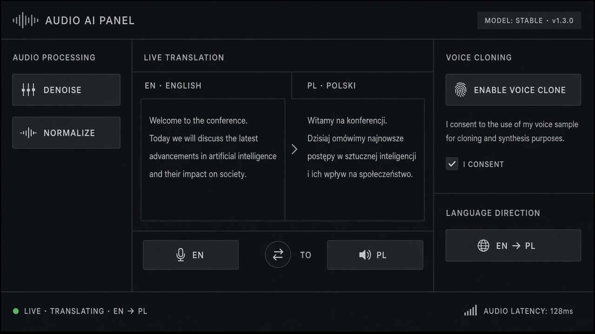

# Real-Time Translation

**ID:** `real-time-translation`  
**Playground:** [real-time-translation](https://aiuxplayground.com/pattern/real-time-translation)  **Related:** voice-transcript, lang-toggle

---



## Purpose

Live translate speech/text with source/target labels and interrupt.

## When to use

Live translate speech/text with source/target labels and interrupt.

## When not to use

Skip when a denser core kit pattern already covers the job (see Related).

## Anatomy

1) Trigger 2) Dense primary surface 3) Confirm / dismiss

## Do / Don't

**Do:** Keep Linear/Raycast density; keyboard where actions exist; reuse kit tokens.  
**Don't:** Don't invent parallel chrome; don't hide irreversible effects.

## Snippet

```tsx
export function LiveTranslation({ source, target }: { source: string; target: string }) {
  return (
    <div className="grid grid-cols-2 gap-control text-xs">
      <p className="rounded-control bg-surface p-control text-ink-muted">{source}</p>
      <p className="rounded-control bg-accent-muted p-control text-accent-ink">{target}</p>
    </div>
  );
}
```
