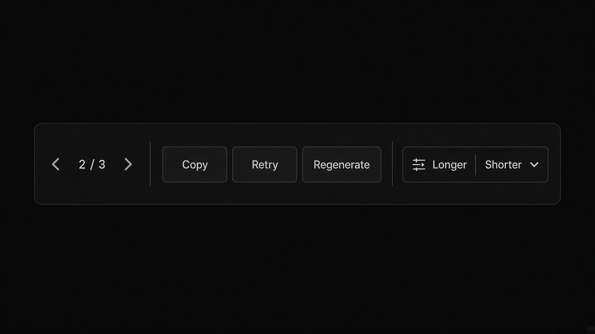
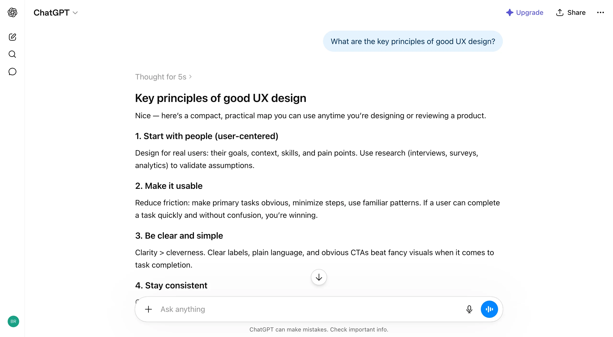
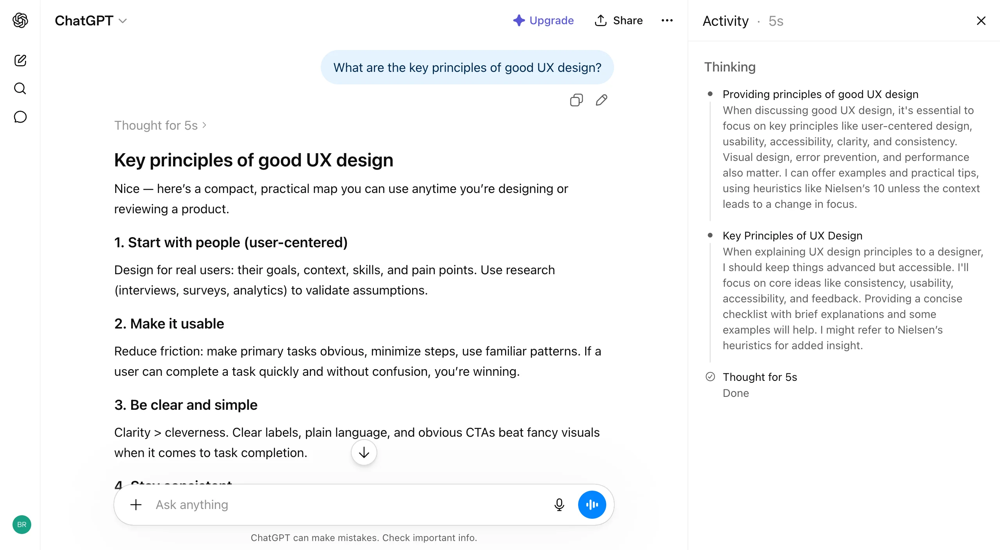
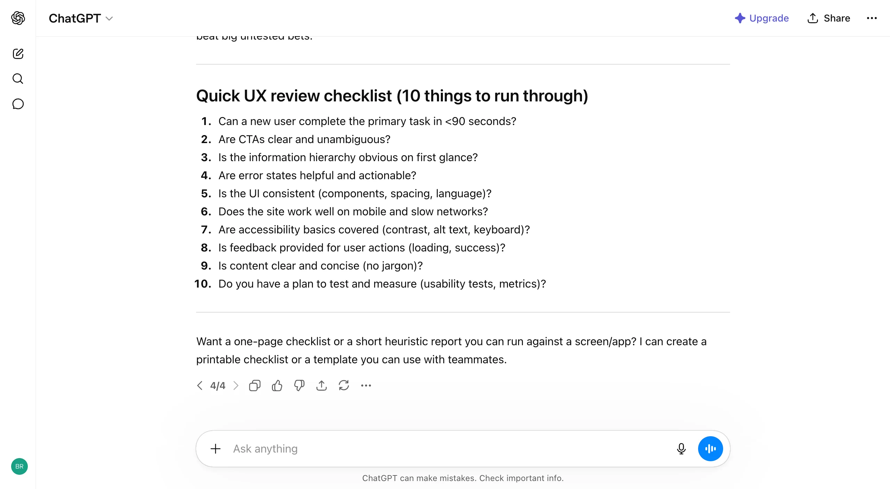
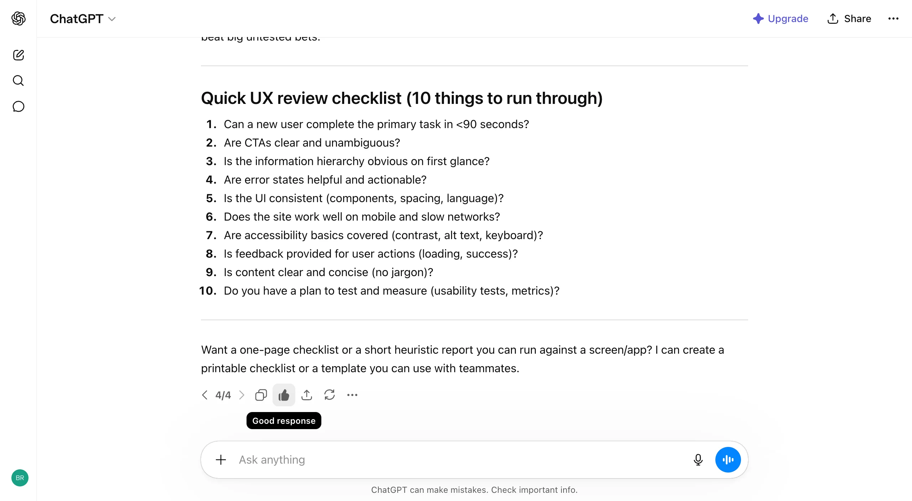
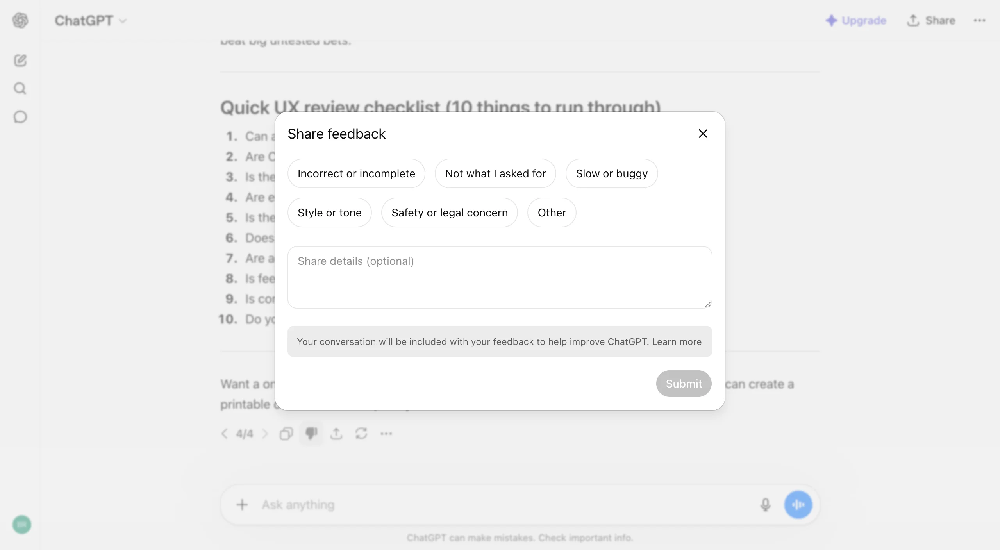
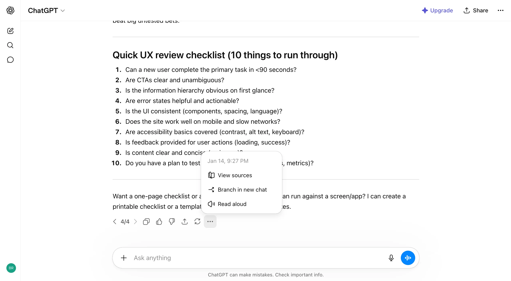
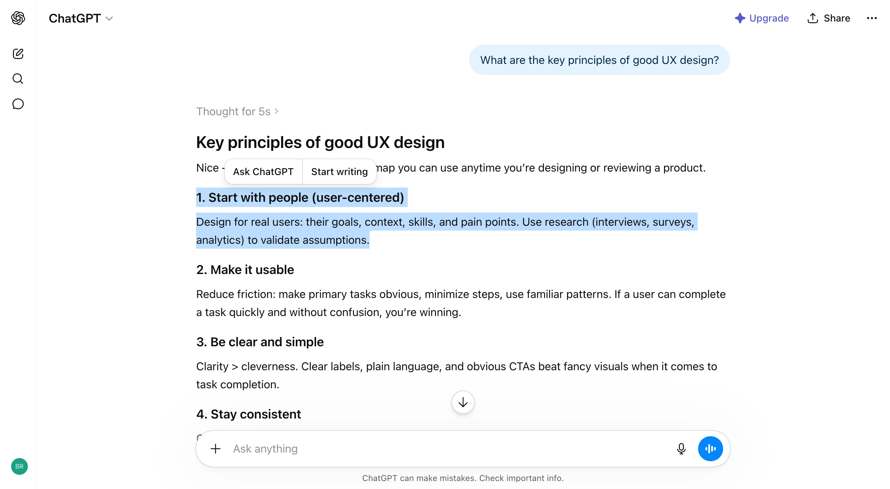

# Response Versions

**ID:** `response-versions`  
**Teardowns:** [Output & artifacts](https://aiuxplayground.com/teardowns/compare/output-artifacts-refinement)  
**Playground:** Response Refinement · non-destructive regenerate  
**Related:** `inline-action`, `controls`, `artifact-pane`



---

<!-- playground-captures:start -->
**AI UX Playground teardowns** · [hub](https://aiuxplayground.com/teardowns)
















<!-- playground-captures:end -->


## Source references (external)


## Purpose

Iterate on an answer **without destroying** prior drafts: `N/N` version navigation, Regenerate / Try again, reshape (Longer / Shorter), and selection-scoped fixes via `inline-action`.

## Do / Don't

**Do:** keep previous versions addressable; label rewrite mode/model; branch on user-message edit.  
**Don't:** overwrite silently; force full regenerate for a one-paragraph fix.

## When to use

Iterate on an answer **without destroying** prior drafts: `N/N` version navigation, Regenerate / Try again, reshape (Longer / Shorter), and selection-scoped fixes via `inline-action`.

## When not to use

Skip when a denser core kit pattern already covers the job (see Related).

## Anatomy

1) Trigger 2) Dense primary surface 3) Confirm / dismiss

## Do / Don't

**Do:** Keep Linear/Raycast density; keyboard where actions exist; reuse kit tokens.  
**Don't:** Don't invent parallel chrome; don't hide irreversible effects.

## Snippet

```tsx
export function ResponseVersionBar({
  index,
  total,
  onPrev,
  onNext,
  onRegenerate,
}: {
  index: number;
  total: number;
  onPrev: () => void;
  onNext: () => void;
  onRegenerate: () => void;
}) {
  return (
    <div className="flex items-center gap-control text-2xs text-ink-muted">
      <button type="button" onClick={onPrev} disabled={index <= 1} className="disabled:opacity-30">
        ‹
      </button>
      <span className="font-mono tabular-nums">
        {index}/{total}
      </span>
      <button type="button" onClick={onNext} disabled={index >= total} className="disabled:opacity-30">
        ›
      </button>
      <button type="button" onClick={onRegenerate} className="ml-control hover:text-ink">
        Regenerate
      </button>
    </div>
  );
}
```
