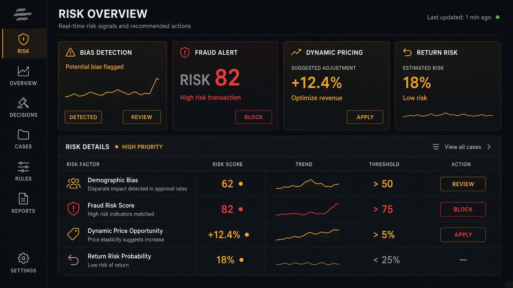

# Return Prediction

**ID:** `return-prediction`  
**Playground:** [return-prediction](https://aiuxplayground.com/pattern/return-prediction)  **Related:** fraud-detection, review-summary

---



## Purpose

Predict return likelihood for items with reasons to inform merchandising/support.

## When to use

Predict return likelihood for items with reasons to inform merchandising/support.

## When not to use

Skip when a denser core kit pattern already covers the job (see Related).

## Anatomy

1) Trigger 2) Dense primary surface 3) Confirm / dismiss

## Do / Don't

**Do:** Keep Linear/Raycast density; keyboard where actions exist; reuse kit tokens.  
**Don't:** Don't invent parallel chrome; don't hide irreversible effects.

## Snippet

```tsx
export function ReturnRisk({ pct, reason }: { pct: number; reason: string }) {
  return <p className="text-xs text-ink">Return risk {pct}% · <span className="text-ink-muted">{reason}</span></p>;
}
```
