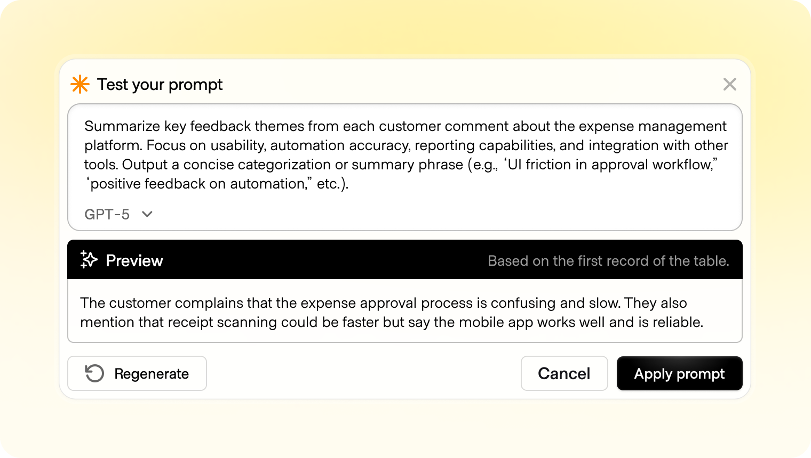
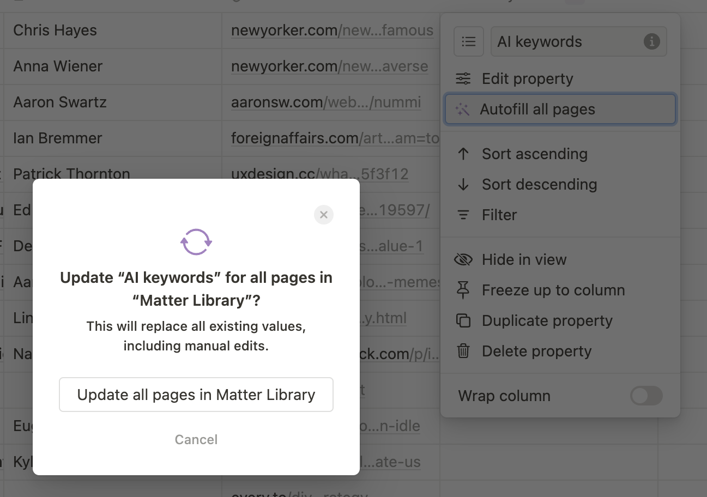
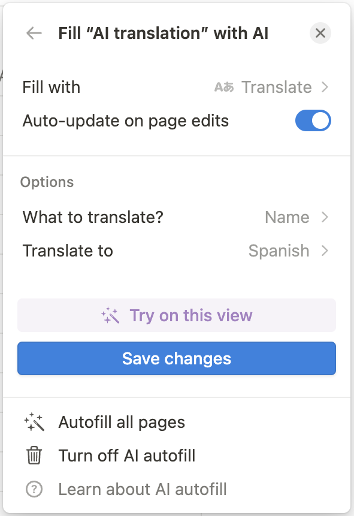
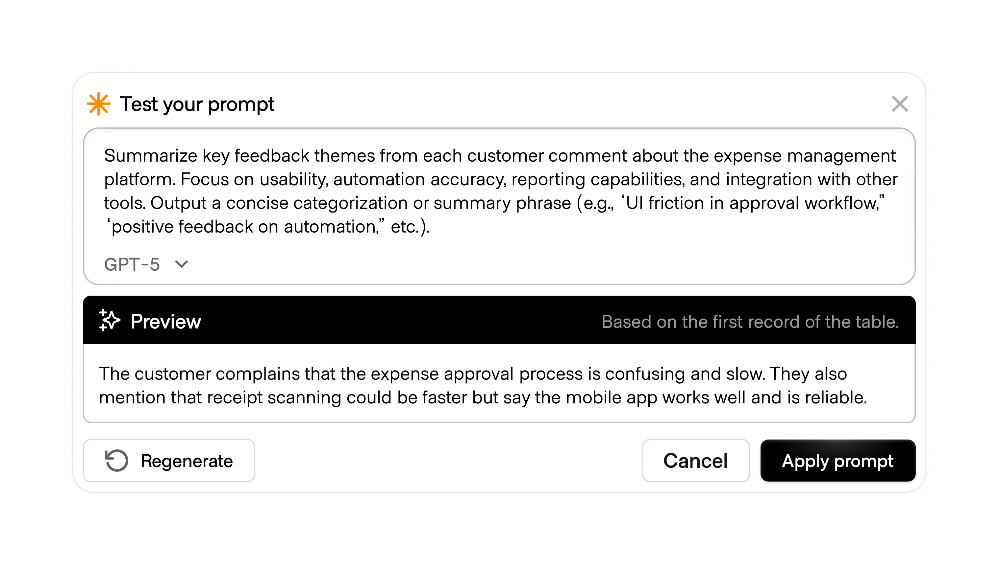
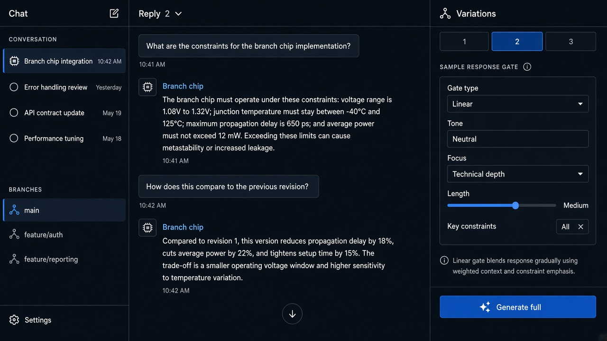

# Sample Response

**ID:** `sample-response`  
**Shape of AI:** https://www.shapeof.ai/pattern-types/governors  **Related:** mandate-approval-card, cost-estimates, action-plan

---

<!-- shapeof-captures:start -->
**Shape of AI captures** · [source](https://www.shapeof.ai/patterns/sample-response)










<!-- shapeof-captures:end -->



## Purpose

Confirm intent on complicated prompts via a cheap sample before full generation.

## When to use

Full run is expensive; confirm direction first.

## When not to use

Cheap instant answers.

## Anatomy

Sample block · cost of full · Generate full

## Do / Don't

**Do:** Cheap sample; clear upgrade to full.  
**Don't:** Charge full price for the sample.

## Snippet

```tsx
export function SampleResponseGate({ sample, onProceed }: { sample: string; onProceed: () => void }) {
  return (
    <section className="rounded-panel border border-hairline p-panel">
      <p className="text-2xs text-ink-faint">Sample</p>
      <p className="mt-dense text-xs text-ink">{sample}</p>
      <button type="button" onClick={onProceed} className="mt-control rounded-control bg-accent px-panel py-control-2 text-xs text-accent-ink">Generate full</button>
    </section>
  );
}
```
