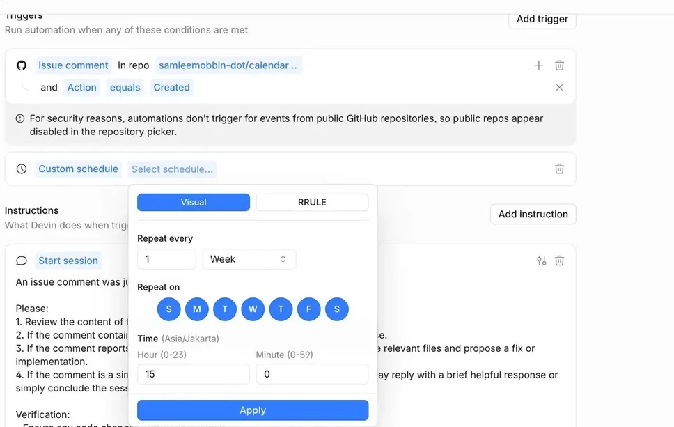
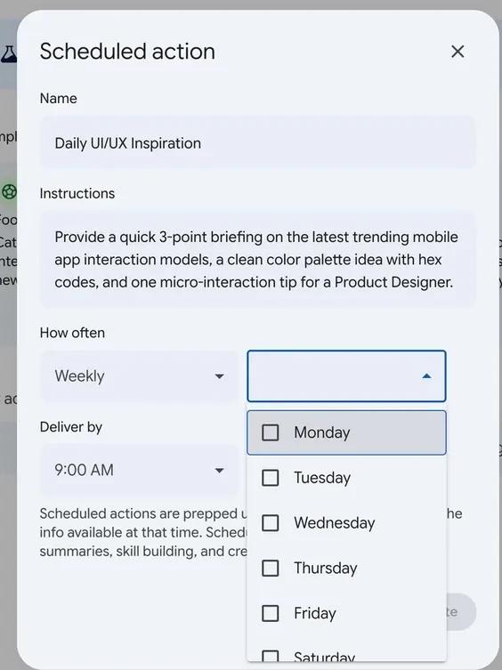
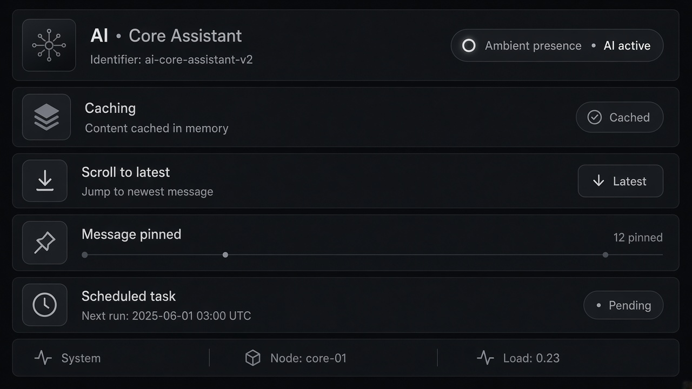

# Scheduled Tasks

**ID:** `scheduled-tasks`  
**Playground:** [scheduled-tasks](https://aiuxplayground.com/pattern/scheduled-tasks)  **Related:** action-plan, autonomy-budget, controls

---

<!-- aidesign-captures:start -->
**AI Design Guide** · [Agentic UX Patterns](https://www.aidesign.guide/agentic-ux-patterns)





<!-- aidesign-captures:end -->



## Purpose

Schedule recurring/deferred agent jobs with next-run visibility and cancel.

## When to use

Schedule recurring/deferred agent jobs with next-run visibility and cancel.

## When not to use

Skip when a denser core kit pattern already covers the job (see Related).

## Anatomy

1) Trigger 2) Dense primary surface 3) Confirm / dismiss

## Do / Don't

**Do:** Keep Linear/Raycast density; keyboard where actions exist; reuse kit tokens.  
**Don't:** Don't invent parallel chrome; don't hide irreversible effects.

## Snippet

```tsx
export function ScheduledTaskRow({ title, next, onCancel }: { title: string; next: string; onCancel: () => void }) {
  return (
    <div className="flex items-center gap-control border-b border-hairline py-control text-xs">
      <span className="flex-1 text-ink">{title}</span>
      <span className="font-mono text-2xs text-ink-faint">{next}</span>
      <button type="button" onClick={onCancel} className="text-2xs text-danger">Cancel</button>
    </div>
  );
}
```
