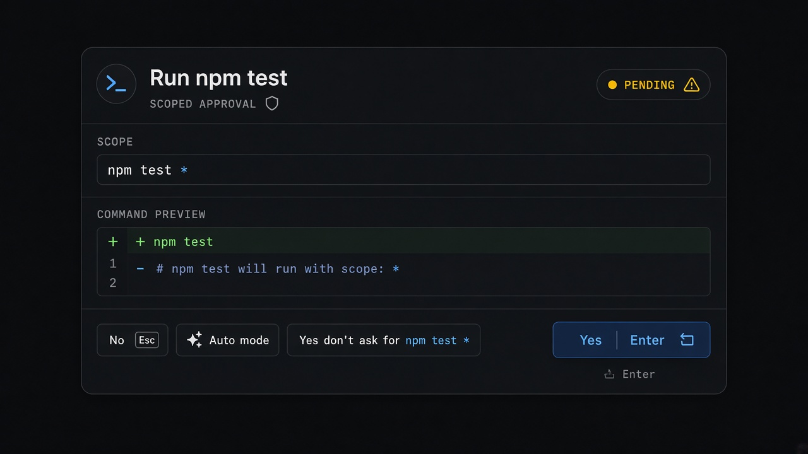
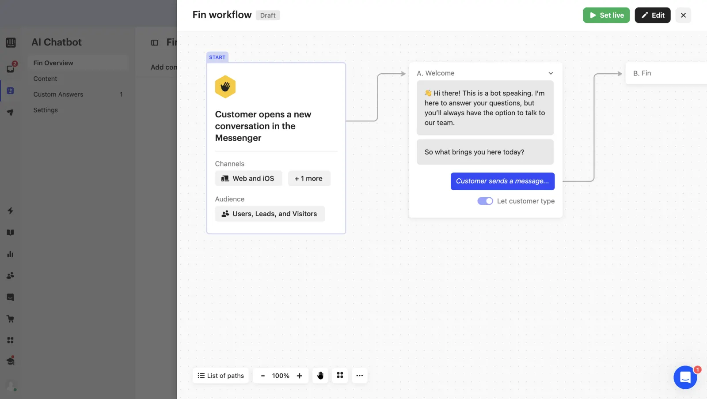

# Scoped Approval

**ID:** `scoped-approval`  
**Sources:** AI Design Guide · Claude Code Bash permission · CopilotKit HITL  
**Related:** `mandate-approval-card`, `autonomy-modes`, `connectors`



---


## Source references (external)


## Purpose

Approve a **risky action with scope**: Yes once · Yes for this pattern · escalate autonomy · No / amend — never a blanket “always allow everything”.

## Anatomy

1. Preview (command / diff / tool args)  
2. Scope line (`npm test *`, domain, path)  
3. Actions: Yes · Yes, don’t ask again for {scope} · Auto mode · No

## Snippet

```tsx
export function ScopedApproval({
  title,
  preview,
  scope,
  onYes,
  onAlwaysScope,
  onAuto,
  onNo,
}: {
  title: string;
  preview: string;
  scope: string;
  onYes: () => void;
  onAlwaysScope: () => void;
  onAuto: () => void;
  onNo: () => void;
}) {
  return (
    <section className="max-w-mandate overflow-hidden rounded-panel border border-hairline-strong bg-surface-raised">
      <header className="border-b border-hairline px-panel py-control-2">
        <h2 className="text-xs font-medium text-ink">{title}</h2>
        <p className="mt-dense font-mono text-2xs text-ink-faint">scope · {scope}</p>
      </header>
      <pre className="max-h-32 overflow-auto bg-canvas px-panel py-control font-mono text-2xs text-ink-muted">
        {preview}
      </pre>
      <footer className="flex flex-wrap justify-end gap-dense border-t border-hairline px-panel py-control">
        <button type="button" onClick={onNo} className="text-xs text-ink-muted">
          No
        </button>
        <button type="button" onClick={onAuto} className="text-xs text-ink-muted">
          Auto mode
        </button>
        <button type="button" onClick={onAlwaysScope} className="rounded-control px-control py-dense text-2xs text-ink">
          Yes, don’t ask for {scope}
        </button>
        <button
          type="button"
          onClick={onYes}
          className="rounded-control bg-accent px-panel py-control-2 text-xs text-accent-ink"
        >
          Yes <kbd className="ml-dense opacity-70">↵</kbd>
        </button>
      </footer>
    </section>
  );
}
```
