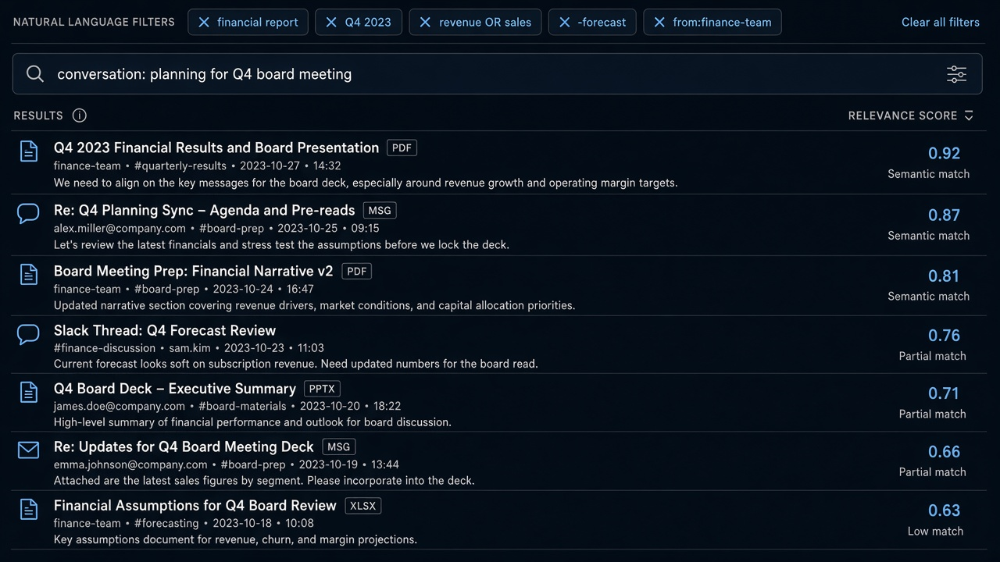

# Semantic Search

**ID:** `semantic-search`  
**Playground:** [semantic-search](https://aiuxplayground.com/pattern/semantic-search)  **Related:** nl-filter, citations

---



## Purpose

Meaning-based retrieval across catalog/docs with relevance cues and facet refine.

## When to use

Meaning-based retrieval over catalogs/docs.

## When not to use

Exact SKU/ID lookup only.

## Anatomy

Query · ranked hits · score/why · refine

## Do / Don't

**Do:** Show relevance cue; allow facet override.  
**Don't:** Fake precision scores without grounding.

## Snippet

```tsx
export function SemanticHit({ title, score }: { title: string; score: number }) {
  return <div className="flex justify-between py-dense text-xs"><span className="text-ink">{title}</span><span className="font-mono text-2xs text-ink-faint">{score.toFixed(2)}</span></div>;
}
```
