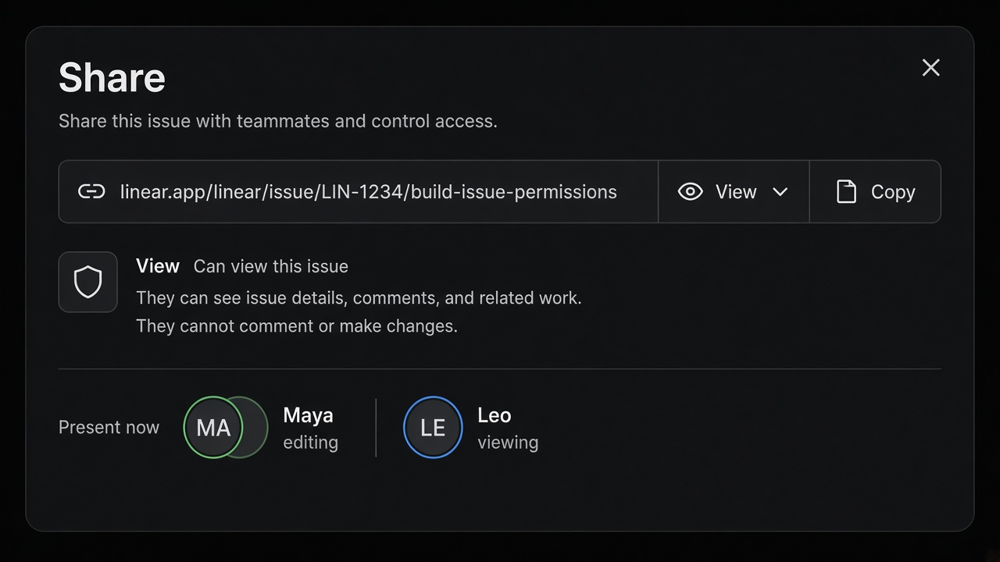

# Shared Session

**ID:** `shared-session`  
**Playground:** [shared-session-link](https://aiuxplayground.com/pattern/shared-session-link) · live-presence · inline-comment-thread  
**Related:** `disclosure`, `smart-diff`, `footprints`

---



## Purpose

Share an AI session URL with **permission tiers** (view / comment / edit), expiry, and optional live presence. AI threads often contain confidential uploads — make visibility explicit.

## Snippet

```tsx
export function SharedSessionLink({
  url,
  permission,
  onCopy,
  onPermission,
}: {
  url: string;
  permission: "view" | "comment" | "edit";
  onCopy: () => void;
  onPermission: (p: "view" | "comment" | "edit") => void;
}) {
  return (
    <div className="flex items-center gap-control rounded-panel border border-hairline bg-surface px-panel py-control">
      <code className="min-w-0 flex-1 truncate font-mono text-2xs text-ink-muted">{url}</code>
      <select
        value={permission}
        onChange={(e) => onPermission(e.target.value as typeof permission)}
        className="rounded-control border border-hairline bg-canvas px-dense text-2xs text-ink"
      >
        <option value="view">View</option>
        <option value="comment">Comment</option>
        <option value="edit">Edit</option>
      </select>
      <button type="button" onClick={onCopy} className="text-2xs text-accent-ink">
        Copy
      </button>
    </div>
  );
}
```
