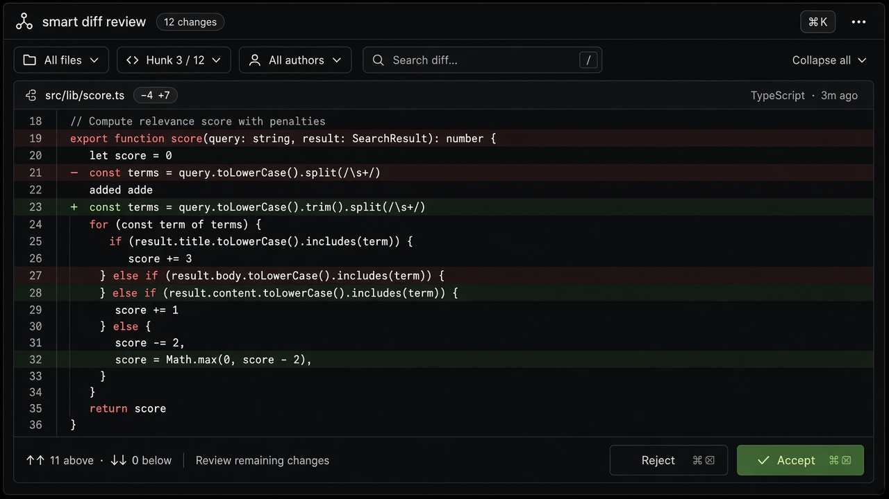

# Smart Diff

**ID:** `smart-diff`  
**Playground:** [smart-diff](https://aiuxplayground.com/pattern/smart-diff)  
**Related:** `mandate-approval-card`, `inline-action`, `artifact-pane`, `checkpoints-restore`

---



## Purpose

Highlight what the model changed vs baseline so reviewers can **Accept / Reject** surgically (docs, code, contracts). Prefer line/block granularity over all-or-nothing overwrite.

## When to use

Highlight what the model changed vs baseline so reviewers can **Accept / Reject** surgically (docs, code, contracts).

## When not to use

Skip when a denser core kit pattern already covers the job (see Related).

## Anatomy

1) Trigger 2) Dense primary surface 3) Confirm / dismiss

## Do / Don't

**Do:** Keep Linear/Raycast density; keyboard where actions exist; reuse kit tokens.  
**Don't:** Don't invent parallel chrome; don't hide irreversible effects.

## Snippet

```tsx
type DiffHunk = { op: "add" | "del" | "ctx"; text: string };

export function SmartDiff({
  hunks,
  onAccept,
  onReject,
}: {
  hunks: DiffHunk[];
  onAccept: () => void;
  onReject: () => void;
}) {
  return (
    <section className="overflow-hidden rounded-panel border border-hairline bg-canvas">
      <pre className="max-h-56 overflow-auto p-panel font-mono text-2xs leading-[16px]">
        {hunks.map((h, i) => (
          <div
            key={i}
            className={
              h.op === "add" ? "bg-diff-add text-ok" : h.op === "del" ? "bg-diff-del text-danger" : "text-ink-muted"
            }
          >
            {h.op === "add" ? "+" : h.op === "del" ? "−" : " "}
            {h.text}
          </div>
        ))}
      </pre>
      <footer className="flex justify-end gap-control border-t border-hairline bg-surface px-panel py-control">
        <button type="button" onClick={onReject} className="text-xs text-ink-muted">
          Reject
        </button>
        <button type="button" onClick={onAccept} className="rounded-control bg-accent px-panel py-control-2 text-xs text-accent-ink">
          Accept
        </button>
      </footer>
    </section>
  );
}
```
