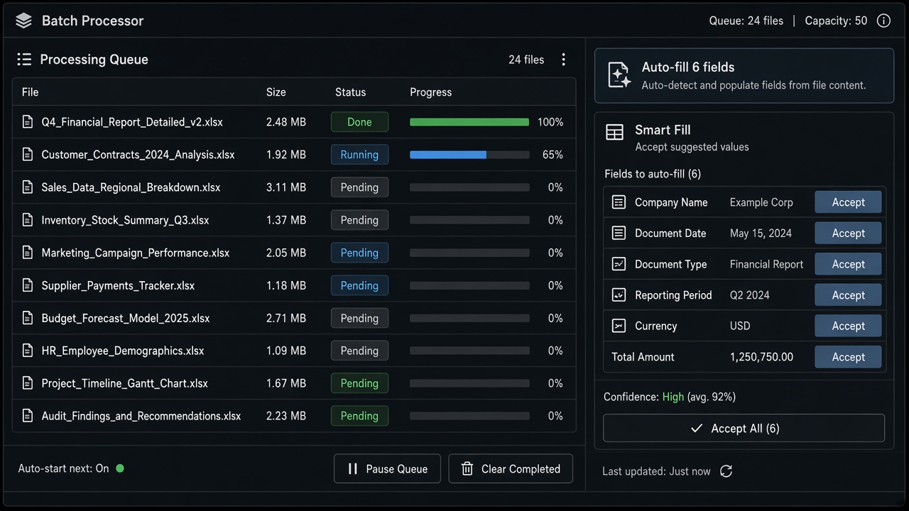

# Smart Fill

**ID:** `smart-fill`  
**Playground:** [smart-fill](https://aiuxplayground.com/pattern/smart-fill)  **Related:** inline-action, clarify-before-act

---



## Purpose

AI completes form fields from context with per-field accept.

## When to use

Forms can be completed from context.

## When not to use

Empty forms with no context.

## Anatomy

Suggested value · Accept · Edit

## Do / Don't

**Do:** Per-field accept; provenance.  
**Don't:** Submit without user review on PII fields.

## Snippet

```tsx
export function SmartFillField({ label, suggestion, onAccept }: { label: string; suggestion: string; onAccept: () => void }) {
  return (
    <label className="block text-xs">
      <span className="text-ink-muted">{label}</span>
      <div className="mt-dense flex gap-dense">
        <input readOnly value={suggestion} className="h-8 flex-1 rounded-control border border-hairline bg-canvas px-control text-ink" />
        <button type="button" onClick={onAccept} className="text-2xs text-accent-ink">Accept</button>
      </div>
    </label>
  );
}
```
