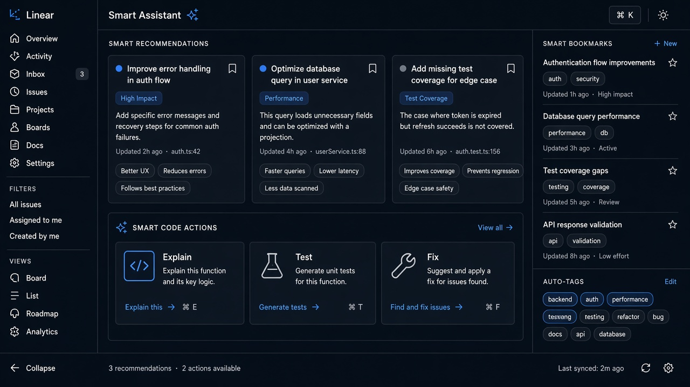

# Smart Recommendations

**ID:** `smart-recommendations`  
**Playground:** [smart-recommendations](https://aiuxplayground.com/pattern/smart-recommendations)  **Related:** suggestions, feedback

---



## Purpose

Ranked AI recommendations with reason chips and dismiss/feedback.

## Snippet

```tsx
export function RecCard({ title, why, onOpen }: { title: string; why: string; onOpen: () => void }) {
  return <button type="button" onClick={onOpen} className="w-full rounded-panel border border-hairline p-panel text-left"><p className="text-xs text-ink">{title}</p><p className="mt-dense text-2xs text-ink-faint">{why}</p></button>;
}
```
