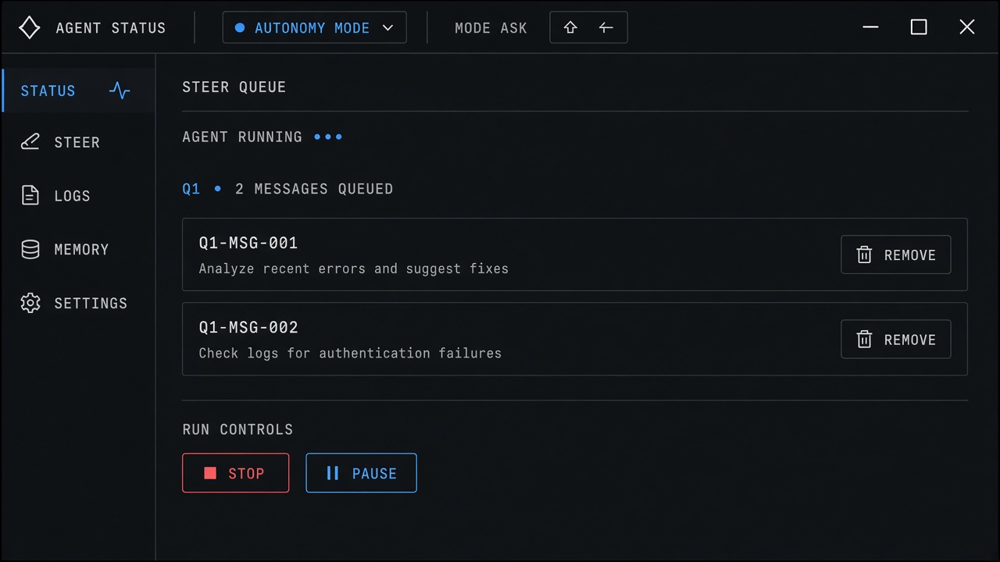

# Steer Queue

**ID:** `steer-queue`  
**Sources:** AI Design Guide · Cursor / Claude Code queue-while-running  
**Related:** `controls`, `copilot-input`, `streaming-thought-state`



---

## Purpose

While the agent runs, the composer stays **busy but listening**: Enter queues; ⌘↵ steers now. Queued messages are editable / reorderable / removable.

## States

| Composer | Enter | ⌘↵ |
|----------|-------|-----|
| Idle | Send | Send |
| Running | Queue | Steer / interrupt-send |

## Snippet

```tsx
export function SteerQueue({
  items,
  onRemove,
  onReorder,
}: {
  items: { id: string; text: string }[];
  onRemove: (id: string) => void;
  onReorder: (from: number, to: number) => void;
}) {
  if (items.length === 0) return null;
  return (
    <ul className="divide-y divide-hairline rounded-control border border-hairline bg-surface">
      {items.map((q, i) => (
        <li key={q.id} className="flex items-center gap-control px-panel py-control text-xs">
          <span className="font-mono text-2xs text-ink-faint">Q{i + 1}</span>
          <span className="min-w-0 flex-1 truncate text-ink-muted">{q.text}</span>
          <button type="button" onClick={() => onReorder(i, Math.max(0, i - 1))} className="text-2xs text-ink-faint">
            ↑
          </button>
          <button type="button" onClick={() => onRemove(q.id)} className="text-2xs text-ink-faint">
            Remove
          </button>
        </li>
      ))}
    </ul>
  );
}
```
