# Streaming Thought State — Agent Cognition UI

**ID:** `streaming-thought-state`  
**Family:** Governors · Trust builders ([shapeof.ai](https://www.shapeof.ai/))  
**Maps to:** [Stream of Thought](https://www.shapeof.ai/patterns/stream-of-thought) · Prompt details · Footprints (live)  
**Compose with:** `controls`, `action-plan`, `footprints`

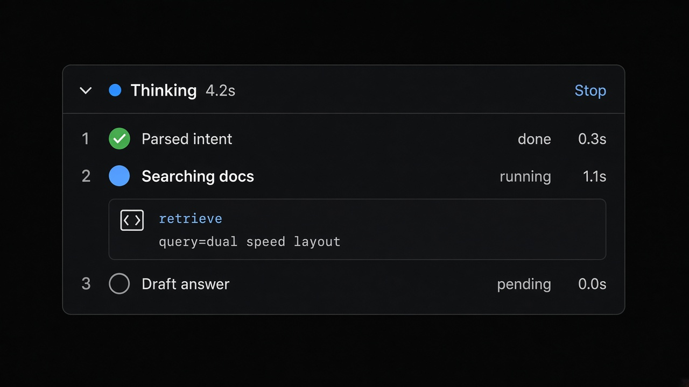

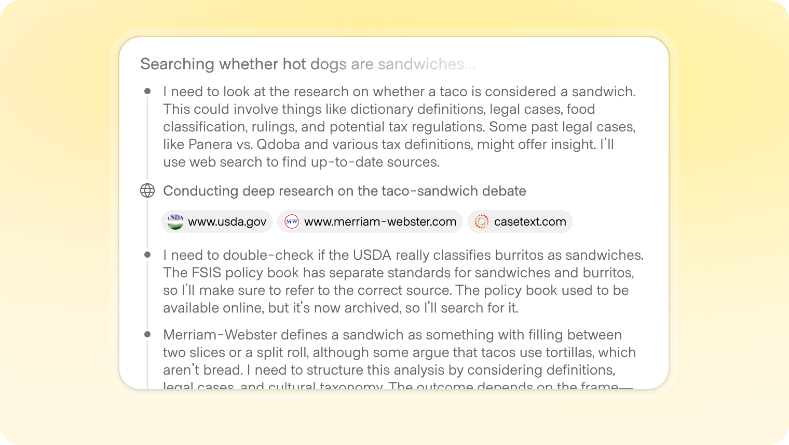

---

<!-- shapeof-captures:start -->
**Shape of AI captures** · [source](https://www.shapeof.ai/patterns/stream-of-thought)


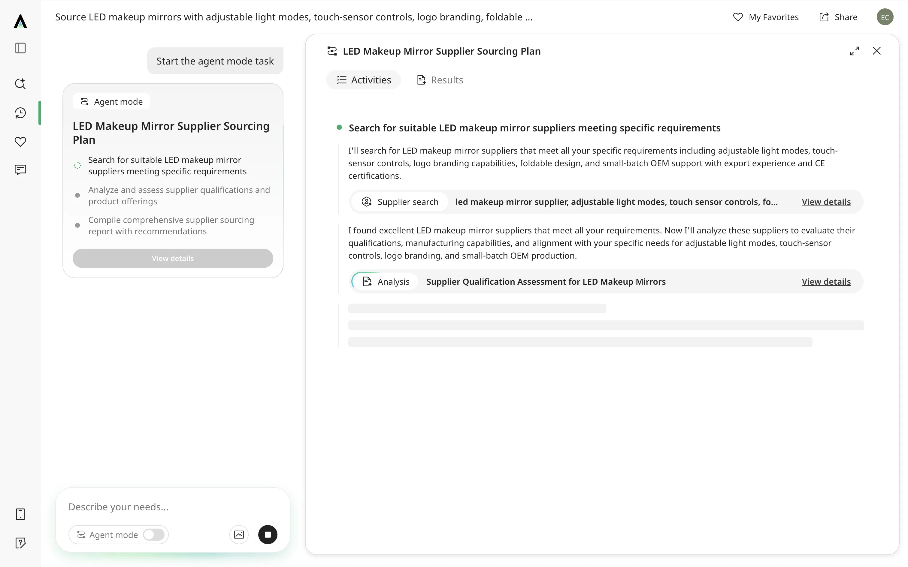

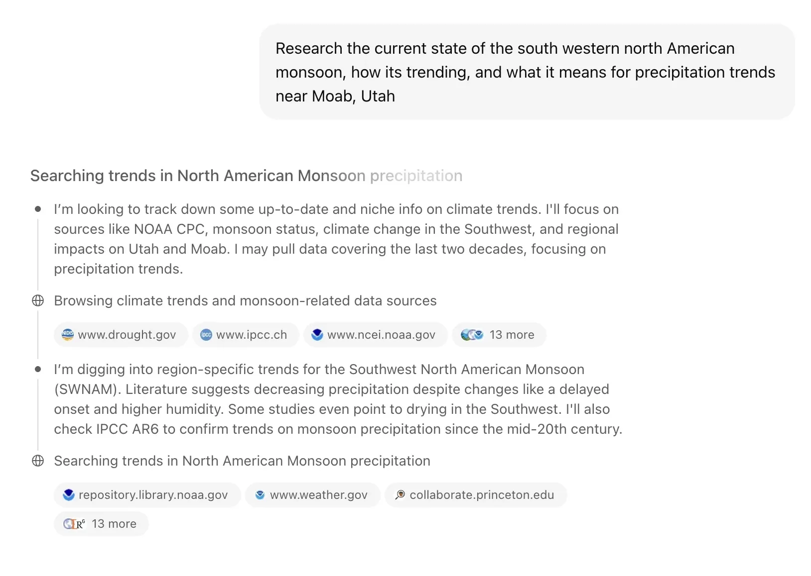

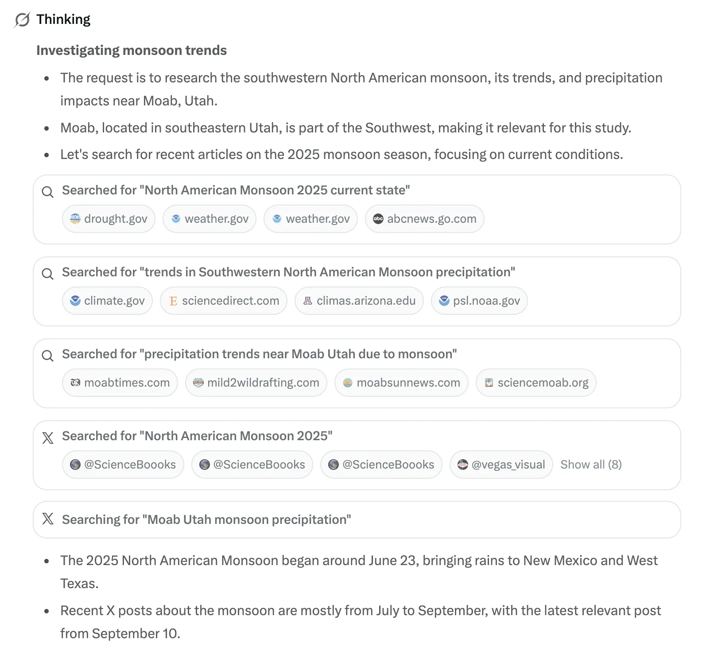

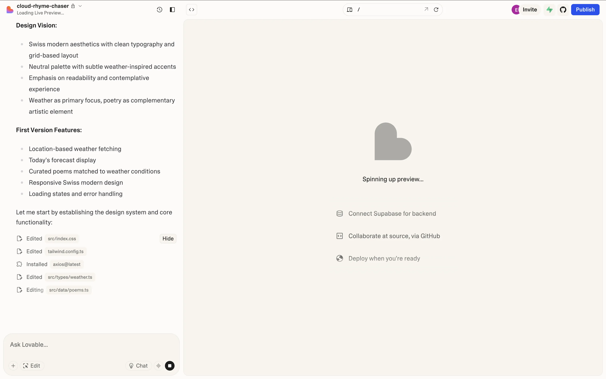


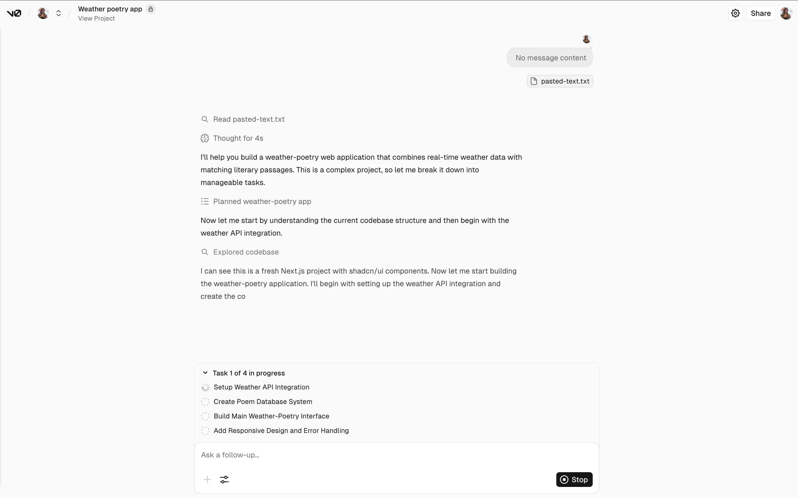

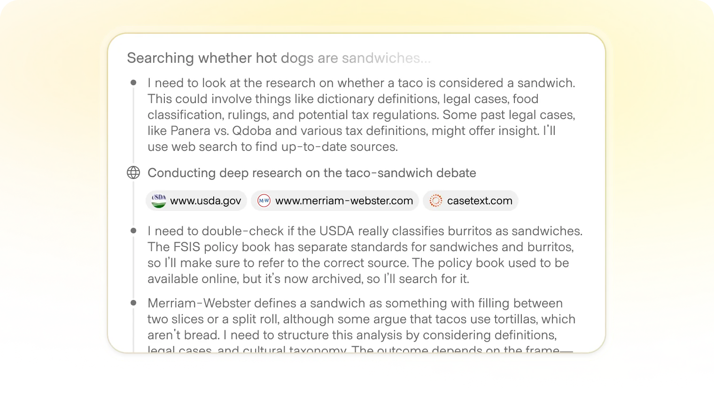

<!-- shapeof-captures:end -->

<!-- aidesign-captures:start -->
**AI Design Guide** · [Agentic UX Patterns](https://www.aidesign.guide/agentic-ux-patterns)

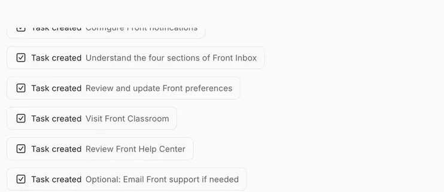

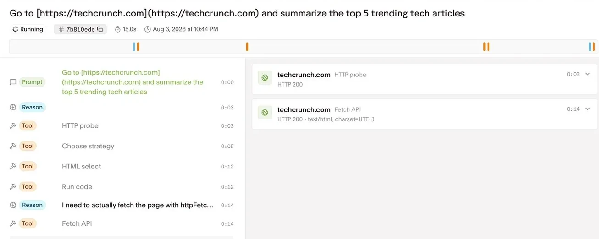


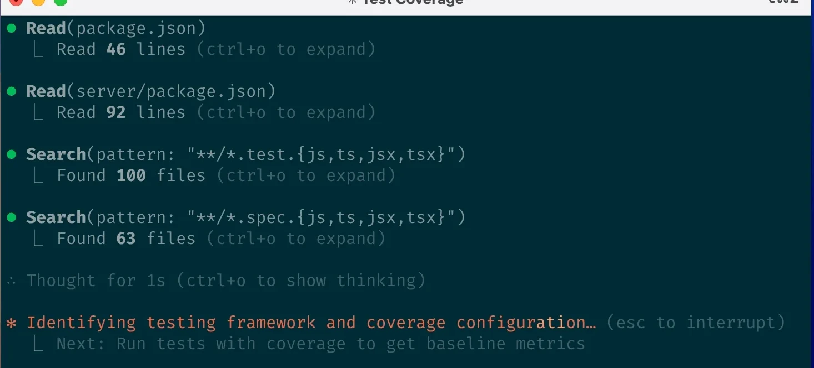

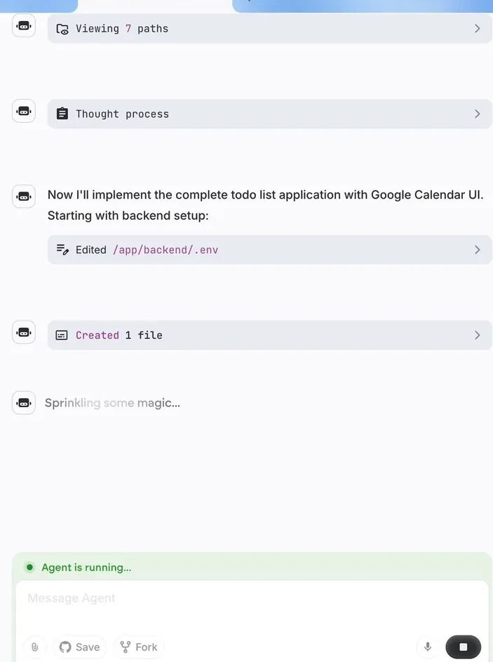

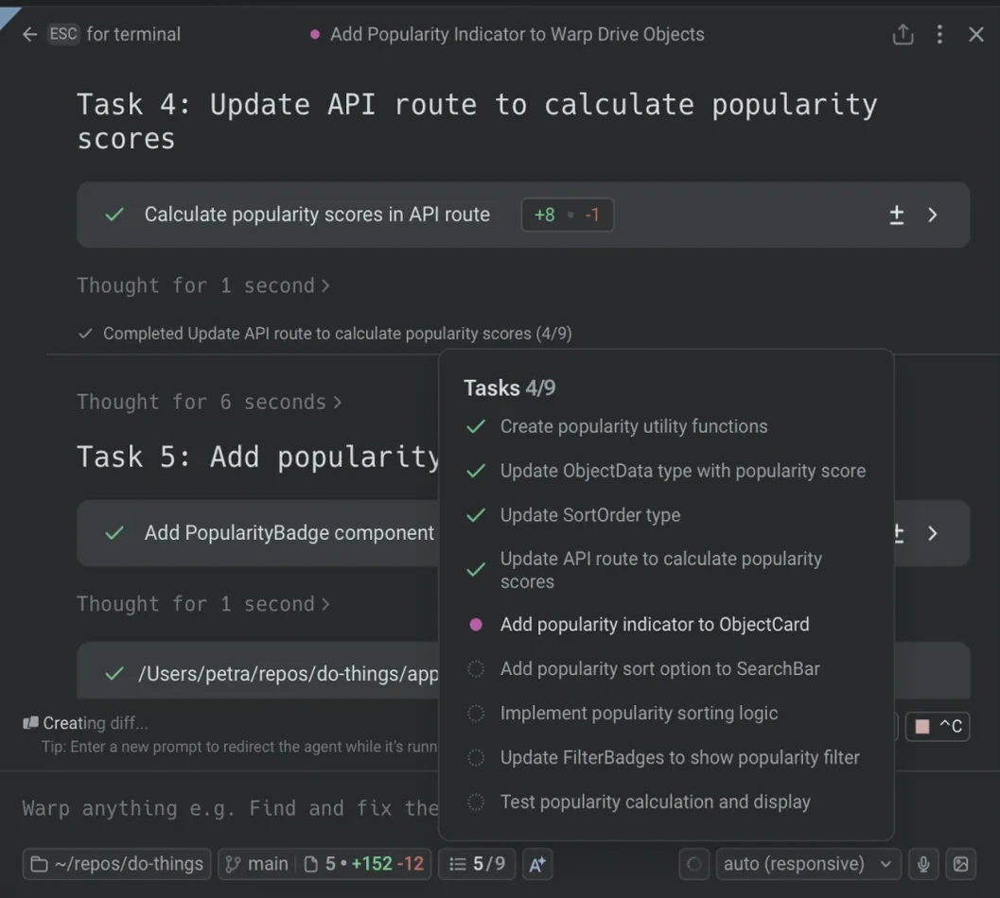

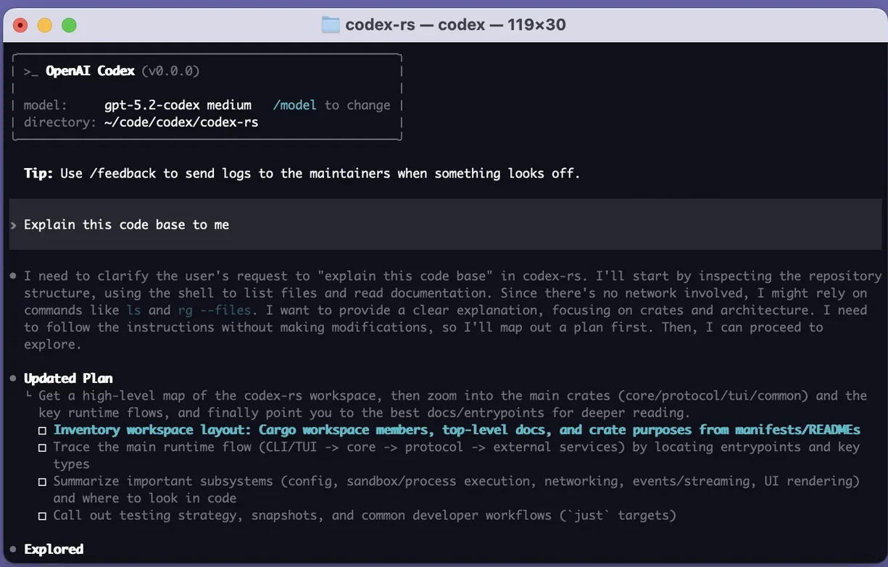

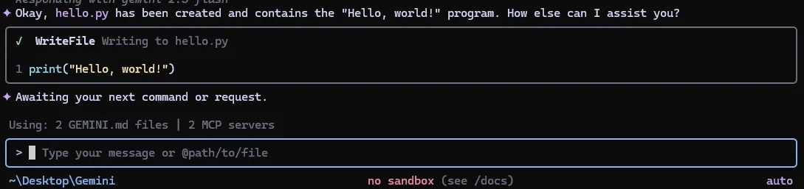

<!-- aidesign-captures:end -->


## Source references (external)

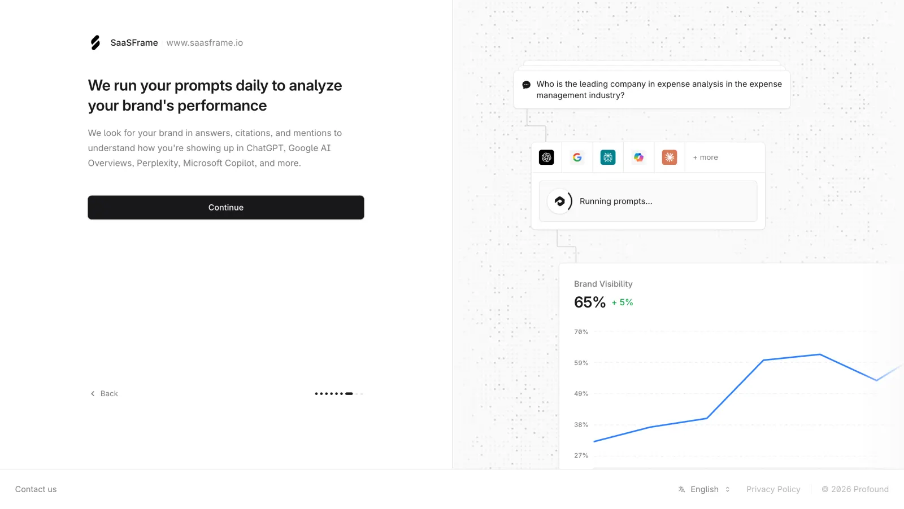
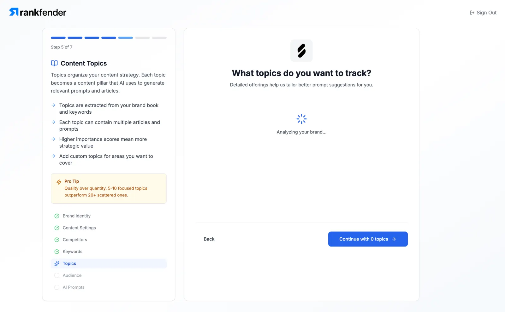
## Purpose

Replace generic spinners with a **structured, streaming trace** of what the agent is doing: plan steps, tool calls, and optional reasoning. Builds trust, enables early cancel, and keeps layout stable while tokens arrive.

## When to use

- Any multi-step agent turn (plan → tools → answer)
- Long tool latency where silence would feel broken
- Debugging / power-user modes (expanded by default)

## When not to use

- Instant single-shot completions (&lt;300ms) — skip or collapse immediately  
- User-facing brand surfaces that must hide chain-of-thought (show only tool footprints)

---

## Anatomy

```
┌ Thought · 4.2s ────────────────────────────────── ▾ ┐
│  1  ✓  Parsed intent                              │
│  2  ●  Searching docs…                    1.1s    │  ← live
│  3  ○  Draft answer                               │
│  ───────────────────────────────────────────────  │
│  tool  retrieve  query=“dual speed layout”        │
└───────────────────────────────────────────────────┘
```

1. **Header** — “Thinking” → “Thought for Ns”; collapse toggle  
2. **Step list** — indexed, status glyph, label, optional duration  
3. **Active detail** — current tool args / partial reason (mono, dense)  
4. **Collapse** — default collapsed after completion for keyboard users  

---

## States

| Step status | Glyph | Motion |
|-------------|-------|--------|
| `pending` | `○` | none |
| `running` | `●` | `animate-pulse-soft` |
| `done` | `✓` | `animate-step-in` |
| `error` | `!` | warn color |
| `skipped` | `–` | faint |

Container: `streaming` while any step `running`; then `complete` with total seconds.

---

## Do / Don't

**Do**
- Keep row height fixed; append steps without jumping the answer above/below  
- Prefer tool footprints over dumping full chain-of-thought in consumer apps  
- Allow Esc / Stop to cancel the run from the header  

**Don't**
- Use a centered page spinner  
- Auto-expand huge reasoning blocks after completion  
- Animate every token of internal monologue in the main column  

---

## React + Tailwind snippet

```tsx
type Step = {
  id: string;
  label: string;
  status: "pending" | "running" | "done" | "error" | "skipped";
  detail?: string;
  ms?: number;
};

export function StreamingThoughtState({
  steps,
  elapsedSec,
  open,
  onToggle,
  onStop,
}: {
  steps: Step[];
  elapsedSec: number;
  open: boolean;
  onToggle: () => void;
  onStop?: () => void;
}) {
  const running = steps.some((s) => s.status === "running");
  const title = running ? "Thinking" : `Thought for ${elapsedSec.toFixed(1)}s`;

  return (
    <section className="rounded-panel border border-hairline bg-surface">
      <header className="flex h-8 items-center gap-control px-panel">
        <button
          type="button"
          onClick={onToggle}
          className="flex min-w-0 flex-1 items-center gap-control text-left"
        >
          <span
            className={`size-1.5 rounded-pill bg-accent ${running ? "animate-pulse-soft" : ""}`}
          />
          <span className="truncate text-xs font-medium text-ink-muted">{title}</span>
          <span className="text-2xs text-ink-faint">{open ? "▾" : "▸"}</span>
        </button>
        {running && onStop && (
          <button
            type="button"
            onClick={onStop}
            className="text-2xs text-ink-faint hover:text-danger"
          >
            Stop
          </button>
        )}
      </header>

      {open && (
        <ol className="border-t border-hairline px-panel py-control">
          {steps.map((s, idx) => (
            <li
              key={s.id}
              className="animate-step-in flex items-start gap-control py-dense text-xs"
            >
              <span className="w-4 shrink-0 tabular-nums text-ink-faint">{idx + 1}</span>
              <StatusGlyph status={s.status} />
              <div className="min-w-0 flex-1">
                <div className="flex items-baseline justify-between gap-control">
                  <span className="text-ink">{s.label}</span>
                  {s.ms != null && (
                    <span className="font-mono text-2xs text-ink-faint">
                      {(s.ms / 1000).toFixed(1)}s
                    </span>
                  )}
                </div>
                {s.detail && (
                  <pre className="mt-dense overflow-x-auto font-mono text-2xs text-ink-muted">
                    {s.detail}
                  </pre>
                )}
              </div>
            </li>
          ))}
        </ol>
      )}
    </section>
  );
}

function StatusGlyph({ status }: { status: Step["status"] }) {
  const map = {
    pending: "text-ink-faint",
    running: "text-accent animate-pulse-soft",
    done: "text-ok",
    error: "text-danger",
    skipped: "text-ink-faint",
  } as const;
  const glyph = { pending: "○", running: "●", done: "✓", error: "!", skipped: "–" }[status];
  return <span className={`w-3 shrink-0 ${map[status]}`}>{glyph}</span>;
}
```

---

## Stream wiring (host)

Map AI SDK / agent events → steps:

| Event | Step update |
|-------|-------------|
| `plan` / todo | upsert pending steps |
| `tool-call` | `running` + detail args |
| `tool-result` | `done` + ms |
| `reasoning` | optional collapsed detail |
| `finish` | collapse; set elapsed |

---

## References

- shapeof.ai: Prompt details, Footprints, Action plan  
- Vercel AI SDK UI: Reasoning / Chain of Thought components  
- Beamline: Reasoning vs Tool call separation  
- Cursor-style agent todos: live checklist while executing  
