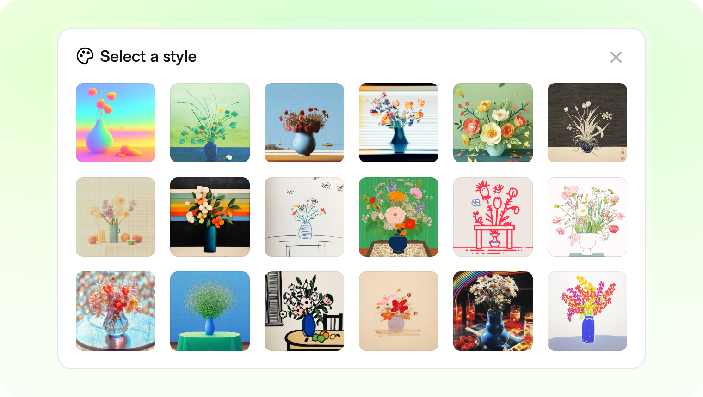
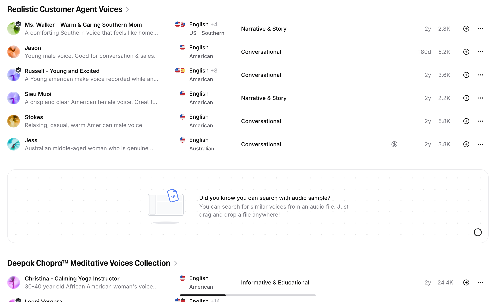
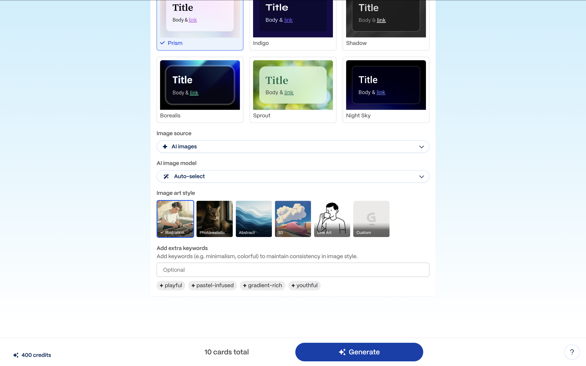
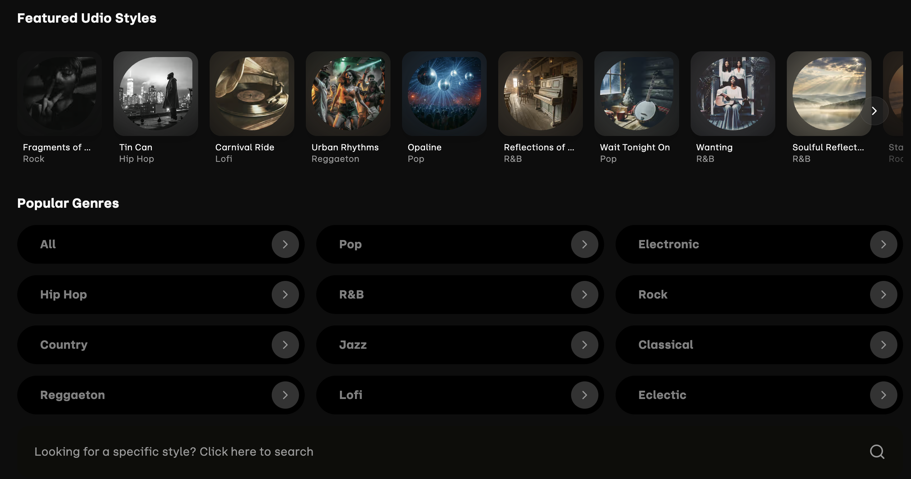
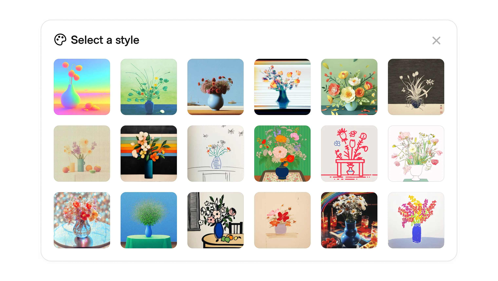
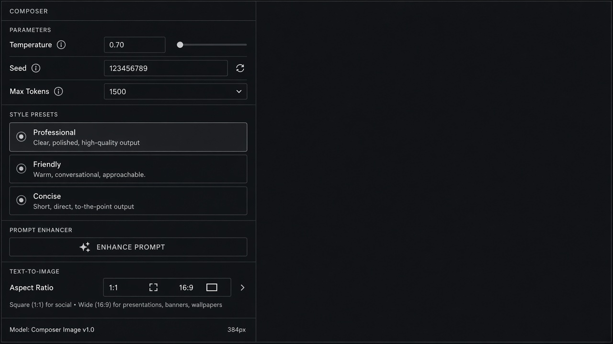

# Style Presets

**ID:** `style-presets`  
**Shape of AI:** https://www.shapeof.ai/pattern-types/tuners  **Related:** memory-personalization, style-transfer

---

<!-- shapeof-captures:start -->
**Shape of AI captures** · [source](https://www.shapeof.ai/patterns/preset-styles)












<!-- shapeof-captures:end -->



## Purpose

Preset and saved styles for tone/aesthetic reuse (Shape of AI Tuners).

## When to use

Tone/aesthetic must be reusable.

## When not to use

One-off restyles (use inline-action).

## Anatomy

Preset chips · save current · manage list

## Do / Don't

**Do:** Named presets; scope (session vs account).  
**Don't:** Invisible style that surprises later turns.

## Snippet

```tsx
export function StylePresets({ presets, active, onPick }: { presets: string[]; active: string; onPick: (p: string) => void }) {
  return <div className="flex flex-wrap gap-dense">{presets.map((p) => <button key={p} type="button" onClick={() => onPick(p)} className={`rounded-control px-control py-dense text-2xs ${active === p ? "bg-accent-muted text-accent-ink" : "text-ink-muted"}`}>{p}</button>)}</div>;
}
```
