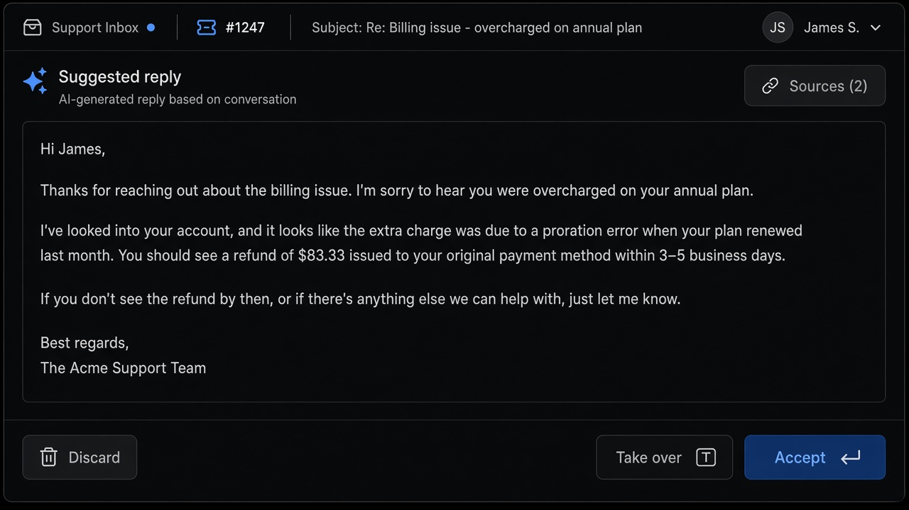
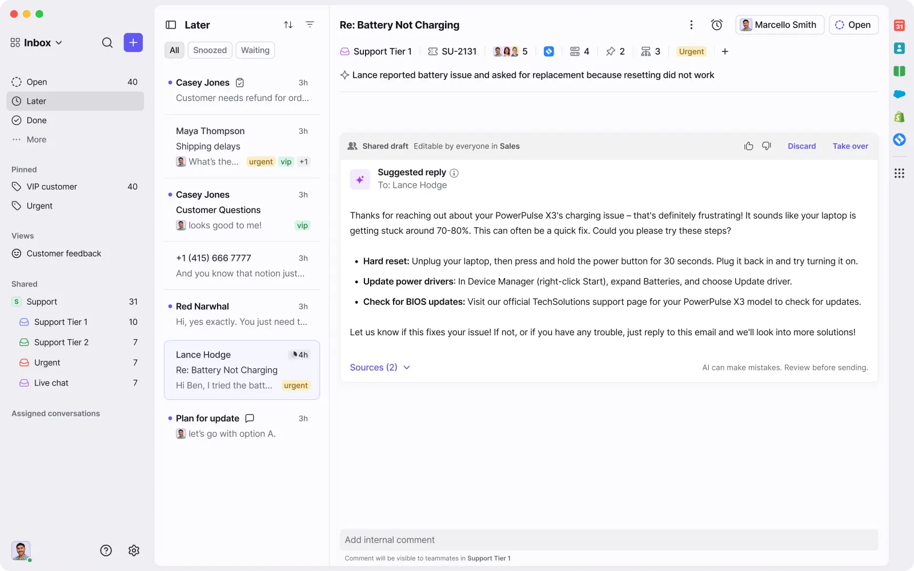
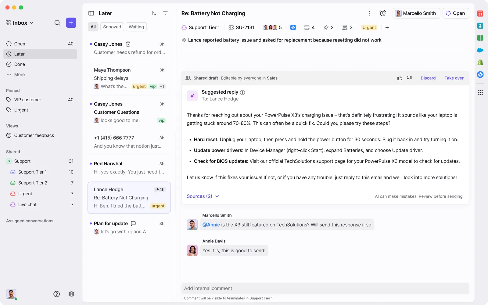

# Suggested Reply

**ID:** `suggested-reply`  
**Sources:** [SaaSFrame AI Copilot](https://www.saasframe.io/patterns/ai-copilot) · AI Design Guide · Sparkle inline generate  
**Related:** `inline-action`, `citations`, `mandate-approval-card`, `smart-diff`



---


## Source references (external)




### Source notes (SaaSFrame AI Copilot)

- Keep the draft **beside** the live task (inbox thread), not in a detached chat.
- Label provisional state (“Suggested reply” / shared draft); Discard · Take over · Accept.
- Put **Sources (n)** on the same card; review reminder must stay visible.
- Internal comments ≠ customer-facing draft.

## Purpose

Show an **AI draft beside the live task** (inbox thread, doc selection, record) as a provisional proposal — labeled, editable, discardable — never as already-sent work.

## When to use

- Support / sales reply drafts  
- In-doc AI generate → Replace / Refine / Insert  
- Any copilot that proposes text the human still owns

## When not to use

- Open Q&A chat → `copilot-input` + `artifact-pane`  
- Irreversible send without review → gate with `mandate-approval-card`

## Anatomy

1. Context strip (thread / selection)  
2. Label: “Suggested reply” / Shared draft  
3. Body + optional Sources  
4. Discard · Edit/Take over · Accept (or Send behind mandate)

## Do / Don't

**Do:** keep parent task visible; separate draft vs sent; sources near claim.  
**Don't:** auto-send; overwrite user edits on regenerate; confuse internal notes with customer text.

## Snippet

```tsx
export function SuggestedReply({
  label = "Suggested reply",
  body,
  sources,
  onDiscard,
  onTakeOver,
  onAccept,
}: {
  label?: string;
  body: string;
  sources?: number;
  onDiscard: () => void;
  onTakeOver: () => void;
  onAccept: () => void;
}) {
  return (
    <section className="max-w-mandate overflow-hidden rounded-panel border border-hairline bg-surface-raised">
      <header className="flex items-center justify-between border-b border-hairline px-panel py-control">
        <span className="text-2xs font-medium uppercase tracking-wide text-accent-ink">{label}</span>
        {sources != null && (
          <button type="button" className="font-mono text-2xs text-ink-faint">
            Sources ({sources})
          </button>
        )}
      </header>
      <pre className="max-h-40 overflow-auto px-panel py-control font-sans text-xs text-ink whitespace-pre-wrap">
        {body}
      </pre>
      <footer className="flex justify-end gap-control border-t border-hairline px-panel py-control">
        <button type="button" onClick={onDiscard} className="text-xs text-ink-muted">
          Discard
        </button>
        <button type="button" onClick={onTakeOver} className="text-xs text-ink-muted">
          Take over
        </button>
        <button
          type="button"
          onClick={onAccept}
          className="rounded-control bg-accent px-panel py-control-2 text-xs text-accent-ink"
        >
          Accept <kbd className="ml-dense opacity-70">↵</kbd>
        </button>
      </footer>
    </section>
  );
}
```
