# Suggestions

**ID:** `suggestions` · **Shape of AI:** Wayfinders · [source](https://www.shapeof.ai/patterns/suggestions)  
**Related:** `copilot-input`, `onboarding-first-value`, `cost-estimates`  
**Playground:** Prompt Starters · Follow-up Chips · Notion AI categorized starters

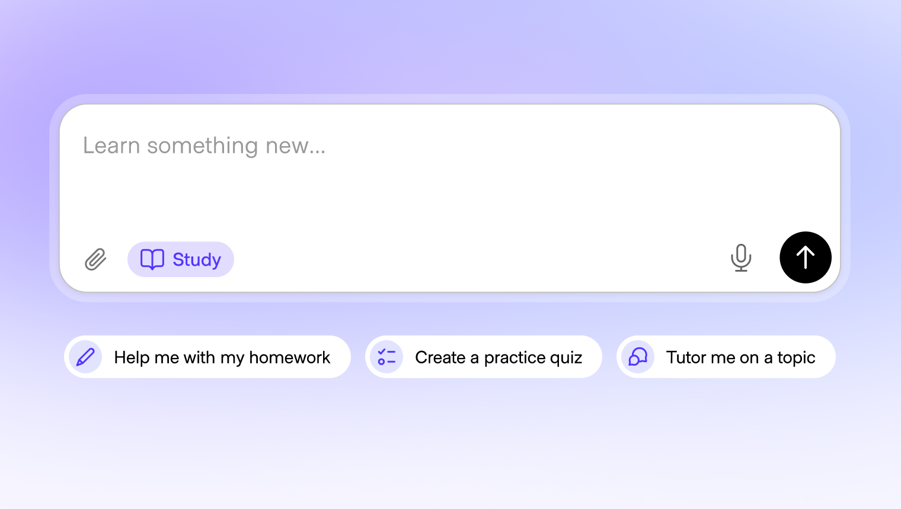

---

<!-- shapeof-captures:start -->
**Shape of AI captures** · [source](https://www.shapeof.ai/patterns/suggestions)


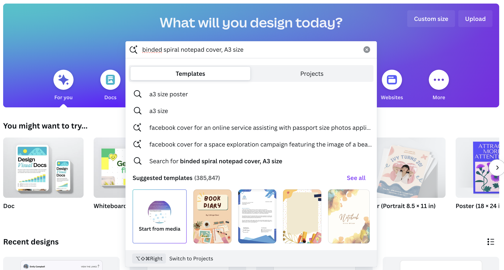

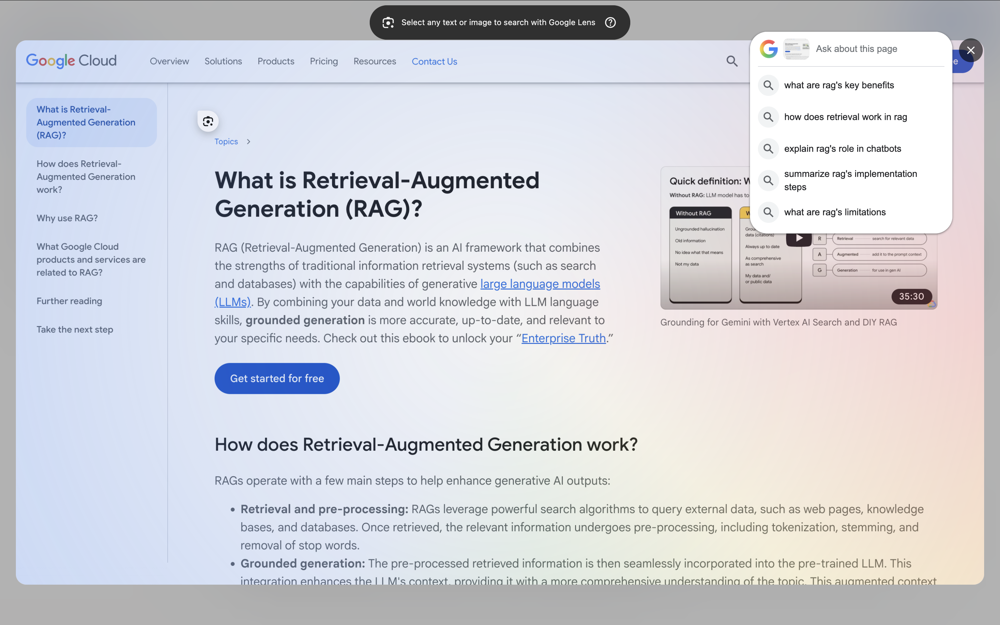

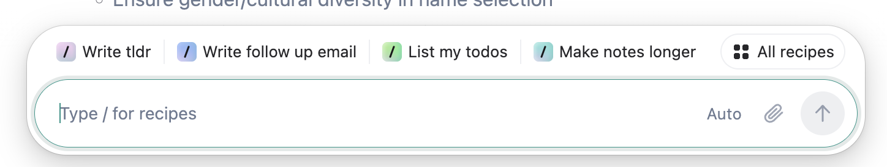


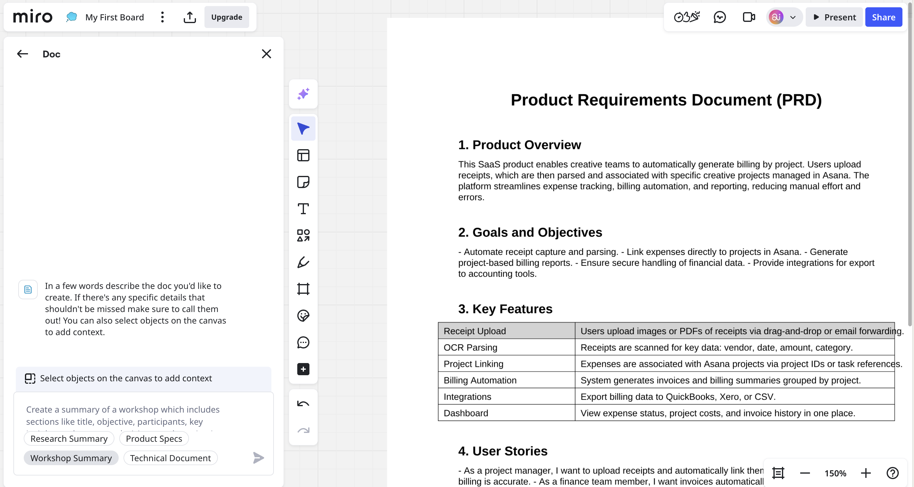

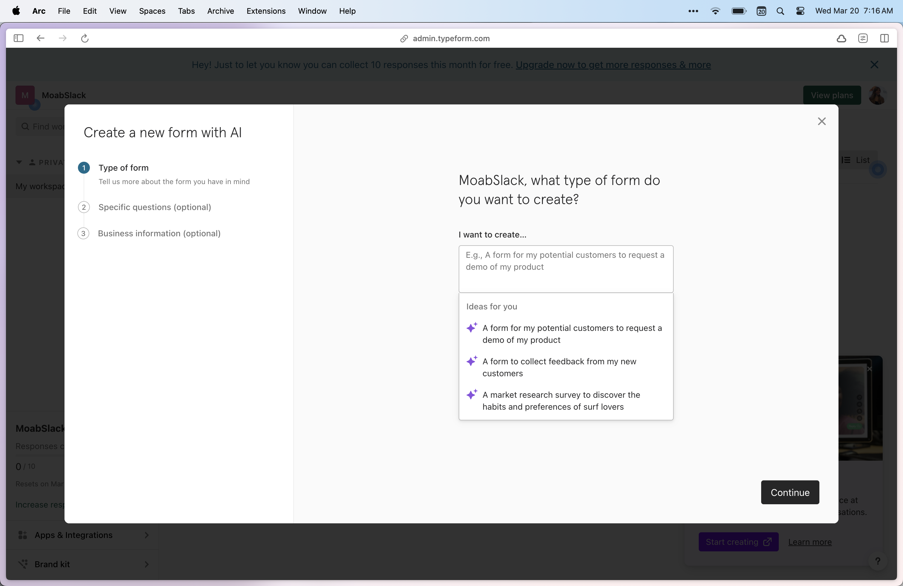

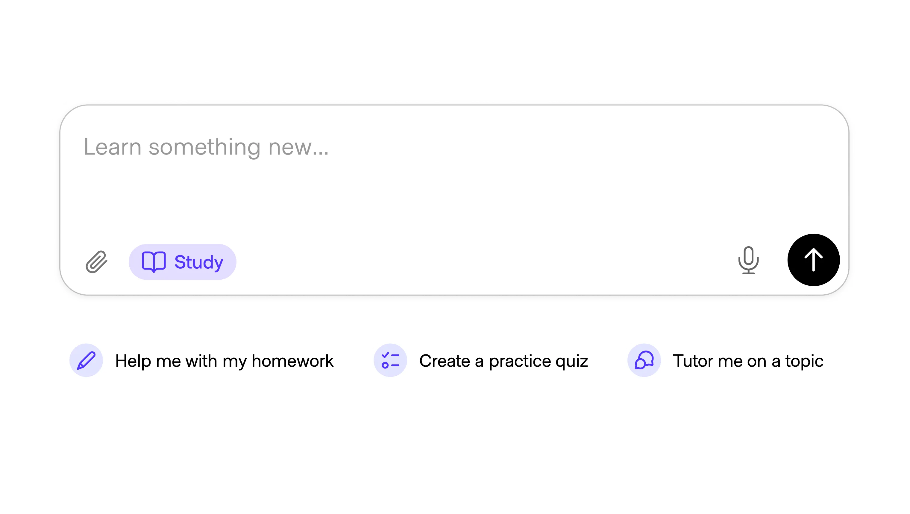

<!-- shapeof-captures:end -->

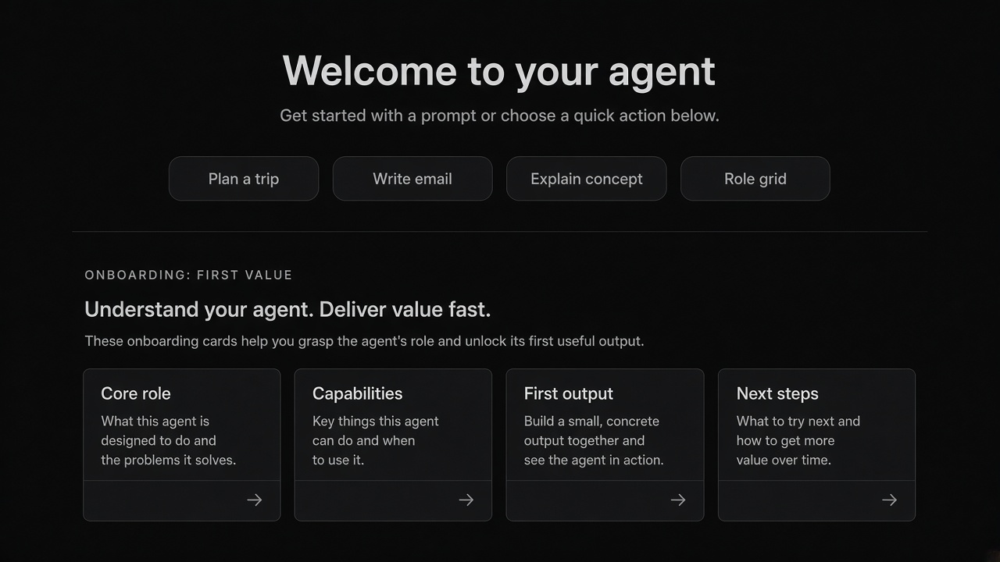


## Source references (external)

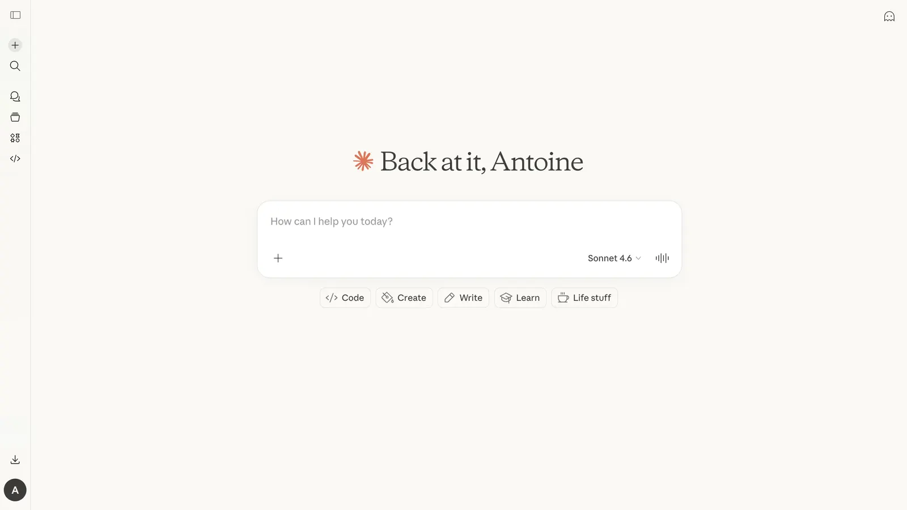
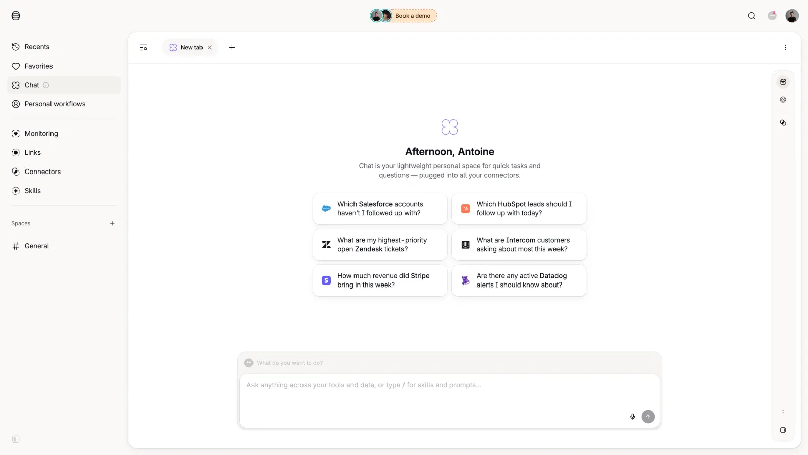
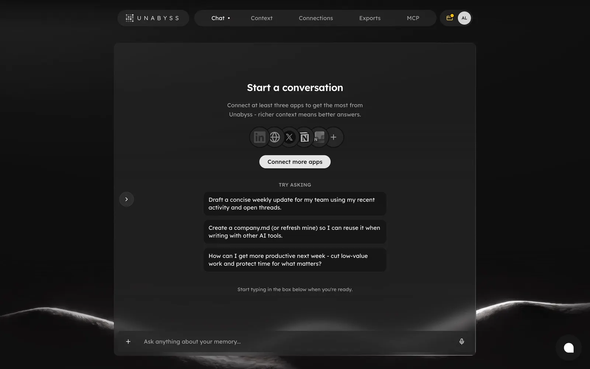
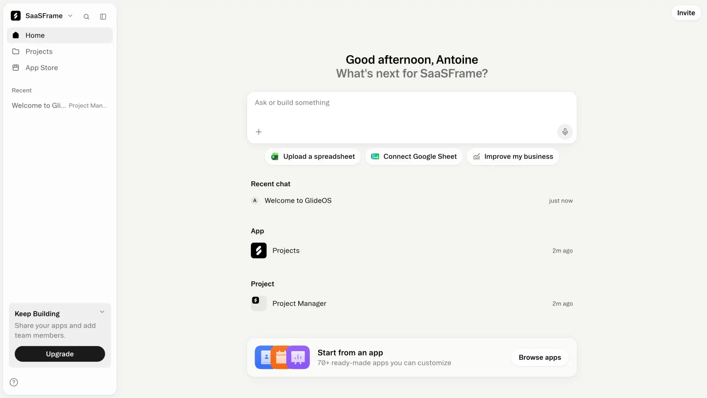
## Purpose

3–6 ranked icebreakers that pre-fill or run a prompt. Forms: **static** (onboarding), **contextual** (page/doc), **adaptive** (user/team history).

## Do / Don't

**Do:** actionable on click; small ranked set; scope to blank/idle moments; confirm if costly.  
**Don't:** show everywhere; 12+ options; irrelevant first-run spam.

## When to use

3–6 ranked icebreakers that pre-fill or run a prompt.

## When not to use

Skip when a denser core kit pattern already covers the job (see Related).

## Anatomy

1) Trigger 2) Dense primary surface 3) Confirm / dismiss

## Do / Don't

**Do:** Keep Linear/Raycast density; keyboard where actions exist; reuse kit tokens.  
**Don't:** Don't invent parallel chrome; don't hide irreversible effects.

## Snippet

```tsx
export function SuggestionRail({
  items,
  onPick,
}: {
  items: { id: string; label: string }[];
  onPick: (id: string) => void;
}) {
  return (
    <ul className="flex flex-wrap gap-dense-2">
      {items.slice(0, 6).map((s) => (
        <li key={s.id}>
          <button
            type="button"
            onClick={() => onPick(s.id)}
            className="rounded-control border border-hairline bg-surface px-control py-control-2 text-xs text-ink-muted hover:border-hairline-strong hover:text-ink"
          >
            {s.label}
          </button>
        </li>
      ))}
    </ul>
  );
}
```
