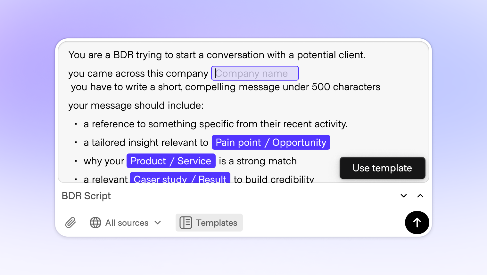
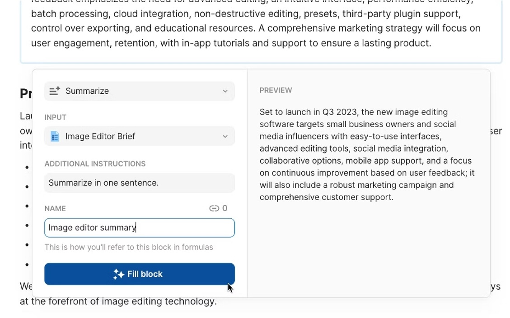
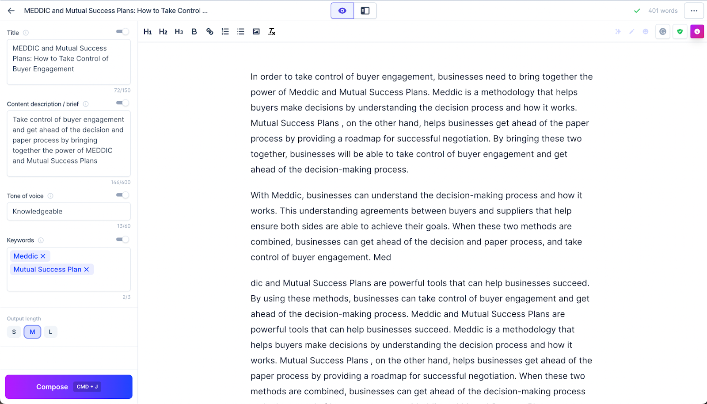
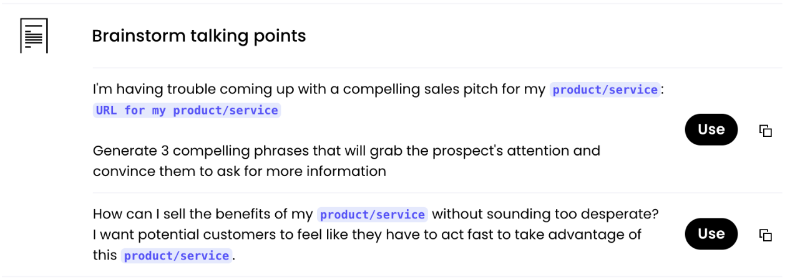
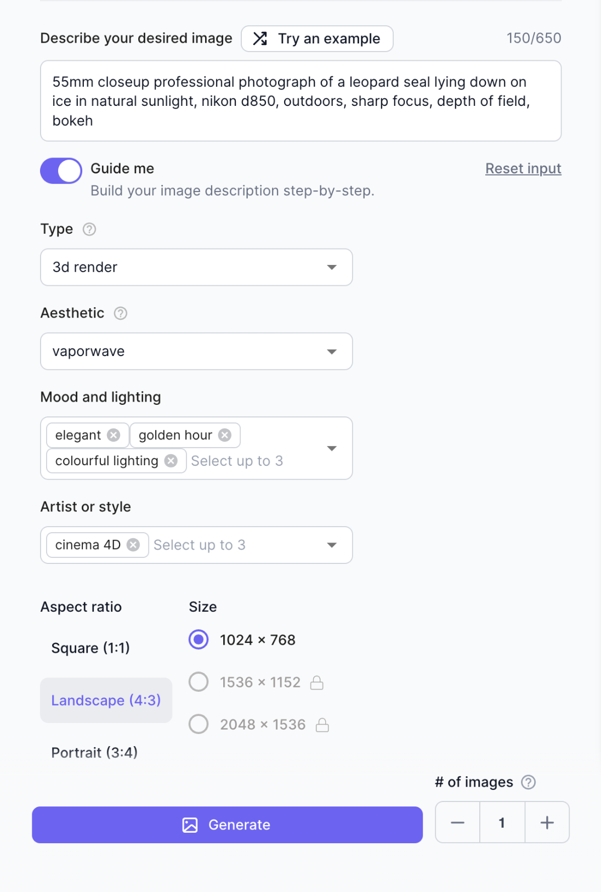
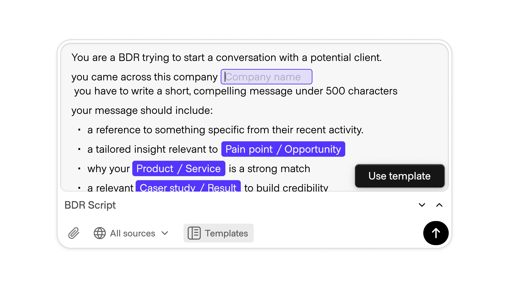

# Templates

**ID:** `templates`  
**Shape of AI:** https://www.shapeof.ai/pattern-types/wayfinders  **Related:** suggestions, madlibs, copilot-input

---

<!-- shapeof-captures:start -->
**Shape of AI captures** · [source](https://www.shapeof.ai/patterns/templates)













<!-- shapeof-captures:end -->


## Purpose

Structured prompt templates fillable by user or pre-filled by AI (Madlibs-adjacent).

## When to use

Repeatable jobs with known slots (briefs, tickets, emails).

## When not to use

Open-ended research chat.

## Anatomy

Template list · slots · Apply to composer

## Do / Don't

**Do:** Name the outcome; prefill smart defaults.  
**Don't:** Huge forms disguised as templates.

## Snippet

```tsx
export function TemplateCard({ name, onUse }: { name: string; onUse: () => void }) {
  return <button type="button" onClick={onUse} className="rounded-panel border border-hairline px-panel py-control text-left text-xs text-ink">{name}</button>;
}
```
