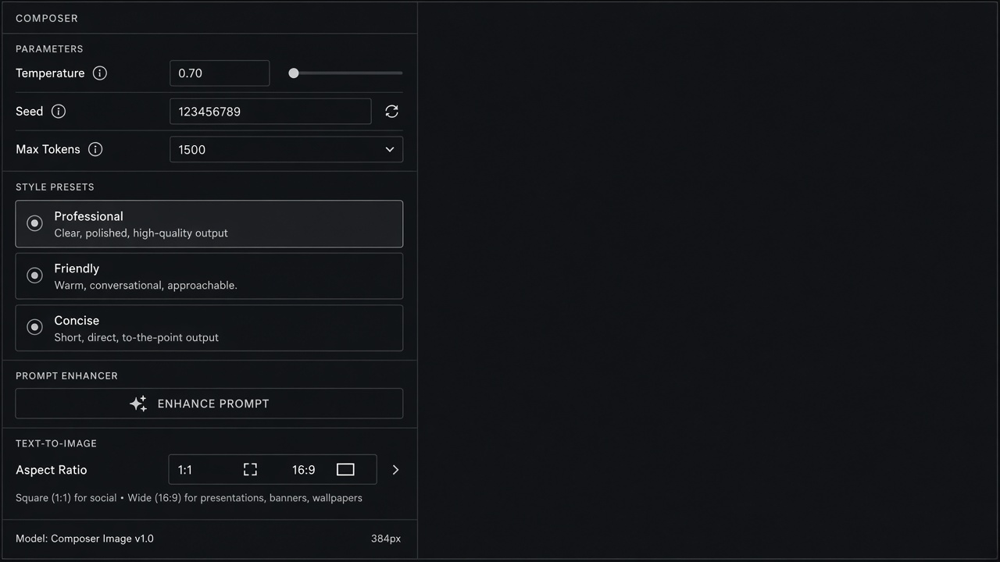

# Text-to-Image Controls

**ID:** `text-to-image-controls`  
**Playground:** [text-to-image-controls](https://aiuxplayground.com/pattern/text-to-image-controls)  **Related:** model-mode-picker, cost-estimates

---



## Purpose

Dense controls for image gen: aspect, seed, steps, refs — with cost estimate.

## Snippet

```tsx
export function T2IControls({ aspect, onAspect }: { aspect: string; onAspect: (a: string) => void }) {
  return <div className="flex gap-dense">{["1:1", "16:9", "9:16"].map((a) => <button key={a} type="button" onClick={() => onAspect(a)} className={`rounded-control px-control py-dense font-mono text-2xs ${aspect === a ? "bg-accent-muted text-accent-ink" : "text-ink-muted"}`}>{a}</button>)}</div>;
}
```
