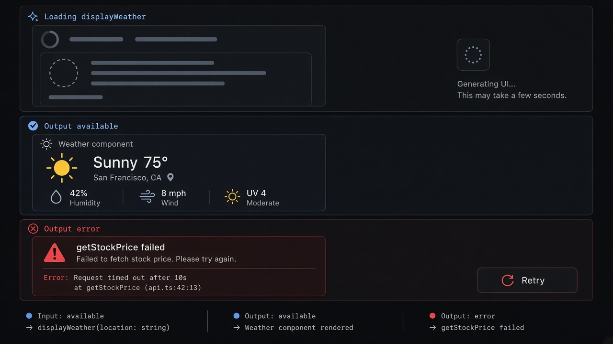

# Tool Render States

**ID:** `tool-render-states`  
**Sources:** [AI SDK Generative UI](https://ai-sdk.dev/docs/ai-sdk-ui/generative-user-interfaces) · CopilotKit tool GenUI  
**Related:** `generative-ui`, `generation-lifecycle`, `failure-disclosure`



---

## Purpose

Render UI for a **tool call lifecycle**: args preparing → output ready → error — so GenUI never flashes empty or looks finished while still loading.

## States (AI SDK-aligned)

| State | UI |
|-------|-----|
| `input-available` | Skeleton / “Loading {tool}…” |
| `output-available` | Bound React component |
| `output-error` | `failure-disclosure` inline |

## Snippet

```tsx
type ToolPhase = "input-available" | "output-available" | "output-error";

export function ToolRenderFrame({
  tool,
  phase,
  errorText,
  children,
}: {
  tool: string;
  phase: ToolPhase;
  errorText?: string;
  children?: React.ReactNode;
}) {
  if (phase === "input-available") {
    return (
      <div className="rounded-panel border border-hairline bg-surface px-panel py-control text-2xs text-ink-faint">
        Loading <span className="font-mono text-ink-muted">{tool}</span>…
      </div>
    );
  }
  if (phase === "output-error") {
    return (
      <div className="rounded-panel border border-danger/40 bg-danger-muted px-panel py-control text-xs text-danger">
        {errorText ?? `${tool} failed`}
      </div>
    );
  }
  return <div className="rounded-panel border border-hairline bg-surface p-panel">{children}</div>;
}
```
