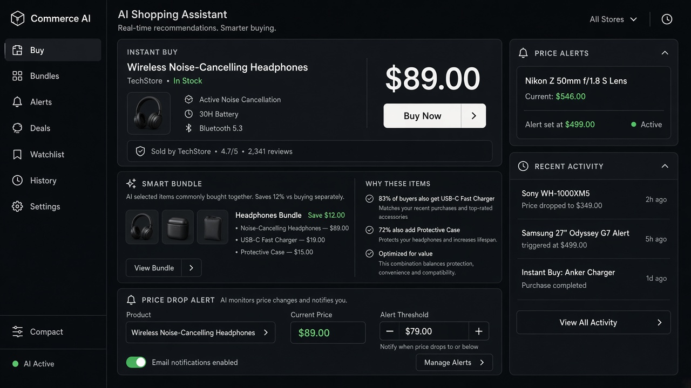

# Universal Cart

**ID:** `universal-cart`  
**Playground:** [universal-cart](https://aiuxplayground.com/pattern/universal-cart)  **Related:** agent-payment, merchant

---



## Purpose

Cross-merchant cart assembled by an agent with per-seller checkout paths.

## When to use

Cross-merchant cart assembled by an agent with per-seller checkout paths.

## When not to use

Skip when a denser core kit pattern already covers the job (see Related).

## Anatomy

1) Trigger 2) Dense primary surface 3) Confirm / dismiss

## Do / Don't

**Do:** Keep Linear/Raycast density; keyboard where actions exist; reuse kit tokens.  
**Don't:** Don't invent parallel chrome; don't hide irreversible effects.

## Snippet

```tsx
export function UniversalCart({ lines }: { lines: { seller: string; item: string; price: string }[] }) {
  return <ul className="divide-y divide-hairline text-xs">{lines.map((l, i) => <li key={i} className="flex justify-between py-control"><span>{l.item} · {l.seller}</span><span className="font-mono">{l.price}</span></li>)}</ul>;
}
```
