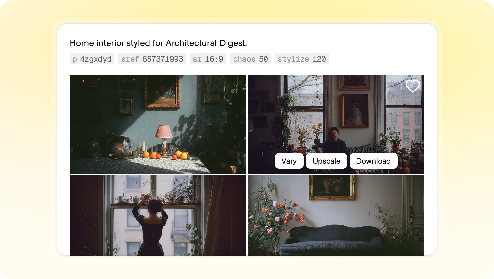
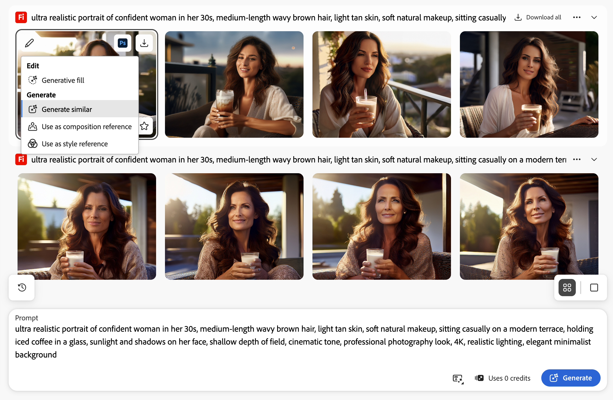
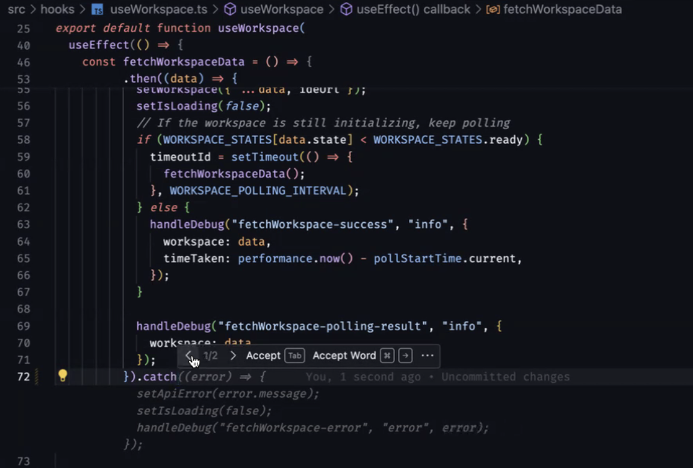
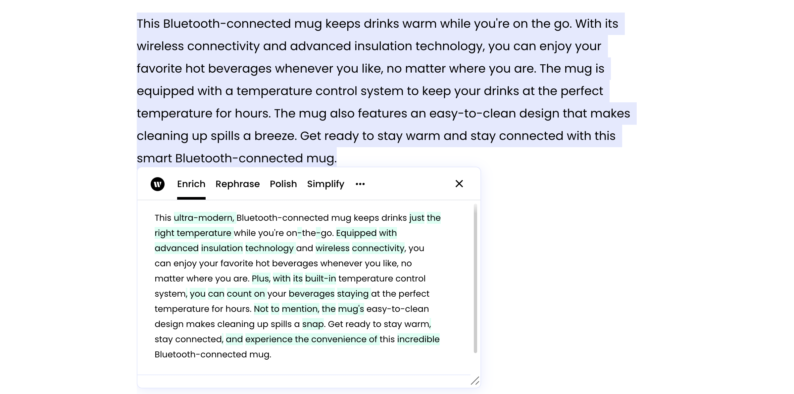
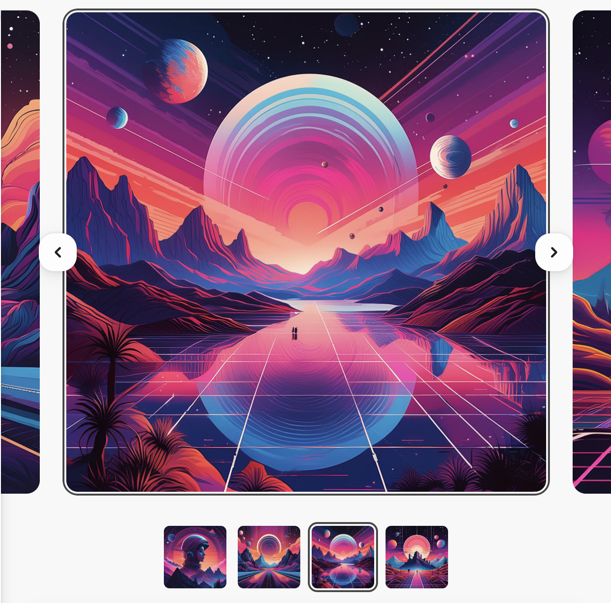
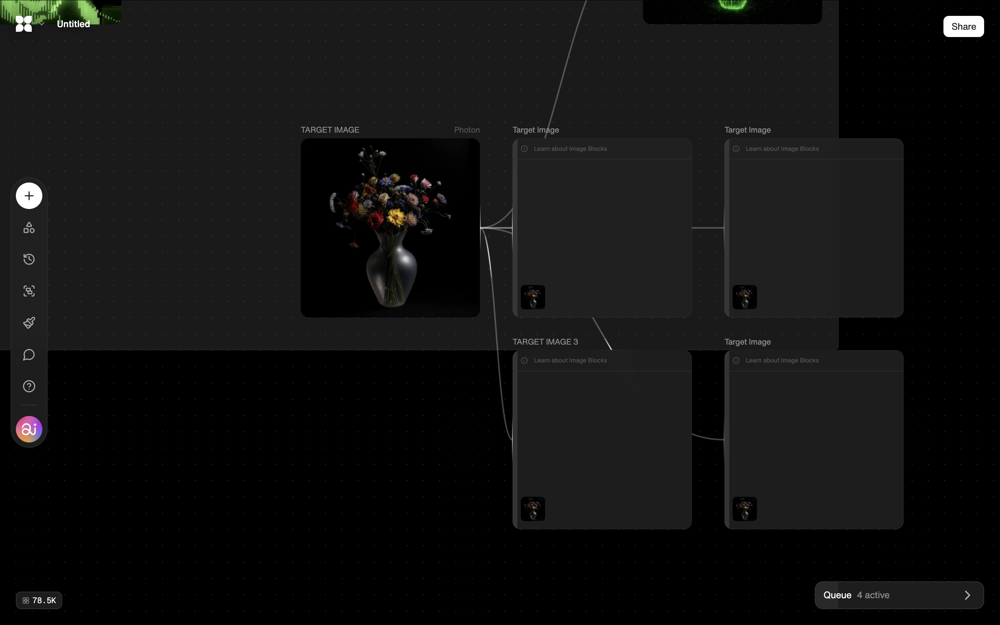
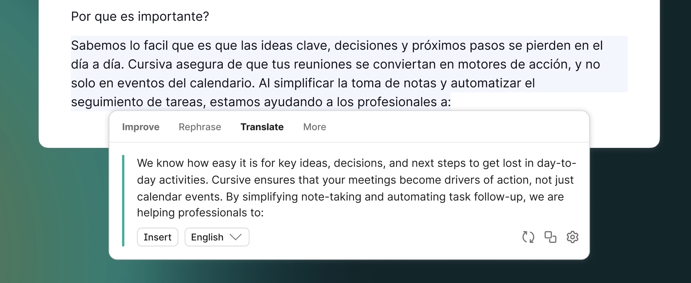
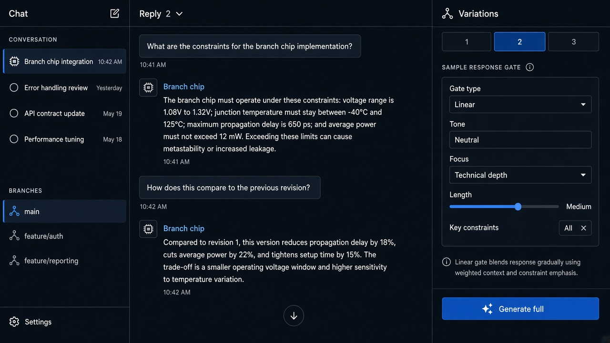

# Variations

**ID:** `variations`  
**Shape of AI:** https://www.shapeof.ai/pattern-types/governors  **Related:** response-versions, component-variants

---

<!-- shapeof-captures:start -->
**Shape of AI captures** · [source](https://www.shapeof.ai/patterns/variations)


















<!-- shapeof-captures:end -->




## Purpose

Trace multiple result variations and choose the best (Shape of AI Governors).

## When to use

User must pick among N generations.

## When not to use

Single deterministic tools.

## Anatomy

1…N nav · compare · select winner

## Do / Don't

**Do:** Keep losers addressable briefly; mark selected.  
**Don't:** Drop non-selected forever with no undo.

## Snippet

```tsx
export function VariationsNav({ index, total, onSelect }: { index: number; total: number; onSelect: (i: number) => void }) {
  return <div className="flex gap-dense">{Array.from({ length: total }, (_, i) => <button key={i} type="button" onClick={() => onSelect(i + 1)} className={`size-6 rounded-control text-2xs ${index === i + 1 ? "bg-accent-muted text-accent-ink" : "text-ink-faint"}`}>{i + 1}</button>)}</div>;
}
```
