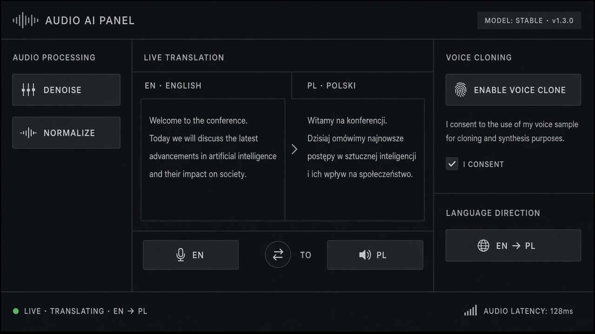

# Voice Cloning

**ID:** `voice-cloning`  
**Playground:** [voice-cloning](https://aiuxplayground.com/pattern/voice-cloning)  **Related:** voice-transcript, consent, disclosure

---



## Purpose

Consent-gated voice clone setup with sample playback and clear disclosure.

## Snippet

```tsx
export function VoiceCloneConsent({ onAgree }: { onAgree: () => void }) {
  return <button type="button" onClick={onAgree} className="rounded-control border border-hairline px-panel py-control text-xs text-ink">I consent to clone my voice</button>;
}
```
