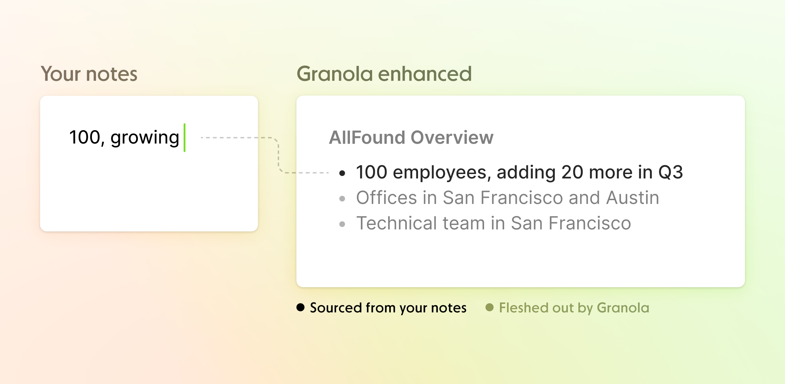
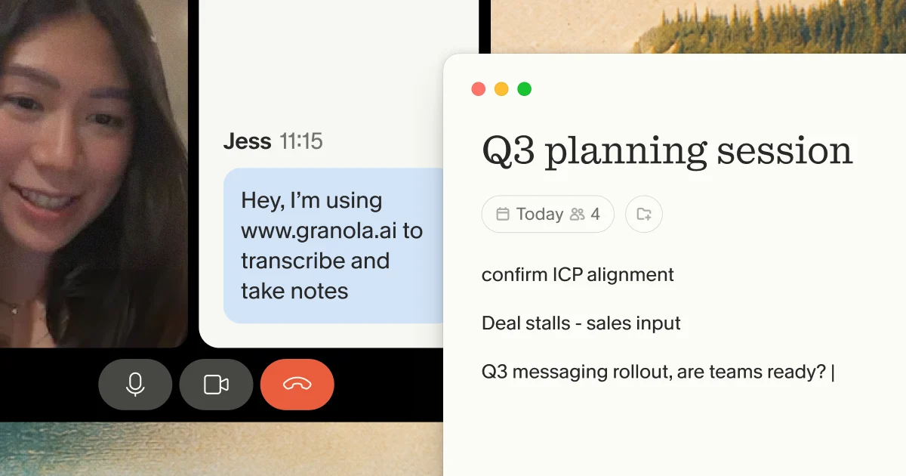
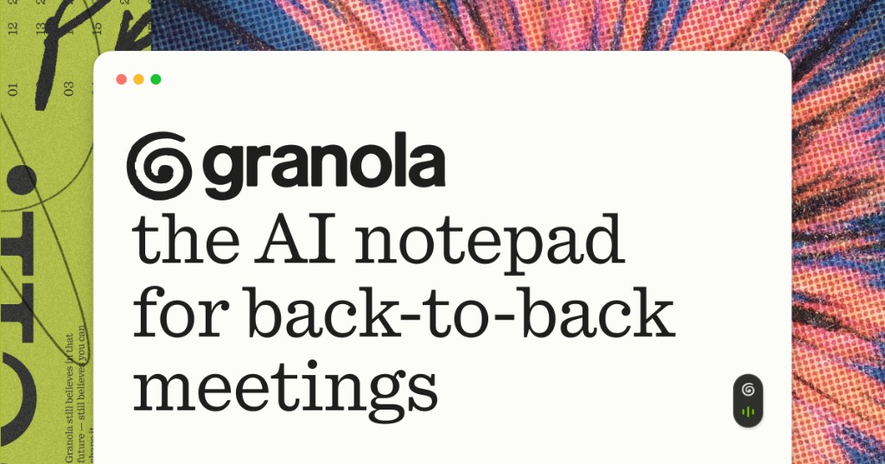
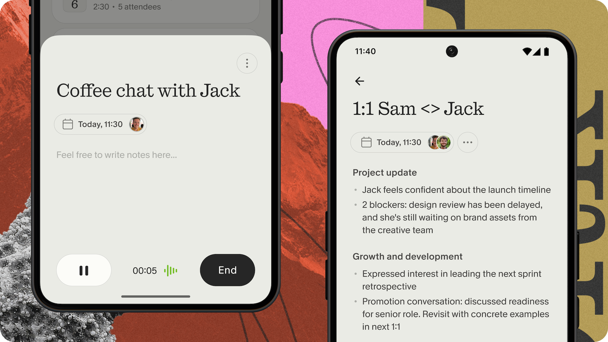
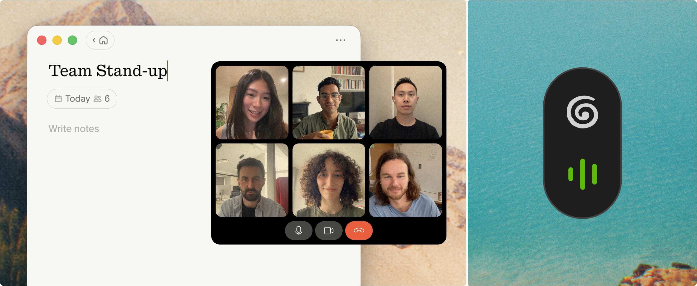
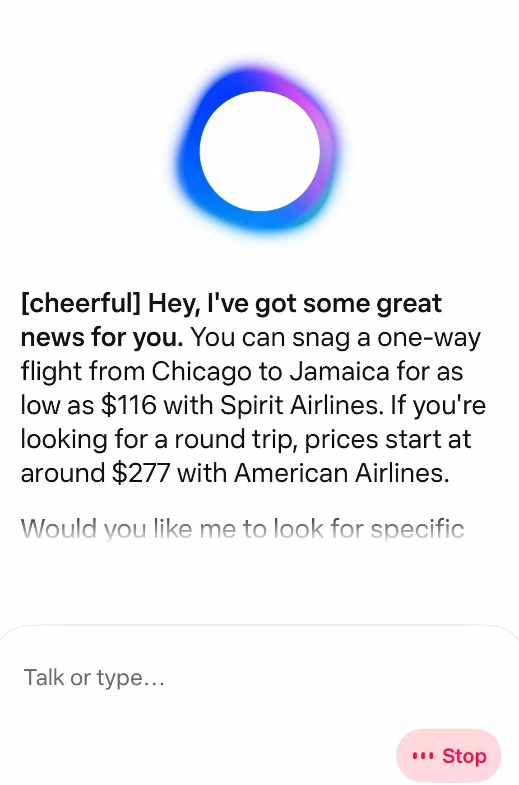
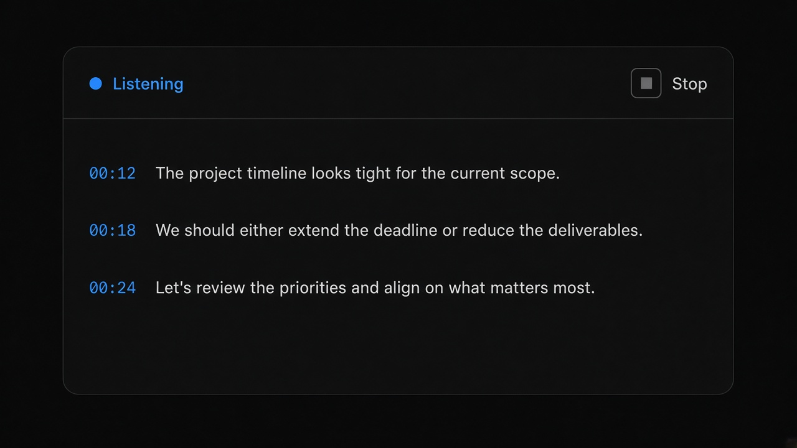
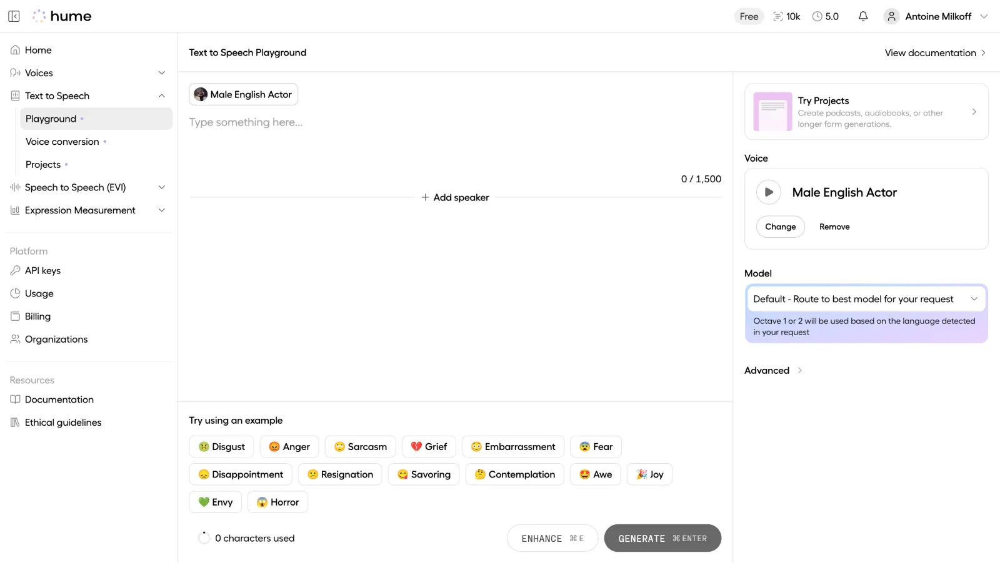

# Voice Transcript

**ID:** `voice-transcript`  
**Playground:** [live-transcript](https://aiuxplayground.com/pattern/live-transcript) · voice-visualizer · interruptibility · voice-commands  
**Related:** `controls`, `copilot-input`, `mandate-approval-card`

---

<!-- playground-captures:start -->
**AI UX Playground teardowns** · [hub](https://aiuxplayground.com/teardowns)














<!-- playground-captures:end -->

<!-- aidesign-captures:start -->
**AI Design Guide** · [Agentic UX Patterns](https://www.aidesign.guide/agentic-ux-patterns)




<!-- aidesign-captures:end -->





## Source references (external)



### Source notes

- Voice / TTS playgrounds still need Stop + live transcript; keep modality controls next to the composer.

## Purpose

Show **listening / processing / speaking** state with a live transcript and a single barge-in control. Confirm destructive voice commands; always offer text fallback.

## When to use

Show **listening / processing / speaking** state with a live transcript and a single barge-in control.

## When not to use

Skip when a denser core kit pattern already covers the job (see Related).

## Anatomy

1) Trigger 2) Dense primary surface 3) Confirm / dismiss

## Do / Don't

**Do:** Keep Linear/Raycast density; keyboard where actions exist; reuse kit tokens.  
**Don't:** Don't invent parallel chrome; don't hide irreversible effects.

## Snippet

```tsx
export function VoiceTranscript({
  state,
  lines,
  onStop,
}: {
  state: "listening" | "processing" | "speaking";
  lines: string[];
  onStop: () => void;
}) {
  return (
    <section className="rounded-panel border border-hairline bg-surface">
      <header className="flex h-8 items-center justify-between px-panel">
        <span className="text-2xs uppercase tracking-wide text-ink-faint">{state}</span>
        <button type="button" onClick={onStop} className="text-2xs text-danger">
          Stop
        </button>
      </header>
      <div className="max-h-40 overflow-auto border-t border-hairline px-panel py-control text-xs text-ink">
        {lines.map((l, i) => (
          <p key={i} className="py-dense">
            {l}
          </p>
        ))}
      </div>
    </section>
  );
}
```
