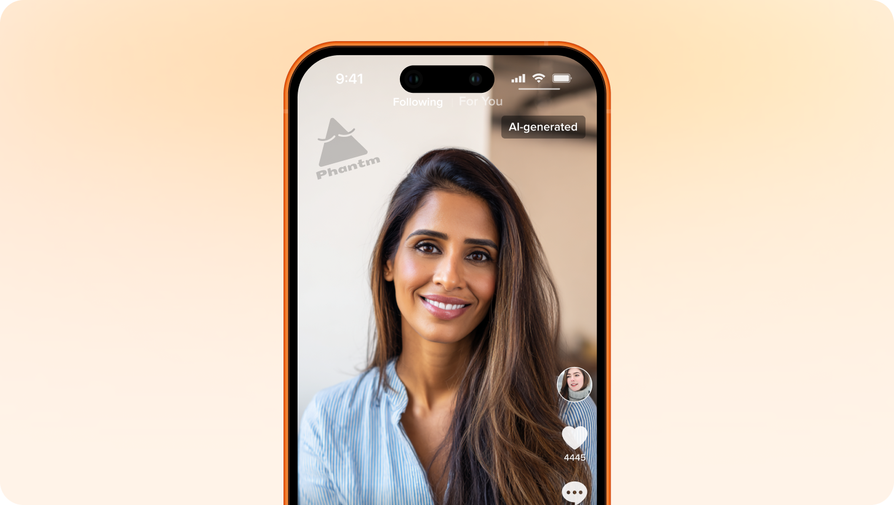
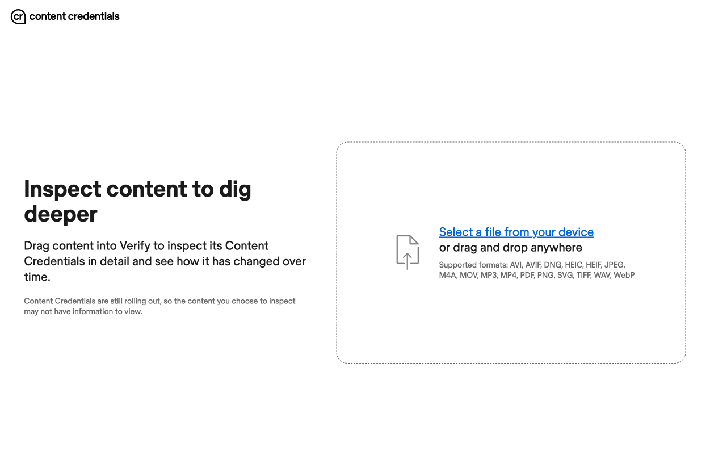
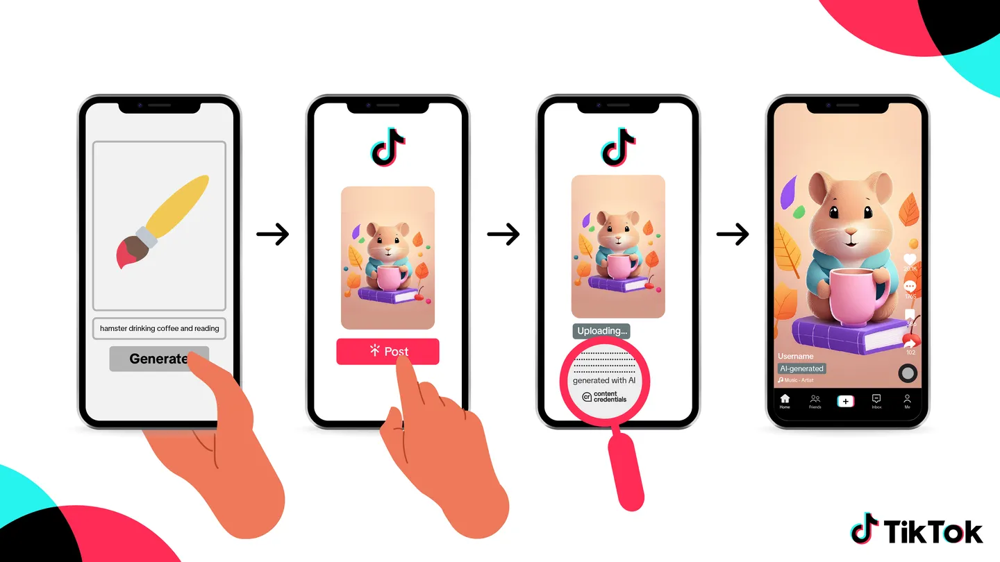
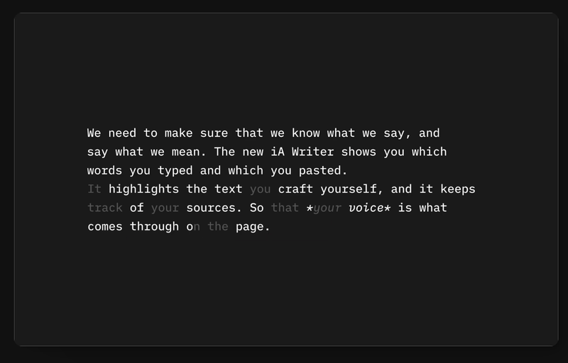
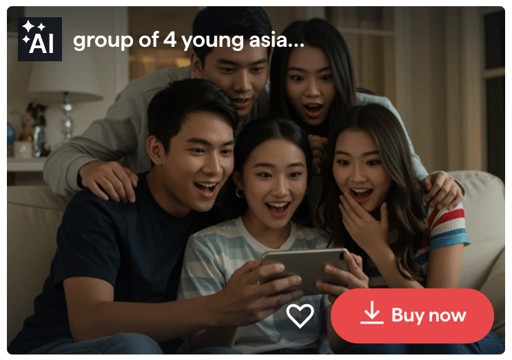
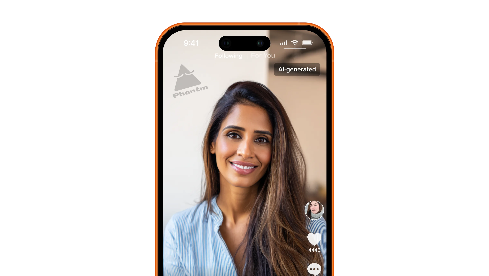
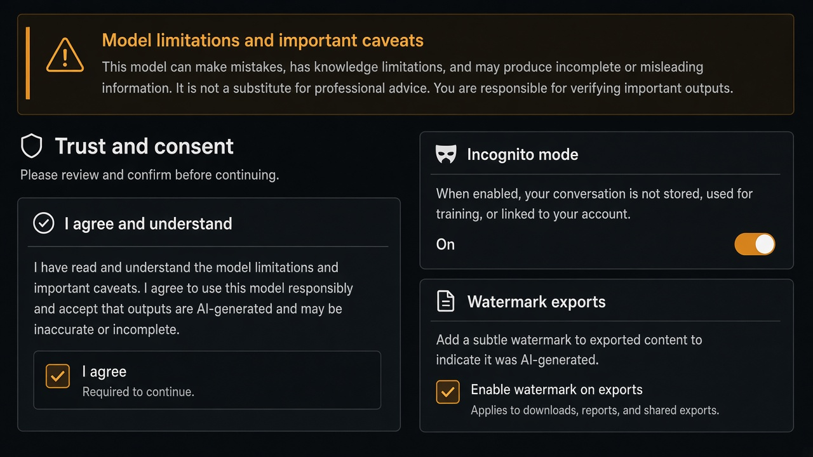

# Watermark

**ID:** `watermark`  
**Shape of AI:** https://www.shapeof.ai/pattern-types/trust-builders  **Related:** disclosure, footprints

---

<!-- shapeof-captures:start -->
**Shape of AI captures** · [source](https://www.shapeof.ai/patterns/watermark)
















<!-- shapeof-captures:end -->



## Purpose

Human/machine-readable identifiers on AI-generated media at export.

## When to use

Exporting synthetic media that could be mistaken as real.

## When not to use

Internal drafts never leaving the tool.

## Anatomy

Export toggle · visible + metadata mark

## Do / Don't

**Do:** Persist in file metadata; say so in UI.  
**Don't:** Easy strip without warning.

## Snippet

```tsx
export function WatermarkToggle({ on, onToggle }: { on: boolean; onToggle: () => void }) {
  return <label className="flex items-center gap-dense text-2xs text-ink-muted"><input type="checkbox" checked={on} onChange={onToggle} /> Watermark exports</label>;
}
```
