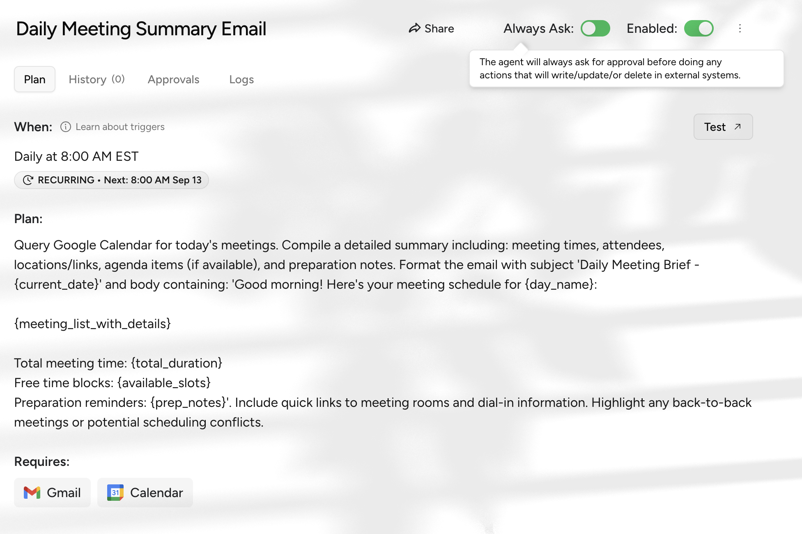
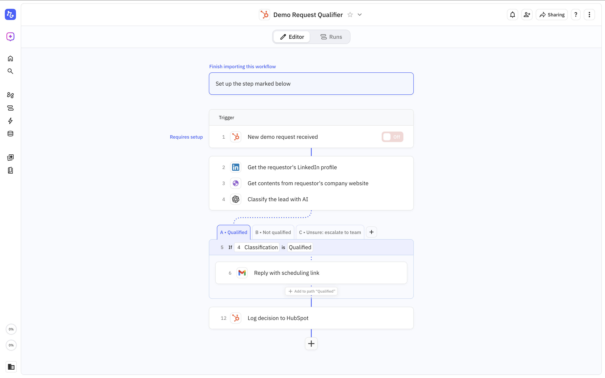
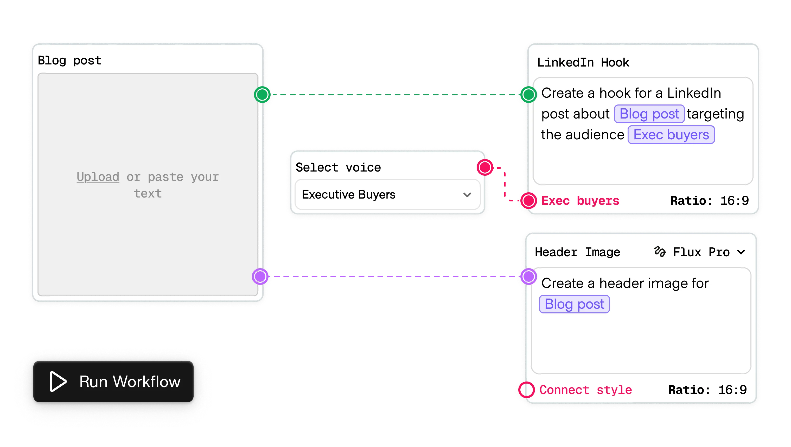
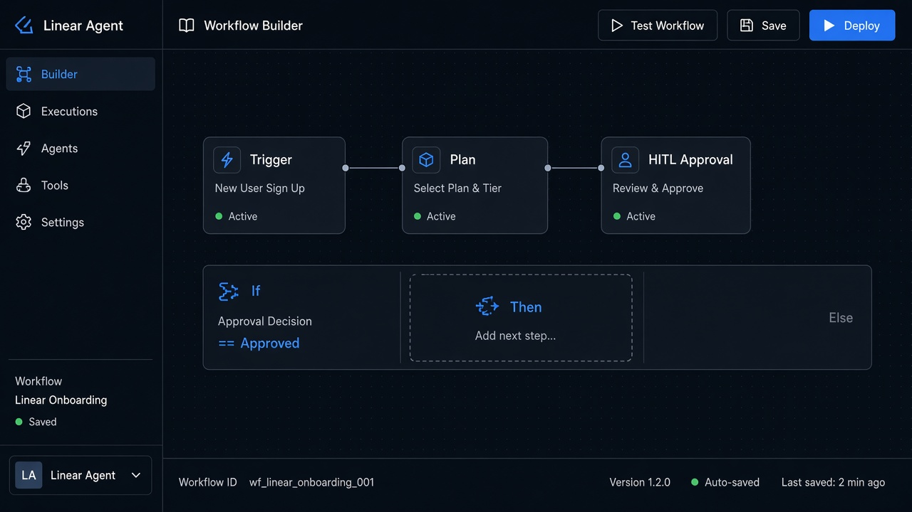

# Workflow Builder

**ID:** `workflow-builder`  
**Playground:** [workflow-builder](https://aiuxplayground.com/pattern/workflow-builder)  **Related:** action-plan, conditional-logic, mandate-approval-card

---

<!-- shapeof-captures:start -->
**Shape of AI captures** · [source](https://www.shapeof.ai/patterns/workflow)









<!-- shapeof-captures:end -->





## Source references (external)


### Source notes (SaaSFrame · Tines)

- Prompt input often sits inside a workflow canvas; keep composer scope tied to the selected runbook.

## Purpose

Node/step builder for multi-tool agent workflows with inspectable edges and HITL nodes.

## When to use

Multi-step agent pipelines need authoring.

## When not to use

Single-tool chat.

## Anatomy

Nodes · edges · HITL nodes · run

## Do / Don't

**Do:** Inspectable steps; test single node.  
**Don't:** Hidden branches that fire without preview.

## Snippet

```tsx
export function WorkflowNode({ title, kind }: { title: string; kind: string }) {
  return <div className="rounded-panel border border-hairline bg-surface px-panel py-control"><p className="text-2xs text-ink-faint">{kind}</p><p className="text-xs text-ink">{title}</p></div>;
}
```
